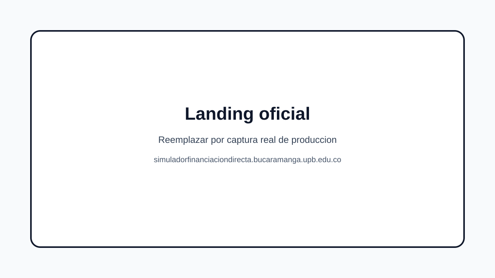
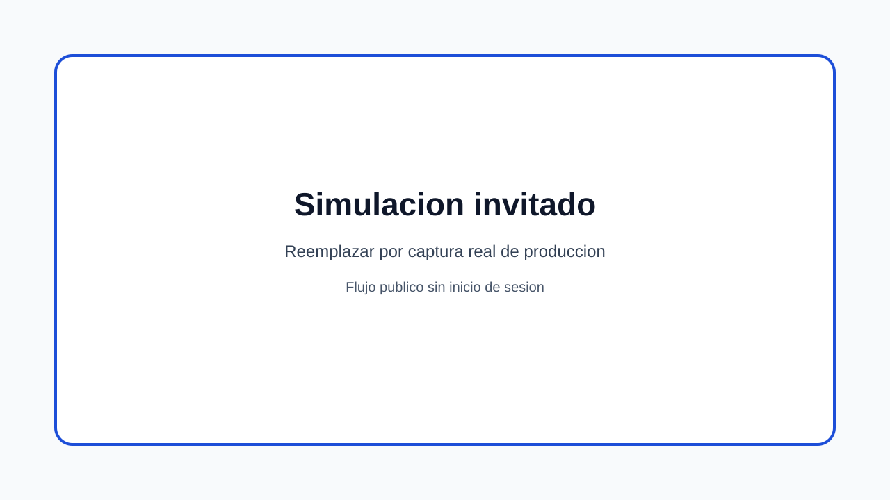
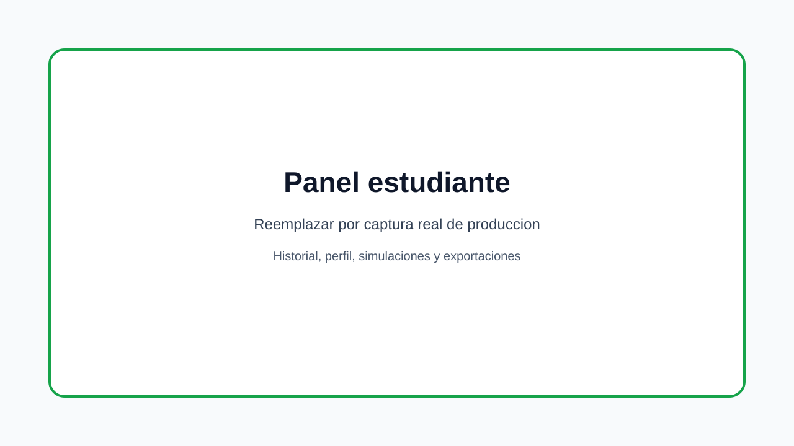
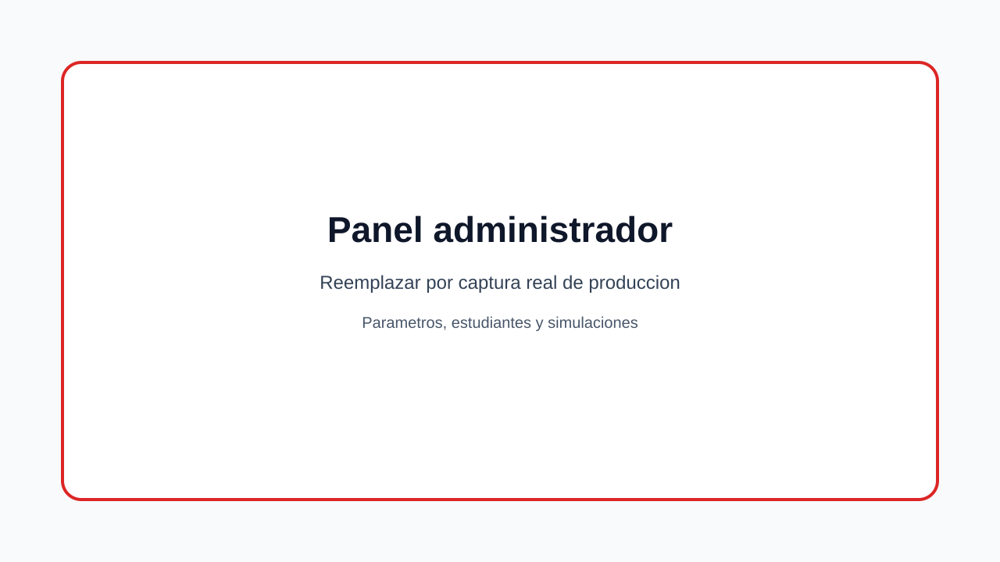

<div align="center">

  

  # Simulador de Credito UPB

  **Plataforma web institucional para simulacion de credito educativo, parametrizacion financiera y despliegue CTIC.**

  [Produccion](https://simuladorfinanciaciondirecta.bucaramanga.upb.edu.co/) ·
  [Documentacion](./docs/README.md) ·
  [Aprender con el proyecto](./LEARN.md) ·
  [Manual de despliegue](./docs/deployment/Manual%20de%20Despliegue%20Simulador%20-%20CTIC.pdf)

  [](https://react.dev/)
  [](https://vite.dev/)
  [](https://nodejs.org/)
  [](https://www.typescriptlang.org/)
  [](https://www.mysql.com/)
  [](./LICENSE)

</div>

---

## Language

[Espanol](#espanol) | [English](#english)

---

## Espanol

### Resumen

El **Simulador de Credito UPB** es una aplicacion web desarrollada para la Universidad Pontificia Bolivariana Seccional Bucaramanga. Permite a invitados, estudiantes y administradores calcular escenarios de financiacion educativa, visualizar tablas de amortizacion, guardar historiales, exportar resultados y administrar parametros financieros.

El repositorio esta preparado como caso de estudio para **GitHub Education Community Exchange / Learn & Collaborate**: incluye README, licencia MIT, documentacion tecnica, manuales, articulo academico, evidencias, diagramas y guia de aprendizaje.

**Descripcion sugerida para GitHub:**
`Educational credit simulator for UPB Bucaramanga. React, Node.js, TypeScript, Clean Architecture, Strategy Pattern, MySQL/MariaDB, Nginx and PM2 deployment.`

**Topics sugeridos:**
`react`, `vite`, `typescript`, `nodejs`, `express`, `clean-architecture`, `strategy-pattern`, `mysql`, `mariadb`, `sequelize`, `zod`, `education`, `upb`, `github-education`

### URL oficial

La version institucional esta desplegada en:

<div align="center">

[https://simuladorfinanciaciondirecta.bucaramanga.upb.edu.co/](https://simuladorfinanciaciondirecta.bucaramanga.upb.edu.co/)

</div>

### Que resuelve

| Rol | Capacidades principales |
|---|---|
| Invitado | Simular credito sin registro y revisar resultados sin guardar historial. |
| Estudiante | Iniciar sesion, simular, guardar resultados, consultar historial y exportar PDF/CSV. |
| Administrador | Gestionar estudiantes, simulaciones, parametros financieros y versiones activas. |
| Equipo tecnico | Desplegar en CTIC, auditar evidencias, revisar arquitectura y mantener el sistema. |

### Stack tecnico

| Capa | Tecnologias |
|---|---|
| Frontend | React 19, Vite 8, TypeScript 6, Tailwind CSS, React Router, React Hook Form, Zod |
| Backend | Node.js, Express 5.2, TypeScript 6, Clean Architecture, JWT, bcrypt, LDAP, Nodemailer |
| Dominio | `SimulationEngine`, Strategy Pattern, amortizacion francesa, modo sin interes |
| Datos | MySQL 8 en Aiven, MariaDB/MySQL CTIC, Sequelize, scripts SQL versionados |
| Operacion | Nginx, PM2, systemd, RHEL, GitHub Actions para preproduccion |
| Calidad | Jest, Supertest, Vitest, evidencias funcionales/manuales e integracion |

### Arquitectura visual

<div align="center">
  
  <br />
  <em>Vista de contexto: cliente React, API Node.js, base de datos, LDAP y SMTP.</em>
</div>

<br />

<div align="center">
  
  <br />
  <em>Componentes principales del backend y sus integraciones.</em>
</div>

### Galeria de produccion

Las siguientes rutas son placeholders versionados para capturas tomadas desde la URL oficial. Deben reemplazarse por screenshots reales de produccion antes de publicar la ficha final en GitHub Education.

<div align="center">

| Landing oficial | Simulacion invitado |
|---|---|
|  |  |
| Panel estudiante | Panel administrador |
|  |  |

</div>

### Documentacion principal

| Entregable | Enlace |
|---|---|
| Manual de usuario | [docs/manuals/Manual_Usuario_Simulador_Credito_UPB.pdf](./docs/manuals/Manual_Usuario_Simulador_Credito_UPB.pdf) |
| Manual tecnico | [docs/manuals/Manual de Tecnico Simulador.pdf](./docs/manuals/Manual%20de%20T%C3%A9cnico%20Simulador.pdf) |
| Manual de despliegue CTIC | [docs/deployment/Manual de Despliegue Simulador - CTIC.pdf](./docs/deployment/Manual%20de%20Despliegue%20Simulador%20-%20CTIC.pdf) |
| Articulo IEEE | [docs/academic/Articulo IEEE Simulador de Credito UPB.pdf](./docs/academic/Articulo%20IEEE%20Simulador%20de%20Credito%20UPB.pdf) |
| Guia educativa | [LEARN.md](./LEARN.md) |
| Indice documental | [docs/README.md](./docs/README.md) |

### Ejecucion local

Prerrequisitos:

- Node.js 20+ LTS o superior.
- npm compatible con la version de Node.
- Base MySQL/MariaDB disponible.
- Variables de entorno basadas en `.env.example`.

```bash
npm install
npm run dev
```

Servicios locales:

| Servicio | URL |
|---|---|
| Frontend | `http://localhost:5173` |
| API | `http://localhost:3000/api` |
| Swagger | `http://localhost:3000/api/docs` |
| Health check | `http://localhost:3000/api/health` |

### Pruebas

```bash
npm run test --workspace=server
npm run test --workspace=client
```

### Despliegue

El despliegue institucional esta documentado para una VM RHEL administrada por CTIC:

- Nginx publica la SPA y enruta `/api` al backend.
- PM2 mantiene vivo el proceso Node.js en `localhost:3000`.
- MariaDB/MySQL opera en el puerto `3306`.
- LDAP usa `389` y SMTP usa `587`.
- HTTP `80` y HTTPS `443` son los puertos publicos esperados.

Ver [docs/deployment/README.md](./docs/deployment/README.md).

---

## English

### Overview

**Simulador de Credito UPB** is an institutional web application built for Universidad Pontificia Bolivariana Bucaramanga. It helps guests, students and administrators simulate educational credit scenarios, review amortization tables, save simulation history, export reports and manage financial parameters.

The repository is ready to be used as a **GitHub Education Community Exchange / Learn & Collaborate** case study. It includes a detailed README, MIT license, technical documentation, manuals, academic article, deployment evidence, diagrams and a dedicated learning guide.

### Official production URL

<div align="center">

[https://simuladorfinanciaciondirecta.bucaramanga.upb.edu.co/](https://simuladorfinanciaciondirecta.bucaramanga.upb.edu.co/)

</div>

### Learning value

Students can study this repository to learn:

- Clean Architecture in a TypeScript/Express backend.
- React SPA organization with role-based routes.
- Zod validation in client and server flows.
- Strategy Pattern applied to a real financial simulation engine.
- MySQL/MariaDB modeling with Sequelize repositories.
- Deployment on RHEL using Nginx, PM2 and environment-based configuration.
- Technical documentation for institutional handoff.

### Main documentation

| Deliverable | Link |
|---|---|
| User manual | [docs/manuals/Manual_Usuario_Simulador_Credito_UPB.pdf](./docs/manuals/Manual_Usuario_Simulador_Credito_UPB.pdf) |
| Technical manual | [docs/manuals/Manual de Tecnico Simulador.pdf](./docs/manuals/Manual%20de%20T%C3%A9cnico%20Simulador.pdf) |
| CTIC deployment manual | [docs/deployment/Manual de Despliegue Simulador - CTIC.pdf](./docs/deployment/Manual%20de%20Despliegue%20Simulador%20-%20CTIC.pdf) |
| IEEE paper | [docs/academic/Articulo IEEE Simulador de Credito UPB.pdf](./docs/academic/Articulo%20IEEE%20Simulador%20de%20Credito%20UPB.pdf) |
| Learning guide | [LEARN.md](./LEARN.md) |
| Documentation index | [docs/README.md](./docs/README.md) |

### Repository map

```text
client/                 React 19 + Vite 8 + TypeScript frontend
server/                 Node.js + Express 5 backend
docs/                   Technical, academic, deployment and user documentation
infrastructure/nginx/   Nginx configuration templates
.github/                Pull request and automation files
```

### Open source readiness

This repository includes:

- `README.md` with bilingual project documentation.
- `LEARN.md` for GitHub Education.
- `LICENSE` with MIT terms.
- `CONTRIBUTING.md` for contribution rules.
- `SECURITY.md` for responsible disclosure.
- `CODE_OF_CONDUCT.md` for community participation.

## Contributors / Equipo

Contributors were identified from the Git history and the IEEE article authorship. Bot accounts are excluded from the team list.

| Contributor | Role / Contribution | Evidence |
|---|---|---|
|  Juan David Ordonez Ferreira | Full-stack development, documentation and deployment support | Git history, IEEE article |
|  Jose David Mora Patino | Full-stack development and deployment artifacts | Git history, IEEE article |
|  David Ricardo Carvajal Barragan | Full-stack development and testing evidence | Git history, IEEE article |
|  David Eduardo Florez Duran | Full-stack development and project artifacts | Git history, IEEE article |
|  Gabriel Arturo Sastoque Cadena | Development, academic support and documentation | Git history, IEEE article |
|  Juan Pablo Arenas Avendano | Academic and technical contribution | Git history, IEEE article |
|  Simon Perez Gomez | Academic and technical contribution | Git history, IEEE article |
| Gabriel Miguel Rodriguez Castro | Academic and technical contribution | Git history, IEEE article |
| S. Cifuentes Cardenas | Academic authorship and project support | IEEE article |

## License

This project is distributed under the [MIT License](./LICENSE).

<div align="center">
  <sub>Proyecto Integrador · Ingenieria de Sistemas e Informatica · Universidad Pontificia Bolivariana Seccional Bucaramanga</sub>
</div>
