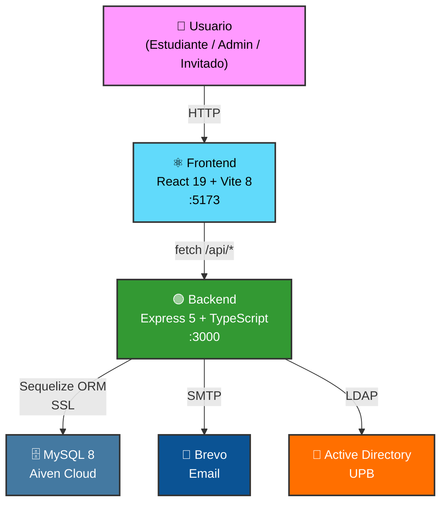
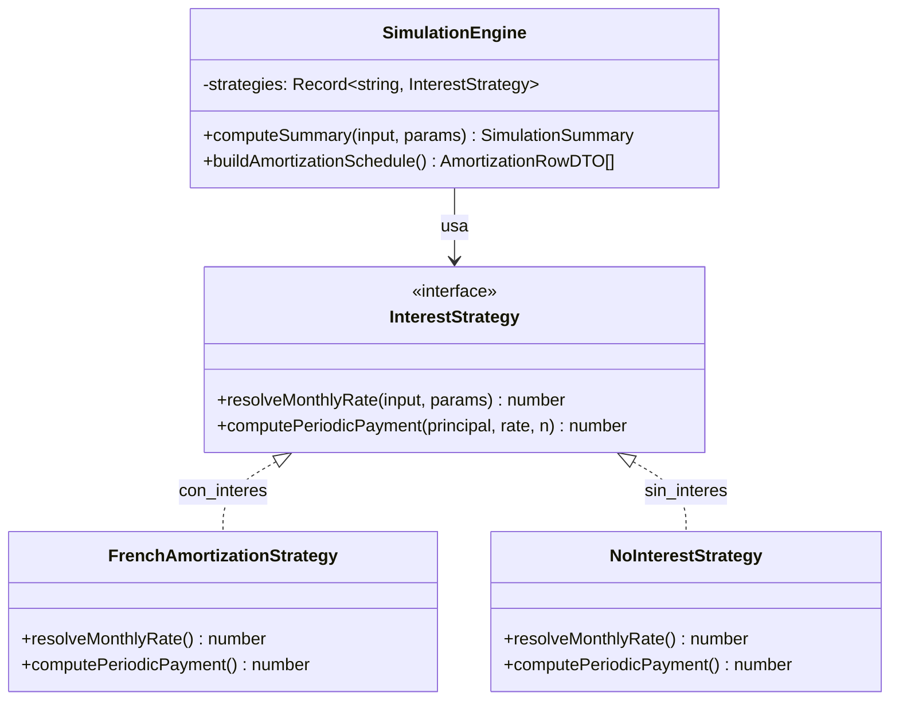

<div align="center">

  

  # 🎓 Simulador de Crédito UPB

  **Plataforma integral de simulación de crédito educativo para la Universidad Pontificia Bolivariana**

  [](https://react.dev/)
  [](https://nodejs.org/)
  [](https://www.typescriptlang.org/)
  [](https://www.mysql.com/)
  [](https://vite.dev/)
  [](LICENSE)

</div>

---

## 📖 Acerca de

El **Simulador de Crédito UPB** permite a estudiantes, invitados y administradores de la Universidad Pontificia Bolivariana modelar, calcular y gestionar planes de financiamiento educativo de forma ágil y segura.

- 🏗️ **Clean Architecture** — Capas `Core/` → `Application/` → `Infrastructure/` con inversión de dependencias estricta.
- 🧮 **Motor Financiero (Strategy Pattern)** — `SimulationEngine` con estrategias intercambiables: amortización francesa (`FrenchAmortizationStrategy`) y sin interés (`NoInterestStrategy`).
- 🔐 **Autenticación Dual** — Login local con bcrypt + JWT y federación LDAP/Active Directory institucional, con autorización por roles (`STUDENT` / `ADMIN`).
- 📧 **Notificaciones Transaccionales** — Correos HTML responsive de recuperación de contraseña vía Brevo SMTP.
- 📄 **Exportación PDF & CSV** — Generación de documentos de simulación con PDFKit y builder CSV.
- 🗑️ **Purga Automática** — Scheduler que archiva simulaciones tras período de retención configurable (soft-delete + auditoría).
- 👤 **Modo Invitado** — Simulaciones sin registro, con restricciones controladas (sin guardado ni historial).

---

## 🖼️ Galería de la Aplicación

<details>
<summary><strong>🔐 Login y Autenticación</strong></summary>
<br/>

|  |  |
|:---:|:---:|
|  |  |
| **Formulario de Login** | **Redirección STUDENT → `/student/main`** |
|  |  |
| **Validación visual de contraseña en tiempo real** | **Retroalimentación de errores por campo** |

</details>

<details>
<summary><strong>👤 Modo Invitado</strong></summary>
<br/>

|  |  |
|:---:|:---:|
|  |  |
| **Página principal modo invitado** | **Formulario de simulación (guest)** |
|  |  |
| **CTA "Crear Nueva Simulación"** | **Resultados invitado (sin botón Guardar)** |

</details>

<details>
<summary><strong>🧮 Simulador y Resultados</strong></summary>
<br/>

|  |  |
|:---:|:---:|
|  |  |
| **Encabezado y datos del estudiante** | **Resumen financiero y gráficas** |
|  |  |
| **Gráficas de distribución** | **Tabla de amortización + Exportar** |

</details>

<details>
<summary><strong>📜 Historial de Simulaciones (Estudiante)</strong></summary>
<br/>

|  |  |
|:---:|:---:|
|  |  |
| **Vista completa con tabla + aviso 90 días** | **Filtros: Modalidad / Período / Fecha** |
|  |  |
| **Fila seleccionada + acciones habilitadas** | **Flujo historial de simulación** |

</details>

<details>
<summary><strong>📄 Exportación PDF</strong></summary>
<br/>

|  |  |
|:---:|:---:|
|  |  |
| **Documento PDF generado (página 1)** | **Tabla de amortización en PDF** |

</details>

<details>
<summary><strong>🛡️ Panel de Administración</strong></summary>
<br/>

|  |  |
|:---:|:---:|
|  |  |
| **Panel principal Admin (3 módulos)** | **Gestión de Simulaciones + paginación** |
|  |  |
| **Filtros y búsqueda** | **Modal de confirmación "Eliminar"** |
|  |  |
| **Parametrización financiera** | **Intercambio de versiones activas** |

</details>

<details>
<summary><strong>🧭 Navegación y UX</strong></summary>
<br/>

|  |  |
|:---:|:---:|
|  |  |
| **Hover en BackNavLink (AdminStudents)** | **BackNavLink (AdminSimulations)** |
|  |  |
| **Logo UPB (gris)** | **Logo UPB hover (color) + focus ring** |

</details>

<details>
<summary><strong>📧 Correo de Recuperación</strong></summary>
<br/>

<div align="center">
  
  <br/><em>Correo HTML responsive de recuperación de contraseña</em>
</div>

</details>

<details>
<summary><strong>🧪 Testing</strong></summary>
<br/>

|  |  |
|:---:|:---:|
|  |  |
| **Suite de tests backend** | **Tests pasando correctamente** |
|  |  |
| **Validación de seguridad en API (400 + fieldErrors)** | **Tests de componentes** |

</details>

---

## 🏛️ Arquitectura del Sistema



### Clean Architecture (Backend)

```mermaid
graph LR
    subgraph Core["🔵 Core (Dominio)"]
        E1["Entities<br/>User · Simulation · Money<br/>ParameterVersion · SimulationRow"]
        E2["Repository Interfaces<br/>IUserRepo · ISimulationRepo<br/>IParameterVersionRepo"]
        E3["Errors<br/>AppError"]
    end

    subgraph App["🟢 Application"]
        S1["Use Cases<br/>AuthenticateUser · SaveSimulation<br/>PreviewSimulation · RegisterUser<br/>ResetPassword · ListSimulations..."]
        S2["Services<br/>SimulationEngine<br/>SimulationService · AuditService"]
        S3["Strategies<br/>FrenchAmortization<br/>NoInterest"]
        S4["DTOs<br/>SimulationInput · LoginInput<br/>SimulationSummary..."]
    end

    subgraph Infra["🟠 Infrastructure"]
        I1["HTTP<br/>Express Routes · Middlewares<br/>Swagger · Error Handler"]
        I2["Persistence<br/>Sequelize Models<br/>Repository Implementations"]
        I3["Auth<br/>JWT · LDAP"]
        I4["Email · Logger · Scheduler"]
    end

    Infra -->|depends on| App
    App -->|depends on| Core
    Core -.->|no dependencies| Core

    style Core fill:#dbeafe,stroke:#3b82f6,stroke-width:2px,color:#000
    style App fill:#dcfce7,stroke:#22c55e,stroke-width:2px,color:#000
    style Infra fill:#ffedd5,stroke:#f97316,stroke-width:2px,color:#000
```



### Strategy Pattern — Motor Financiero



---

## 📚 Índice Documental

> Toda la documentación del proyecto se encuentra organizada en la carpeta [`docs/`](./docs/). Consulta el [índice detallado](./docs/README.md) para ver cada archivo.

### Entregables principales

| Entregable | Enlace directo |
|---|---|
| Manual de usuario | [`docs/manuals/Manual_Usuario_Simulador_Credito_UPB.pdf`](./docs/manuals/Manual_Usuario_Simulador_Credito_UPB.pdf) |
| Manual tecnico | [`docs/manuals/Manual de Técnico Simulador.pdf`](./docs/manuals/Manual%20de%20T%C3%A9cnico%20Simulador.pdf) |
| Manual de despliegue CTIC | [`docs/deployment/Manual de Despliegue Simulador - CTIC.pdf`](./docs/deployment/Manual%20de%20Despliegue%20Simulador%20-%20CTIC.pdf) |
| Articulo IEEE | [`docs/academic/Articulo IEEE Simulador de Credito UPB.pdf`](./docs/academic/Articulo%20IEEE%20Simulador%20de%20Credito%20UPB.pdf) |

| Categoría | Descripción | Ubicación |
|---|---|---|
| 🎓 **Entregables académicos** | Artículo IEEE y sustentación final. | [`docs/academic/`](./docs/academic/) |
| 📘 **Manuales** | Manual de usuario y manual técnico. | [`docs/manuals/`](./docs/manuals/) |
| 📋 **Requisitos** | Project Charter, Product Backlog, especificaciones del proyecto integrador y plan de requisitos de software. | [`docs/requirements/`](./docs/requirements/) |
| 📐 **Diagramas** | Diagramas UML por módulo (StarUML `.mdj`) y diagrama de clases general. | [`docs/diagrams/`](./docs/diagrams/) |
| 🗄️ **Base de Datos** | Diagrama entidad-relación y diccionario de datos. | [`docs/database/`](./docs/database/) |
| 🚀 **Despliegue CTIC** | Manual formal, runbooks, bootstrap, variables ejemplo y evidencias operativas. | [`docs/deployment/`](./docs/deployment/) |
| 💰 **Lineamientos Financieros** | Formatos oficiales de solicitud de crédito del área financiera UPB. | [`docs/financial-guidelines/`](./docs/financial-guidelines/) |
| 🤝 **Actas de Reunión** | Actas firmadas de reuniones con el área financiera (7 sesiones). | [`docs/meeting-minutes/`](./docs/meeting-minutes/) |
| 🏃 **Sprints** | Backlogs y presentaciones de cada Sprint. | [`docs/sprints/`](./docs/sprints/) |
| 🏗️ **Sustento Técnico** | Decisiones arquitectónicas, flujos de datos, ambientes, secretos y evidencias de testing. | [`docs/architecture/`](./docs/architecture/) |

### 🛡️ Sustento Técnico — Arquitectura y Evidencias

Documentación técnica que fundamenta las decisiones de diseño y demuestra la calidad del sistema:

| Documento | Descripción |
|---|---|
| 📝 [**Decisiones Técnicas (ADR)**](./docs/architecture/technical-decisions.md) | 9 Architecture Decision Records: Clean Architecture, Strategy Pattern, Zod validation, autenticación dual JWT+LDAP, monorepo, stack frontend, MySQL Aiven, soft-delete + purga automática y manejo seguro de ambientes/secretos. |
| ⚙️ [**Diseño del Sistema**](./docs/architecture/system-design.md) | Flujos de datos completos con diagramas Mermaid: pipeline de simulación (SimulationForm → Engine → AmortizationTable), modelo de seguridad Defense in Depth (7 capas), flujo de autenticación, exportación PDF, ciclo de vida de simulaciones y modelo ER detallado. |
| 🔐 [**Ambientes y Secretos (HU-58)**](./docs/architecture/environments-and-secrets.md) | Estrategia oficial de configuración para Local, Testing/Staging y Producción WAN; matriz de variables; exclusión de secretos y guía rápida de `.env`. |
| 📄 [**Ambientes y Secretos — DOCX**](./docs/architecture/environments-and-secrets.docx) | Versión editable Word para entrega formal o revisión externa. |
| 🧪 [**Evidencias de Testing**](./docs/architecture/test-evidence.md) | Resultados de ejecución de Jest (50 tests backend) y Vitest (6 tests frontend), reporte de cobertura de código, análisis de priorización y estrategia de testing por sprint. |

---

## 🗂️ Estructura del Proyecto

```
simulador-credito-upb/
├── client/                          # ⚛️ Frontend — React 19 + Vite + TypeScript
│   ├── src/
│   │   ├── modules/
│   │   │   ├── auth/                # Login, Register, ForgotPassword, ResetPassword
│   │   │   ├── admin/               # Panel admin (Students, Parameters, Simulations)
│   │   │   ├── simulator/           # Simulador (user + guest)
│   │   │   └── landing/             # Landing page pública
│   │   ├── shared/
│   │   │   ├── components/          # Layout, Header, Footer, SimulationForm, Charts...
│   │   │   ├── services/            # API client
│   │   │   └── utils/               # Helpers
│   │   └── App.tsx                  # Router principal + rutas protegidas
│   ├── nginx.conf                   # Nginx config (producción)
│   ├── tailwind.config.js
│   └── package.json
│
├── server/                          # 🟢 Backend — Node.js + Express 5 + TypeScript
│   ├── src/
│   │   ├── Core/                    # 🔵 Dominio (entities, repos interfaces, errors)
│   │   ├── Application/             # 🟢 Casos de uso, servicios, strategies, DTOs
│   │   │   ├── use-cases/           # AuthenticateUser, SaveSimulation, etc.
│   │   │   ├── services/            # SimulationEngine, AuditService, PDF/CSV builders
│   │   │   └── strategies/          # FrenchAmortization, NoInterest
│   │   ├── Infrastructure/          # 🟠 Frameworks y drivers
│   │   │   ├── http/                # Express app, routes, middlewares, Swagger
│   │   │   ├── persistence/         # Sequelize models + repository implementations
│   │   │   ├── auth/                # JWT + LDAP services
│   │   │   ├── email/               # Nodemailer + Brevo SMTP
│   │   │   ├── scheduler/           # Purga automática de simulaciones
│   │   │   └── config/              # env, database singleton
│   │   └── index.ts                 # Bootstrap del servidor
│   ├── jest.config.ts
│   └── package.json
│
├── docs/                            # 📖 Documentación del proyecto
│   ├── academic/                    # Artículo IEEE y sustentación final
│   ├── architecture/               # 🏗️ ADRs, flujos técnicos, ambientes, secretos y testing
│   ├── database/                    # ER diagram + diccionario de datos
│   ├── deployment/                  # Manual CTIC, runbooks y evidencias operativas
│   ├── diagrams/                    # Diagramas UML por módulo
│   ├── financial-guidelines/        # Formatos de crédito financiero
│   ├── manuals/                     # Manual de usuario y manual técnico
│   ├── meeting-minutes/             # Actas de reunión firmadas
│   ├── requirements/                # Charter, backlog, especificaciones
│   └── sprints/                     # Artefactos por sprint
│
├── .github/                         # CI/CD workflows, templates, Dependabot
├── .env.example                     # Variables de entorno de referencia
├── package.json                     # Monorepo workspaces (npm)
├── LICENSE                          # Licencia MIT
├── SECURITY.md                      # Política de reporte de vulnerabilidades
├── CONTRIBUTING.md                  # Guía de contribución
├── CODE_OF_CONDUCT.md               # Código de conducta
└── README.md
```

---

## 🚀 Guía de Inicio Rápido

### Prerrequisitos

- **Node.js** ≥ 18
- **npm** ≥ 9

### Instalación

```bash
# 1. Clonar el repositorio
git clone https://github.com/tu-org/simulador-credito-upb.git
cd simulador-credito-upb

# 2. Instalar dependencias (monorepo — instala client + server)
npm install

# 3. Configurar variables de entorno
cp .env.example .env
# Edita .env con tus credenciales de BD (Aiven), LDAP, SMTP y JWT
```

> 🔐 Consulta la guía completa de ambientes y secretos en
> [`docs/architecture/environments-and-secrets.md`](./docs/architecture/environments-and-secrets.md).

### Desarrollo

```bash
# Levantar backend + frontend simultáneamente
npm run dev

# O por separado:
npm run dev:server    # Backend  → http://localhost:3000
npm run dev:client    # Frontend → http://localhost:5173
```

| Servicio | URL | Descripción |
|---|---|---|
| Frontend | `http://localhost:5173` | Aplicación React (Vite HMR) |
| Backend API | `http://localhost:3000/api` | REST API Express |
| Swagger Docs | `http://localhost:3000/api/docs` | Documentación interactiva de la API |
| Health Check | `http://localhost:3000/api/health` | Estado del servidor |

### Testing

```bash
# Tests del backend (Jest)
npm run test --workspace=server

# Tests del frontend (Vitest)
npm run test --workspace=client
```

---

## 🚀 Ambientes de Despliegue

| Ambiente | Modelo | Documentación |
|---|---|---|
| 🟡 **Pre-Producción (Staging)** | Automatizado vía GitHub Actions + Aiven Cloud | [`docs/deployment/PRE-PROD-ENVIRONMENT.md`](./docs/deployment/PRE-PROD-ENVIRONMENT.md) |
| 🟢 **Producción (CTIC)** | Despliegue manual/script on-premise + MariaDB CTIC | [`docs/deployment/CTIC-PROD-DEPLOYMENT.md`](./docs/deployment/CTIC-PROD-DEPLOYMENT.md) |

---

## 🛠️ Stack Tecnológico

### Frontend

| Herramienta | Propósito |
|---|---|
| ⚛️ **React 19** | Librería de UI con componentes funcionales |
| ⚡ **Vite 8** | Bundler ultrarrápido con HMR |
| 🎨 **Tailwind CSS v4** | Utility-first CSS framework |
| 🔷 **TypeScript 6** | Tipado estático |
| ✅ **Zod 4** | Validación de esquemas en cliente y servidor |
| 📝 **React Hook Form 7** | Gestión de formularios performante |
| 🧭 **React Router 7** | Enrutamiento SPA con rutas protegidas |
| 💎 **Lucide React** | Iconografía SVG moderna |
| 🧪 **Vitest + Testing Library** | Testing unitario y de integración |

### Backend

| Herramienta | Propósito |
|---|---|
| 🟢 **Node.js + Express 5** | Runtime y framework HTTP |
| 🔷 **TypeScript 6** | Tipado estático |
| 🗄️ **Sequelize 6 + MySQL 8** | ORM con conexión SSL a Aiven Cloud |
| 🔑 **JWT (jsonwebtoken)** | Autenticación stateless |
| 🔐 **bcrypt** | Hashing seguro de contraseñas |
| 🏛️ **passport-ldapauth** | Autenticación federada LDAP/AD |
| 📧 **Nodemailer + Brevo SMTP** | Correos transaccionales (reset password) |
| 🛡️ **Helmet + CORS + XSS** | Seguridad HTTP y sanitización |
| ⏱️ **express-rate-limit** | Rate limiting por endpoint |
| 📄 **PDFKit** | Generación de documentos PDF |
| 📊 **Swagger UI Express** | Documentación interactiva de la API |
| 📝 **Winston** | Logging estructurado |
| 🧪 **Jest + Supertest** | Testing del API |

---

## 🤝 Contribución

1. Crea un **fork** del repositorio.
2. Crea una rama para tu feature: `git checkout -b feature/mi-feature`.
3. Haz commit de tus cambios: `git commit -m "feat: descripción del cambio"`.
4. Sube tu rama: `git push origin feature/mi-feature`.
5. Abre un **Pull Request** describiendo tus cambios.

> 📖 Consulta la [Guía de Contribución](./CONTRIBUTING.md) para convenciones de código, commits y flujo de trabajo.
> 📝 Usa la [plantilla de Pull Request](./.github/PULL_REQUEST_TEMPLATE.md) para la estructura esperada.
> 🤝 Lee nuestro [Código de Conducta](./CODE_OF_CONDUCT.md) antes de participar.

---

## 🔒 Seguridad

Si descubres una vulnerabilidad de seguridad, **NO** abras un issue público. Consulta nuestra [Política de Seguridad](./SECURITY.md) para el proceso de reporte responsable.

---

## 📄 Licencia

Este proyecto está licenciado bajo la [Licencia MIT](LICENSE) — libre para uso, modificación y distribución.

---

<div align="center">

  Hecho con ❤️ por el equipo de desarrollo — **Universidad Pontificia Bolivariana**

  <sub>Proyecto Integrador · Ingeniería de Sistemas e Informática · 2026-2027</sub>

</div>
