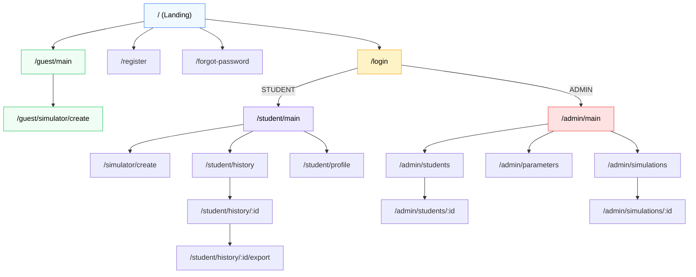
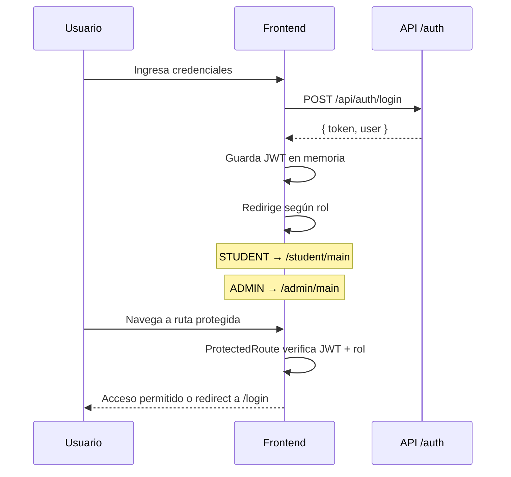

<div align="center">

# ⚛️ Client — Simulador de Crédito UPB

Frontend SPA construido con **React 19**, **Vite 7** y **TypeScript 5.9**

[](https://react.dev/)
[](https://vite.dev/)
[](https://tailwindcss.com/)
[](https://www.typescriptlang.org/)

</div>

---

## 📁 Estructura

```
client/src/
├── modules/                    # Feature modules (vertical slicing)
│   ├── auth/                   # Autenticación
│   │   ├── context/            # AuthContext (JWT + estado global)
│   │   └── pages/              # Login, Register, ForgotPassword, ResetPassword
│   ├── admin/                  # Panel de administración
│   │   └── pages/              # Dashboard, Students, Parameters, Simulations
│   ├── simulator/              # Simulador de crédito
│   │   └── pages/
│   │       ├── user/           # Flujo autenticado (Student)
│   │       └── guest/          # Flujo invitado (sin registro)
│   └── landing/                # Landing page pública
│
├── shared/                     # Código compartido entre módulos
│   ├── components/             # UI reutilizable
│   │   ├── SimulationForm.tsx  # Formulario principal (~47KB)
│   │   ├── SimulationResultsPreview.tsx
│   │   ├── SimulationCharts.tsx
│   │   ├── UpbHeader.tsx       # Header institucional
│   │   ├── UpbFooter.tsx       # Footer institucional
│   │   ├── ProtectedRoute.tsx  # Guard por rol (STUDENT/ADMIN)
│   │   ├── PublicRoute.tsx     # Redirect si ya autenticado
│   │   ├── BackNavLink.tsx     # Navegación "volver" con hover
│   │   └── ...
│   ├── services/               # API client (fetch wrapper)
│   └── utils/                  # Helpers y constantes
│
├── App.tsx                     # Router principal
├── main.tsx                    # Punto de entrada
└── index.css                   # Tailwind directives
```

---

## 🧭 Mapa de Rutas



> Las rutas `/student/*` y `/admin/*` están protegidas por `ProtectedRoute` con validación de rol JWT.
> Las rutas `/guest/*` y auth son públicas, redirigen al dashboard si ya hay sesión activa.

---

## 🛠️ Stack

| Librería | Versión | Uso |
|---|---|---|
| **React** | 19 | UI con componentes funcionales |
| **Vite** | 7 | Dev server + bundler con HMR |
| **TypeScript** | 5.9 | Tipado estático |
| **Tailwind CSS** | v4 | Estilos utility-first |
| **React Router** | 7 | Enrutamiento SPA |
| **React Hook Form** | 7 | Formularios con validación |
| **Zod** | 4 | Esquemas de validación |
| **Lucide React** | — | Iconos SVG |
| **Vitest** | 4 | Testing unitario |
| **Testing Library** | — | Testing de componentes React |

---

## 🚀 Desarrollo

```bash
# Desde la raíz del monorepo
npm run dev:client

# O directamente
cd client && npm run dev
```

| Comando | Descripción |
|---|---|
| `npm run dev` | Servidor de desarrollo (Vite HMR) → `:5173` |
| `npm run build` | Build de producción (`tsc -b && vite build`) |
| `npm run preview` | Preview del build de producción |
| `npm run lint` | ESLint sobre todo el proyecto |
| `npm run test` | Vitest (run once) |
| `npm run test:watch` | Vitest en modo watch |

---

## 🔐 Autenticación

El flujo de auth está gestionado por `AuthContext`:



---

<div align="center">
  <sub>🔙 <a href="../README.md">Volver al README principal</a></sub>
</div>
