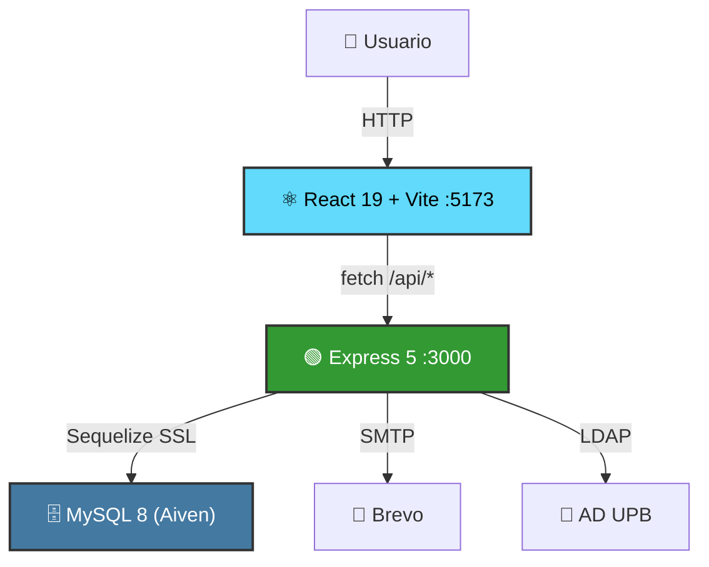
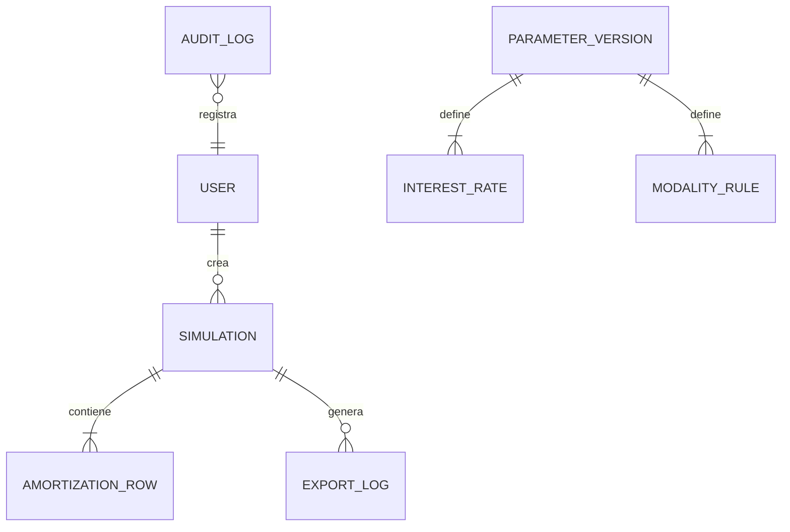

<div align="center">

# 📖 Documentación — Simulador de Crédito UPB

Índice centralizado de toda la documentación del proyecto.

</div>

---

## 📂 Estructura

```
docs/
├── architecture/           # 🏗️ Sustento técnico (ADRs, flujos, evidencias)
│   ├── technical-decisions.md
│   ├── system-design.md
│   ├── environments-and-secrets.md
│   ├── environments-and-secrets.docx
│   └── test-evidence.md
├── deployment/             # 🚀 Ambientes, despliegue CTIC y evidencia operativa
│   ├── PRE-PROD-ENVIRONMENT.md
│   └── CTIC-PROD-DEPLOYMENT.md
├── requirements/           # Requisitos, charter, backlog y especificaciones
├── diagrams/               # Diagramas UML por módulo (StarUML)
│   └── class-diagram/      # Diagrama de clases general
├── database/               # Modelo ER y diccionario de datos
├── financial-guidelines/   # Formatos oficiales del área financiera
├── meeting-minutes/        # Actas de reunión firmadas
├── sprints/                # Artefactos por sprint
│   └── sprint-1/
└── track 2/                # 📡 Infraestructura de red (DHCP, FTP, Proxy)
├── track 2/                # 📡 Infraestructura de red (DHCP, FTP, Proxy)
│   ├── HU-65-proxy-client.md
```

---

## 🛡️ Sustento Técnico — Arquitectura y Evidencias

Documentación técnica que fundamenta las decisiones de diseño y demuestra la calidad del sistema.

| Archivo | Descripción |
|---|---|
| [`technical-decisions.md`](./architecture/technical-decisions.md) | **9 ADRs** — Clean Architecture, Strategy Pattern, validación Zod + XSS, autenticación dual JWT/LDAP, monorepo npm workspaces, stack React 19 + Vite, MySQL Aiven Cloud, soft-delete + purga automática y manejo seguro de ambientes/secretos. |
| [`system-design.md`](./architecture/system-design.md) | **Flujos técnicos** — Diagrama de secuencia completo de una simulación (Form → Middleware → UseCase → Engine → Strategy), modelo de seguridad Defense in Depth (7 capas), flujo de autenticación, exportación PDF, ciclo de vida de simulaciones y modelo ER detallado. |
| [`environments-and-secrets.md`](./architecture/environments-and-secrets.md) | **HU-58** — Definición de ambientes Local, Testing/Staging y Producción WAN; matriz de variables; estrategia de secretos; guía de configuración local y evidencia documental. |
| [`environments-and-secrets.docx`](./architecture/environments-and-secrets.docx) | **Versión Word** — Documento editable para entrega formal o revisión externa de la HU-58. |
| [`test-evidence.md`](./architecture/test-evidence.md) | **Evidencias de testing** — Salida de Jest (4 suites, 50 tests) y Vitest (2 suites, 6 tests), reporte de cobertura de código, análisis de componentes con alta/baja cobertura y plan de mejora por sprint. |

---

## 🚀 Despliegue y Ambientes

Documentación operativa de HU-59 para los ambientes de Pre-Producción y Producción CTIC.

| Archivo | Descripción |
|---|---|
| [`PRE-PROD-ENVIRONMENT.md`](./deployment/PRE-PROD-ENVIRONMENT.md) | **Pre-Producción / Staging** — Entorno automatizado con GitHub Actions, runner self-hosted RHEL, Aiven Cloud MySQL, PM2 cluster y Nginx. |
| [`CTIC-PROD-DEPLOYMENT.md`](./deployment/CTIC-PROD-DEPLOYMENT.md) | **Producción CTIC** — Guía formal para despliegue manual/script on-premise con RHEL, Nginx, PM2, systemd y MariaDB administrada por CTIC. |

---

## 📋 Requisitos y Planeación

| Archivo | Descripción |
|---|---|
| [`project-charter.docx`](./requirements/project-charter.docx) | Acta de constitución del proyecto |
| [`product-backlog.xlsx`](./requirements/product-backlog.xlsx) | Product Backlog con todas las historias de usuario |
| [`software-requirements.pdf`](./requirements/software-requirements.pdf) | Planificación y especificación de requisitos de software (firmado) |
| [`project-specifications.pdf`](./requirements/project-specifications.pdf) | Especificaciones del proyecto integrador |
| [`project-budget.xlsx`](./requirements/project-budget.xlsx) | Presupuesto del proyecto |
| [`verification-checklist.docx`](./requirements/verification-checklist.docx) | Lista de verificación de entregables |

---

## 📐 Diagramas

| Archivo | Descripción |
|---|---|
| [`module-01-access-and-roles.mdj`](./diagrams/module-01-access-and-roles.mdj) | Módulo 1 — Acceso y gestión de roles |
| [`module-02-forms-validations-history.mdj`](./diagrams/module-02-forms-validations-history.mdj) | Módulos 2 y 4 — Formularios, validaciones e historial |
| [`module-03-calculation-results.mdj`](./diagrams/module-03-calculation-results.mdj) | Módulo 3 — Cálculo financiero y resultados |
| [`module-05-exports.mdj`](./diagrams/module-05-exports.mdj) | Módulo 5 — Exportaciones |
| [`module-06-admin-parameterization.mdj`](./diagrams/module-06-admin-parameterization.mdj) | Módulo 6 — Administración y parametrización |
| [`class-diagram.jpg`](./diagrams/class-diagram/class-diagram.jpg) | Diagrama de clases general (imagen) |
| [`class-diagram.mdj`](./diagrams/class-diagram/class-diagram.mdj) | Diagrama de clases (StarUML editable) |
| [`class-diagram-explanation.docx`](./diagrams/class-diagram/class-diagram-explanation.docx) | Explicación detallada del diagrama de clases |

---

## 🗄️ Base de Datos

| Archivo | Descripción |
|---|---|
| [`er-diagram.png`](./database/er-diagram.png) | Diagrama entidad-relación del modelo final |
| [`data-dictionary.html`](./database/data-dictionary.html) | Diccionario de datos (tablas, columnas, tipos y restricciones) |

---

## 💰 Lineamientos Financieros

| Archivo | Descripción |
|---|---|
| [`credit-application-form.pdf`](./financial-guidelines/credit-application-form.pdf) | Formato estándar de solicitud de crédito |
| [`credit-application-upb-tech.pdf`](./financial-guidelines/credit-application-upb-tech.pdf) | Formato de solicitud de crédito UPB Tech |

---

## 🤝 Actas de Reunión

Actas de reuniones firmadas con el área financiera de la UPB.

| Archivo | Sesión |
|---|---|
| [`meeting-01.pdf`](./meeting-minutes/meeting-01.pdf) | Reunión 1 |
| [`meeting-02.pdf`](./meeting-minutes/meeting-02.pdf) | Reunión 2 |
| [`meeting-03.pdf`](./meeting-minutes/meeting-03.pdf) | Reunión 3 |
| [`meeting-04.pdf`](./meeting-minutes/meeting-04.pdf) | Reunión 4 |
| [`meeting-05.pdf`](./meeting-minutes/meeting-05.pdf) | Reunión 5 |
| [`meeting-06.pdf`](./meeting-minutes/meeting-06.pdf) | Reunión 6 |
| [`meeting-07.pdf`](./meeting-minutes/meeting-07.pdf) | Reunión 7 |

---

## 🏃 Sprints

### Sprint 1

| Archivo | Descripción |
|---|---|
| [`sprint-1-backlog.xlsx`](./sprints/sprint-1/sprint-1-backlog.xlsx) | Sprint Backlog con tareas y estimaciones |
| [`sprint-1-presentation.pptx`](./sprints/sprint-1/sprint-1-presentation.pptx) | Presentación de cierre del Sprint 1 |

---

## 📡 Infraestructura de Red (Track 2)

Documentación correspondiente a la configuración de servicios de red e integración de topología.

| Archivo | Descripción |
|---|---|
| [`HU-65-proxy-client.md`](./track%202/HU-65-proxy-client.md) | **HU-65** — Configuración y validación del cliente para el servicio Proxy (Evidencia funcional y logs). |
| [`HU-65-proxy-client.docx`](./track%202/HU-65-proxy-client.docx) | **HU-65 (Word)** — Versión editable del informe de configuración y validación del cliente proxy. |
| *Directorio de pruebas* | Ver [`track 2/`](./track%202/) para evidencias de DHCP y FTP. |

---

## 🖼️ Capturas de Pantalla

Las siguientes capturas provienen de los Pull Requests del proyecto y documentan el estado funcional de cada módulo.

<details>
<summary><strong>🔐 Autenticación y Registro</strong></summary>
<br/>

| Captura | Descripción |
|:---:|---|
|  | Formulario de login |
|  | Redirección STUDENT → `/student/main` |
|  | Dashboard del estudiante autenticado |
|  | Validación visual de fortaleza de contraseña |
|  | Retroalimentación de errores por campo |
|  | Correo HTML de recuperación de contraseña |

</details>

<details>
<summary><strong>👤 Modo Invitado</strong></summary>
<br/>

| Captura | Descripción |
|:---:|---|
|  | Página principal invitado con badge "Modo Invitado" |
|  | CTA "Crear Nueva Simulación" |
|  | Tarjeta informativa modo invitado |
|  | Formulario de simulación (guest) |
|  | Resultados invitado (sin botón "Guardar") |

</details>

<details>
<summary><strong>🧮 Simulador y Resultados</strong></summary>
<br/>

| Captura | Descripción |
|:---:|---|
|  | Encabezado y datos del estudiante |
|  | Resumen financiero y gráficas |
|  | Gráficas de distribución (donut chart) |
|  | Vista completa de resultados |
|  | Tabla de amortización + botón Exportar |

</details>

<details>
<summary><strong>📜 Historial de Simulaciones</strong></summary>
<br/>

| Captura | Descripción |
|:---:|---|
|  | Vista completa con tabla + mensaje de retención 90 días |
|  | Dropdown de filtros (Modalidad / Período / Fecha) |
|  | Fila seleccionada + botones "Ver" y "Exportar" |
|  | Flujo completo de historial |
|  | Detalle de simulación guardada |
|  | Vista de exportación |
|  | Gráfica en detalle de historial |
|  | Tabla amortización en detalle |
|  | Exportación desde historial |

</details>

<details>
<summary><strong>📄 Exportación PDF</strong></summary>
<br/>

| Captura | Descripción |
|:---:|---|
|  | Documento PDF generado (encabezado + datos) |
|  | Tabla de amortización en PDF |

</details>

<details>
<summary><strong>🛡️ Panel de Administración</strong></summary>
<br/>

| Captura | Descripción |
|:---:|---|
|  | Login como ADMIN |
|  | Menú principal Admin (Students / Parameters / Simulations) |
|  | `/admin/students` |
|  | `/admin/parameters` |
|  | `/admin/simulations` |
|  | Gestión de Simulaciones: tabla + paginación |
|  | Dropdown de filtros + búsqueda aplicada |
|  | Modal de confirmación "Eliminar Simulación" |
|  | Placeholder "Ver Simulación" |
|  | Parametrización financiera (editar versión) |
|  | Activar versión e intercambio sin pérdida de datos |

</details>

<details>
<summary><strong>🧭 Navegación, UX y Header</strong></summary>
<br/>

| Captura | Descripción |
|:---:|---|
|  | Header institucional UPB |
|  | Hover en BackNavLink (AdminStudents) |
|  | BackNavLink (AdminSimulations) |
|  | BackNavLink (StudentHistory) |
|  | Hover detalle vista |
|  | Hover completo |
|  | Logo UPB gris (estado normal) |
|  | Logo UPB color (hover) + focus ring |

</details>

<details>
<summary><strong>🧪 Testing y Validación API</strong></summary>
<br/>

| Captura | Descripción |
|:---:|---|
|  | Suite de tests backend |
|  | Tests pasando correctamente |
|  | Validación de seguridad en API (400 + fieldErrors) |
|  | Test de respuesta de API |
|  | Validación de esquemas Zod |
|  | Test de seguridad adicional |
|  | Test cobertura completa |
|  | Tests de componentes frontend |

</details>

---

## 🏛️ Referencia Rápida — Arquitectura

### Sistema General



### Modelo de Datos Simplificado



> Para diagramas de arquitectura detallados, consulta el [README del servidor](../server/README.md).
> Para el mapa de rutas del frontend, consulta el [README del cliente](../client/README.md).

---

<div align="center">
  <sub>🔙 <a href="../README.md">Volver al README principal</a></sub>
</div>
