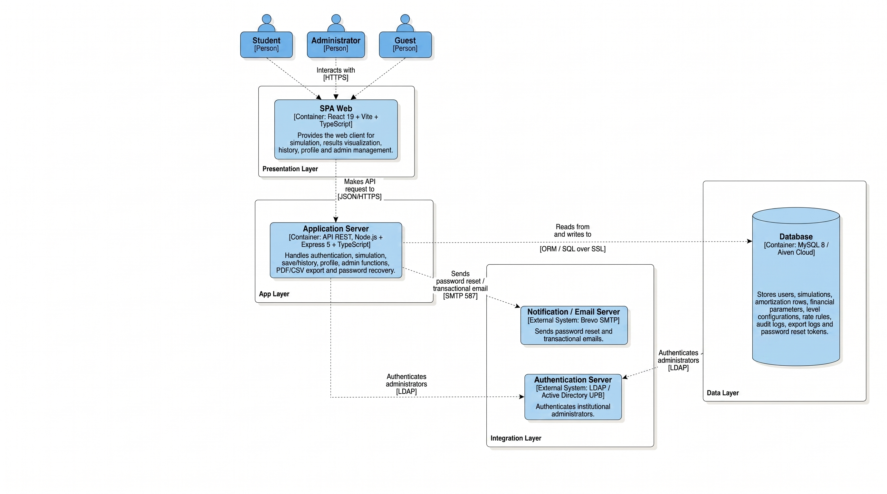

# Arquitectura / Architecture

Esta carpeta consolida las decisiones tecnicas, flujos, evidencias y diagramas que soportan la aplicacion desarrollada.

This folder consolidates the technical decisions, flows, evidence and diagrams that support the developed application.

## Vista de alto nivel / High-level View

  
   
  <em>Cliente React, API Node.js, base de datos, LDAP y SMTP.</em>

## Diagramas graficos / Visual Diagrams

| Diagrama | Archivo |
|---|---|
| Contexto del sistema / System context | [`assets/diagrams/system-context.png`](./assets/diagrams/system-context.png) |
| Componentes principales / Component diagram | [`assets/diagrams/component-diagram.png`](./assets/diagrams/component-diagram.png) |
| Servidor de aplicacion / Application server | [`assets/diagrams/application-server.png`](./assets/diagrams/application-server.png) |
| Cliente React / React web client | [`assets/diagrams/react-web-client.png`](./assets/diagrams/react-web-client.png) |

## Documentos tecnicos / Technical Documents

| Documento | Proposito |
|---|---|
| [`system-design.md`](./system-design.md) | Flujos de sistema, componentes, seguridad y datos. |
| [`technical-decisions.md`](./technical-decisions.md) | Registro ADR de decisiones arquitectonicas. |
| [`environments-and-secrets.md`](./environments-and-secrets.md) | Ambientes, variables y politica de secretos. |
| [`integration-test.md`](./integration-test.md) | Evidencias de integracion, funcionales/manuales y regresion. |
| [`unit-test.md`](./unit-test.md) | Evidencias unitarias de motor financiero, servicios y validaciones. |

## Capas principales / Main Layers

| Capa | Componentes | Responsabilidad |
|---|---|---|
| Presentacion | React, React Router, React Hook Form, Zod, Tailwind | Captura de datos, rutas por rol y visualizacion de resultados. |
| API | Express, middlewares, controladores, Swagger | Endpoints REST, validacion de entrada y seguridad HTTP. |
| Aplicacion | Use cases, `SimulationService`, `ParameterService`, `AuditService` | Orquestacion de reglas de negocio. |
| Dominio | Entidades, DTO, `SimulationEngine`, estrategias de interes | Calculo financiero y reglas de simulacion. |
| Infraestructura | Sequelize, JWT, LDAP, SMTP, PM2, Nginx | Persistencia, autenticacion, correo y operacion. |

## Seguridad / Security

- No publicar secretos reales en Markdown, capturas ni archivos de ejemplo.
- Usar placeholders para dominios, tokens, SMTP, LDAP y base de datos.
- Exponer la API por Nginx bajo `/api`; mantener Node.js en `localhost:3000`.
