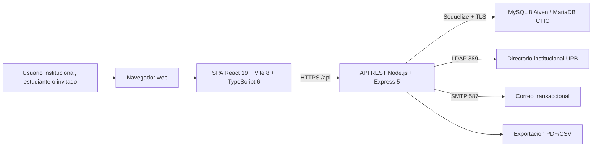

# Arquitectura del Simulador de Credito UPB

Esta carpeta consolida las decisiones tecnicas, flujos, evidencias y diagramas que soportan la aplicacion desarrollada. El sistema esta compuesto por una SPA React, una API Node.js/Express en TypeScript, persistencia relacional MySQL/MariaDB y servicios externos para LDAP y SMTP.

## Vista de alto nivel

## Diagramas graficos

| Diagrama | Archivo |
|---|---|
| Vista de contexto del sistema | [`assets/diagrams/system-context.png`](./assets/diagrams/system-context.png) |
| Componentes principales | [`assets/diagrams/component-diagram.png`](./assets/diagrams/component-diagram.png) |
| Application Server | [`assets/diagrams/application-server.png`](./assets/diagrams/application-server.png) |
| React Web Client | [`assets/diagrams/react-web-client.png`](./assets/diagrams/react-web-client.png) |

## Documentos tecnicos

| Documento | Proposito |
|---|---|
| [`system-design.md`](./system-design.md) | Explica flujos de simulacion, seguridad, autenticacion, exportacion y ciclo de vida. |
| [`technical-decisions.md`](./technical-decisions.md) | Registro ADR de las decisiones arquitectonicas adoptadas. |
| [`environments-and-secrets.md`](./environments-and-secrets.md) | Define ambientes, variables y politica de secretos. |
| [`integration-test.md`](./integration-test.md) | Evidencias de integracion, funcional/manual y regresion. |
| [`unit-test.md`](./unit-test.md) | Evidencias unitarias de motor financiero, servicios y validaciones. |

## Componentes principales

| Capa | Componentes | Responsabilidad |
|---|---|---|
| Presentacion | React, React Router, React Hook Form, Zod, Tailwind | Captura de datos, rutas por rol, validacion client-side y visualizacion de resultados. |
| API | Express, middlewares, controladores, Swagger | Exponer endpoints REST, validar entrada y aplicar seguridad HTTP. |
| Aplicacion | Use cases, `SimulationService`, `ParameterService`, `AuditService` | Orquestar reglas de negocio sin acoplarse al framework. |
| Dominio | Entidades, DTO, `SimulationEngine`, estrategias de interes | Calculo financiero, amortizacion y reglas de simulacion. |
| Infraestructura | Sequelize, repositorios, JWT, LDAP, SMTP, PM2/Nginx | Persistencia, autenticacion, correo, despliegue y operacion. |

## Notas de seguridad

- Los secretos reales no deben aparecer en Markdown ni en capturas.
- Las rutas publicas deben mostrar placeholders para dominio, base de datos, LDAP, SMTP y tokens.
- La API se expone por Nginx bajo `/api`; el backend debe permanecer escuchando localmente en `localhost:3000`.
