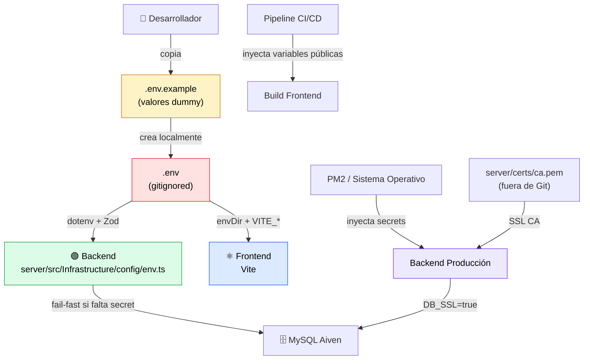
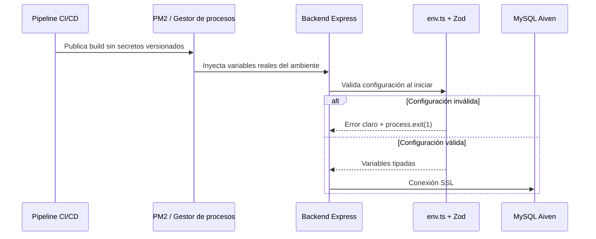

<div align="center">

# 🔐 Ambientes y Secretos — HU-58

**Simulador de Crédito UPB**

Estrategia oficial para variables de entorno, secretos y despliegue seguro en
desarrollo local, testing/staging y producción WAN.

</div>

---

## Índice

1. [Objetivo](#1-objetivo)
2. [Arquitectura de configuración](#2-arquitectura-de-configuración)
3. [Definición de ambientes](#3-definición-de-ambientes)
4. [Matriz de variables](#4-matriz-de-variables)
5. [Estrategia de secretos](#5-estrategia-de-secretos)
6. [Guía rápida de configuración local](#6-guía-rápida-de-configuración-local)
7. [Criterios operativos](#7-criterios-operativos)
8. [Evidencia documental](#8-evidencia-documental)

---

## 1. Objetivo

Este documento define la estrategia oficial para configurar variables de entorno y
secretos del **Simulador de Crédito UPB**. La regla base es simple:

> **Los secretos reales nunca se versionan en Git.**

El repositorio solo contiene la plantilla segura [`.env.example`](../../.env.example),
con valores dummy, y la documentación necesaria para que cada ambiente inyecte sus
propias credenciales.

---

## 2. Arquitectura de configuración

La aplicación se configura desde la raíz del monorepo. El backend carga y valida
variables al iniciar; el frontend solo consume variables públicas con prefijo
`VITE_`.



### Responsabilidades por componente

| Componente | Responsabilidad |
|---|---|
| `.env.example` | Plantilla segura, sin credenciales reales. Debe mantenerse actualizada con cada variable nueva. |
| `.gitignore` | Excluye `.env`, variantes locales, certificados y llaves privadas. |
| `server/src/Infrastructure/config/env.ts` | Valida variables con Zod y detiene el proceso si falta una variable crítica. |
| `client/vite.config.ts` | Lee variables desde la raíz del monorepo mediante `envDir`. |
| `client/src/shared/services/api.ts` | Consume `VITE_API_URL` para definir la URL base del API. |
| PM2 / CI/CD | Inyecta secretos reales por ambiente sin escribirlos en el repositorio. |

---

## 3. Definición de ambientes

### 3.1. Desarrollo local

Ambiente usado por cada desarrollador en su equipo. El archivo `.env` se crea
localmente a partir de `.env.example` y no se sube al repositorio.

| Elemento | Valor esperado |
|---|---|
| Backend | `http://localhost:3000` |
| Frontend | `http://localhost:5173` |
| Base de datos | MySQL Aiven o instancia local equivalente |
| Secretos | Definidos en `.env`, excluido por Git |
| LDAP / SMTP | Opcionales si el flujo probado no los requiere |

### 3.2. Testing / Staging

Ambiente previo a producción para validar integraciones, pruebas de aceptación y
despliegues candidatos. Debe usar datos no productivos o anonimizados, secretos
propios del ambiente y una base de datos separada.

| Elemento | Valor esperado |
|---|---|
| Variables | Inyectadas por pipeline CI/CD o gestor de procesos |
| Datos | Sintéticos, anonimizados o no productivos |
| Secretos | Diferentes a desarrollo y producción |
| URL | Pública o privada, estable para pruebas de integración |

### 3.3. Producción — Despliegue WAN

Ambiente expuesto a usuarios reales. No debe depender de archivos `.env`
versionados ni de valores locales. Los secretos se inyectan desde PM2, variables
del servidor, pipeline CI/CD o secret manager.

| Elemento | Valor esperado |
|---|---|
| `NODE_ENV` | `production` |
| Base de datos | MySQL Aiven con `DB_SSL=true` |
| Certificado CA | Provisionado fuera de Git, por ejemplo `server/certs/ca.pem` |
| `FRONTEND_URL` | Dominio WAN real, nunca `localhost` |
| `VITE_API_URL` | Endpoint público del backend, por ejemplo `https://simulador.example.edu/api` |

---

## 4. Matriz de variables

| Variable | Componente | Obligatoria | Propósito |
|---|---|---|---|
| `NODE_ENV` | Backend | Sí | Define el modo de ejecución: `development`, `test` o `production`. |
| `PORT` | Backend | No | Puerto HTTP del backend. Por defecto usa `3000`. |
| `DB_HOST` | Backend | Sí | Host de MySQL Aiven o de la base de datos equivalente. |
| `DB_PORT` | Backend | Sí | Puerto de conexión MySQL. |
| `DB_NAME` | Backend | Sí | Nombre de la base de datos. |
| `DB_USER` | Backend | Sí | Usuario de conexión a la base de datos. |
| `DB_PASSWORD` | Backend | Sí | Password del usuario de base de datos. Es secreto y debe inyectarse por ambiente. |
| `DB_SSL` | Backend | Sí en producción | Habilita SSL para MySQL. En producción debe ser `true`. |
| `JWT_SECRET` | Backend | Sí | Secreto usado para firmar y verificar JWT. Debe tener al menos 32 caracteres y no usar placeholders. |
| `JWT_EXPIRES_IN` | Backend | Sí | Tiempo de expiración de tokens JWT, por ejemplo `15m`, `8h` o `7d`. |
| `ADMIN_DEFAULT_PASSWORD` | Backend seed | Solo al ejecutar seed | Password temporal para crear el usuario administrador inicial cuando no existe. |
| `LDAP_URL` | Backend | Sí en producción | URL del servidor LDAP/Active Directory. |
| `LDAP_DOMAIN` | Backend | Sí en producción | Dominio usado para construir el UPN del usuario. |
| `LDAP_BASE_DN` | Backend | Sí en producción | Base DN usada para búsquedas de usuarios en LDAP. |
| `LDAP_BIND_DN` | Backend | No | DN de cuenta de servicio LDAP si una integración futura requiere bind dedicado. |
| `LDAP_BIND_PASSWORD` | Backend | No | Password de la cuenta de servicio LDAP. Es secreto y no se versiona. |
| `LDAP_TIMEOUT_MS` | Backend | No | Timeout de conexión y búsqueda LDAP. Por defecto usa `5000`. |
| `SMTP_HOST` | Backend | Sí en producción | Host del servicio SMTP. |
| `SMTP_PORT` | Backend | Sí en producción | Puerto SMTP, normalmente `587` o `465`. |
| `SMTP_USER` | Backend | Sí en producción | Usuario de autenticación SMTP. |
| `SMTP_PASS` | Backend | Sí en producción | Password o token SMTP. Es secreto y no se versiona. |
| `SMTP_FROM_EMAIL` | Backend | Sí en producción | Remitente usado para correos de recuperación de contraseña. |
| `FRONTEND_URL` | Backend | Sí | URL base del frontend para construir enlaces enviados por correo. En producción no puede ser `localhost`. |
| `VITE_API_URL` | Frontend | Sí | URL base de la API consumida por el cliente. Es pública por ser variable `VITE_`, no debe contener secretos. |
| `RETENTION_DAYS` | Backend | No | Días de retención de simulaciones antes de purga. |
| `PURGE_INTERVAL_HOURS` | Backend | No | Frecuencia de ejecución del job de purga de simulaciones. |
| `PURGE_BATCH_SIZE` | Backend | No | Tamaño máximo del lote de purga de simulaciones. |
| `TOKEN_PURGE_RETENTION_DAYS` | Backend | No | Días de retención de tokens de recuperación expirados. |
| `TOKEN_PURGE_INTERVAL_HOURS` | Backend | No | Frecuencia del job de purga de tokens de recuperación. |
| `TOKEN_PURGE_BATCH_SIZE` | Backend | No | Tamaño máximo del lote de purga de tokens de recuperación. |

---

## 5. Estrategia de secretos

Los secretos reales nunca se guardan en el repositorio. Esto incluye `.env`,
variantes locales de entorno, passwords, tokens, certificados y llaves privadas.
La plantilla `.env.example` solo contiene valores dummy para orientar la
configuración.

### Exclusiones obligatorias

| Patrón | Motivo |
|---|---|
| `.env`, `.env.local`, `.env.*.local`, `.env.*` | Evita publicar credenciales por ambiente. |
| `*.pem`, `*.crt`, `*.key` | Excluye certificados y llaves privadas. |
| `server/certs/` | Mantiene fuera de Git el certificado CA usado por Aiven. |

### Inyección en producción



PM2 debe recibir las variables reales al iniciar el proceso. El archivo
`server/ecosystem.config.js` no debe contener passwords, tokens ni certificados.
Si se usa certificado CA para Aiven, el archivo debe copiarse al servidor fuera
del flujo de Git y ubicarse en `server/certs/ca.pem` o en la ruta definida por
operación.

---

## 6. Guía rápida de configuración local

### 6.1. Copiar la plantilla

```bash
cp .env.example .env
```

En PowerShell:

```powershell
Copy-Item .env.example .env
```

### 6.2. Completar valores mínimos

Editar `.env` y reemplazar todos los valores dummy por valores reales del
ambiente local. Como mínimo, configurar:

| Grupo | Variables mínimas |
|---|---|
| Base de datos | `DB_HOST`, `DB_PORT`, `DB_NAME`, `DB_USER`, `DB_PASSWORD`, `DB_SSL` |
| JWT | `JWT_SECRET`, `JWT_EXPIRES_IN` |
| Frontend | `VITE_API_URL` |

Si no se va a probar correo o LDAP en local, esas variables pueden quedar sin
definir. Si se definen, deben tener valores reales, no placeholders.

### 6.3. Instalar y levantar

```bash
npm install
npm run dev
```

| Servicio | URL |
|---|---|
| Frontend | `http://localhost:5173` |
| Backend API | `http://localhost:3000/api` |
| Health Check | `http://localhost:3000/api/health` |

---

## 7. Criterios operativos

- Toda variable nueva debe agregarse a `.env.example`, a esta matriz y al esquema
  de validación cuando sea usada por backend.
- Toda variable expuesta al frontend debe iniciar con `VITE_` y debe asumirse
  pública.
- Ningún secreto debe aparecer en código fuente, tests, documentación, logs o
  archivos de configuración versionados.
- Los valores de cada ambiente deben rotarse de forma independiente; desarrollo,
  staging y producción no comparten secretos.
- El backend debe fallar rápido si falta un secreto crítico o si producción
  conserva un valor local como `localhost`.

---

## 8. Evidencia documental

| Entregable | Ubicación |
|---|---|
| Plantilla segura de entorno | [`.env.example`](../../.env.example) |
| Validación fail-fast backend | [`server/src/Infrastructure/config/env.ts`](../../server/src/Infrastructure/config/env.ts) |
| Configuración frontend | [`client/vite.config.ts`](../../client/vite.config.ts) |
| Cliente API frontend | [`client/src/shared/services/api.ts`](../../client/src/shared/services/api.ts) |
| Versión editable Word | [`environments-and-secrets.docx`](./environments-and-secrets.docx) |

---

<div align="center">

<sub>🔙 <a href="../../README.md">Volver al README principal</a> · <a href="../README.md">Índice de Documentación</a></sub>

</div>
