# Evidencias de Testing - Simulador de Credito UPB

**HU-57 - Base documental consolidada de pruebas de integracion, funcional/manual y regresion**

Documento consolidado con la ejecucion real de HU-57, incluyendo validaciones de ambiente, soporte del Gate HU-56, casos de integracion API, bloque funcional/manual y regresion basica. Cada registro incluido a continuacion corresponde a evidencia efectivamente recopilada durante la ejecucion.

> Nota: Las tablas plantilla se conservan como referencia metodologica, pero el documento ya incorpora resultados reales, estados finales y rutas de evidencia consolidadas.

---

## 1. Titulo General

**HU-57 - Integracion API, funcional/manual y regresion basica**

---

## 2. Resumen Ejecutivo

| Campo | Detalle |
|---|---|
| Historia de usuario | `HU-57` |
| Alcance | Ejecucion documental consolidada de `6` validaciones de ambiente, `14` soportes del Gate `HU-56`, `24` casos de integracion API (`I-01` a `I-18` con derivados), `16` casos funcional/manual (`F-01` a `F-16`) y `7` casos de regresion basica (`R-01` a `R-07`) |
| Fecha de ejecucion | Ventana principal de ejecucion entre el `23/04/2026` y el `25/04/2026`, segun fechas visibles en interfaz, historial y archivos exportados |
| Ambiente validado | Ambiente local con frontend en `http://localhost:5173`, backend disponible en `http://localhost:3000/api`, BD MySQL util, parametros activos consultables y herramientas de apoyo operativas |
| Resultado global | `PASS CON OBSERVACION DE AMBIENTE`: se completaron `47/47` casos planificados de HU-57 (`24` integracion API, `16` funcional/manual y `7` regresion), con `0 FAIL` y `0 BLOQUEADOS` |
| Observaciones generales | La ejecucion se completo usando usuarios reales del ambiente (`admin@upb.edu.co`, `richardcarvajalb@gmail.com`, `vanecasti@gmail.com`) y la version activa de parametros `52fe8170-293f-4c43-9660-f045de2daf7f`. Se mantuvo como observacion controlada la ausencia del seed `juantest@upb.edu.co`, resuelta documentalmente mediante uso de estudiante alternativo activo |

---

## 3. Ambiente de Prueba

| Campo | Detalle |
|---|---|
| Backend / API base URL | Backend validado en `http://localhost:3000/api`; durante pruebas desde cliente tambien se observo consumo proxy en `http://localhost:5173/api/...` |
| Frontend / cliente base URL | `http://localhost:5173` |
| Base de datos | MySQL local util para HU-57, con consultas verificadas sobre `parameter_versions`, `users`, `level_configs`, `level_rate_rules` y simulaciones persistidas |
| Branch / commit / version | Branch `feat/HU-57-integration-e2e-main-flow-tests` sobre commit `61ac2f4` |
| Variables o parametros activos relevantes | Version activa de parametros `52fe8170-293f-4c43-9660-f045de2daf7f`; reglas visibles de cuota inicial minima `20%` sin intereses para `Pregrado/Posgrado`, `25%` con intereses para `Pregrado/Posgrado`, `15%` para `UPB Tech`; al cierre funcional/manual `UPB Tech` quedo visible como `Inactivo` en UI admin |
| Navegador / herramienta de apoyo | Navegador de escritorio y movil emulado, DevTools (`Network`, `Application`), Postman, terminal y consulta de BD/logs |
| Responsable de ejecucion | Richard en ejecucion manual y recoleccion de evidencias, con apoyo documental de Codex |
| Fecha y hora | Ejecucion distribuida en abril de 2026; cierre documental consolidado sobre la misma ventana `23/04/2026 - 25/04/2026` |

### 3.1 Validaciones de ambiente ejecutadas

#### ENV-01

| Campo | Detalle |
|---|---|
| ID | `ENV-01` |
| Objetivo | Confirmar que el frontend local esta disponible y renderiza la aplicacion base |
| Herramienta usada | `Navegador` |
| Accion ejecutada | Se ejecuto `npm install`, luego `npm run dev`, y posteriormente se abrio `http://localhost:5173` para validar la carga inicial de la aplicacion |
| Resultado esperado | La aplicacion renderiza una pantalla inicial utilizable sin errores visibles |
| Resultado obtenido | Cargo correctamente la landing page del Simulador de Credito Educativo UPB en `http://localhost:5173`, sin errores visibles ni pantalla en blanco |
| Estado | `PASS` |
| Evidencia asociada | `environment/ENV-01_frontend_local_5173.png` |
| Observaciones | Ambiente levantado localmente con `npm install` y `npm run dev` |

Evidencia visual:

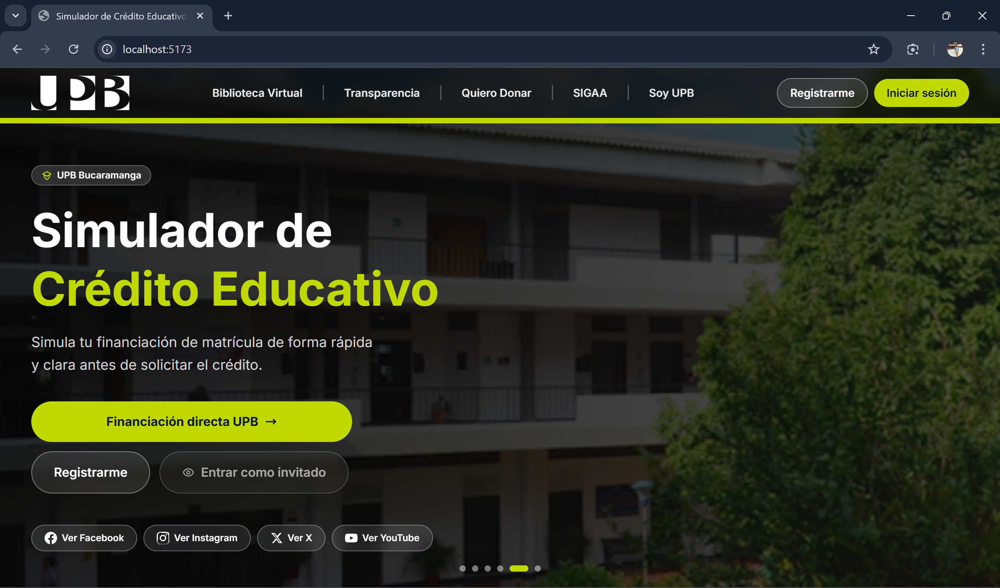

---

#### ENV-02

| Campo | Detalle |
|---|---|
| ID | `ENV-02` |
| Objetivo | Confirmar que Swagger del backend local esta disponible y accesible desde navegador |
| Herramienta usada | `Navegador` |
| Accion ejecutada | Se abrio `http://localhost:3000/api/docs` para validar la disponibilidad de Swagger UI del backend |
| Resultado esperado | Swagger UI carga correctamente y muestra la documentacion inicial del API sin errores visibles |
| Resultado obtenido | Cargo correctamente Swagger UI del backend local en `/api/docs`, mostrando encabezado y secciones iniciales del API sin errores visibles ni pantalla en blanco |
| Estado | `PASS` |
| Evidencia asociada | `environment/ENV-02_swagger_api_docs.png` |
| Observaciones | Se visualizaron correctamente las secciones Health, Auth, Simulator y Admin; no se ejecutaron endpoints en esta etapa |

Evidencia visual:

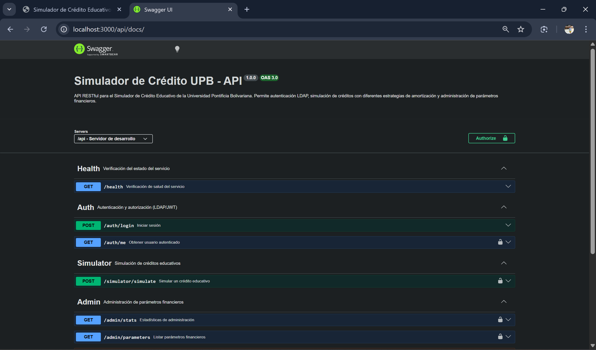

---

#### ENV-03

| Campo | Detalle |
|---|---|
| ID | `ENV-03` |
| Objetivo | Confirmar que el endpoint de health del backend responde correctamente |
| Herramienta usada | `Navegador` |
| Accion ejecutada | Se abrio `http://localhost:3000/api/health` para validar la respuesta basica del backend |
| Resultado esperado | El endpoint responde correctamente con un JSON que incluye al menos `status` y `timestamp` |
| Resultado obtenido | Respondio correctamente mostrando un JSON visible en navegador con `status: ok` y `timestamp`, sin errores visibles de conexion ni error 500 |
| Estado | `PASS` |
| Evidencia asociada | `environment/ENV-03_health_api.png` |
| Observaciones | El subpaso se valido desde navegador; en esta etapa no fue necesario usar Postman |

Evidencia visual:

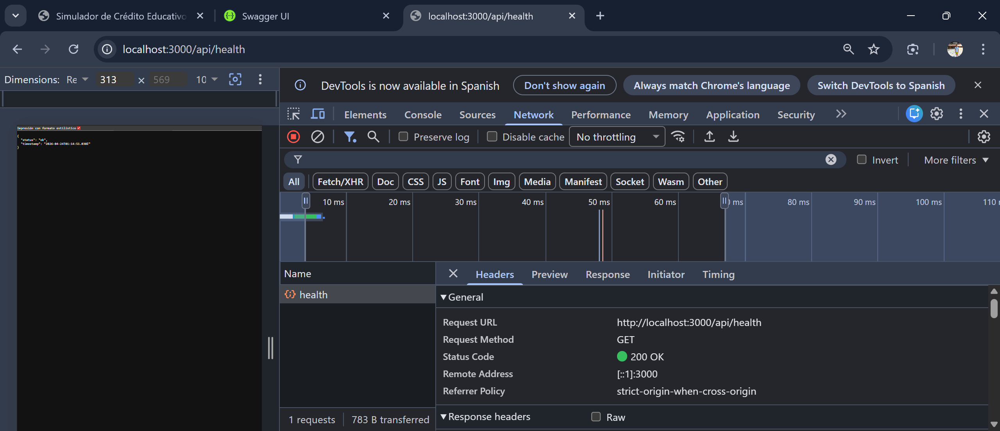

---

#### ENV-04

| Campo | Detalle |
|---|---|
| ID | `ENV-04` |
| Objetivo | Confirmar que el backend responde sobre un endpoint con datos reales de negocio y que existen parametros activos utilizables para HU-57 |
| Herramienta usada | `Postman` |
| Accion ejecutada | Se ejecuto una solicitud `GET` a `http://localhost:3000/api/parameters/active` desde Postman, sin autenticacion y con header `Accept: application/json` |
| Resultado esperado | El endpoint responde `200` con un JSON que contiene parametros activos reales y utilizables para los flujos de simulacion |
| Resultado obtenido | Respondio `200 OK` con `success: true` y una estructura JSON coherente de parametros activos, incluyendo version activa, `paymentPeriodDays`, `initialPaymentRules` y `levelConfigs` para PREGRADO, POSGRADO y UPB_Tech |
| Estado | `PASS` |
| Evidencia asociada | `environment/ENV-04_parameters_active_postman.png` |
| Observaciones | La respuesta confirma que el sistema cuenta con base de configuracion real para simulacion; no fue necesario usar autenticacion en este subpaso |

Evidencia visual:

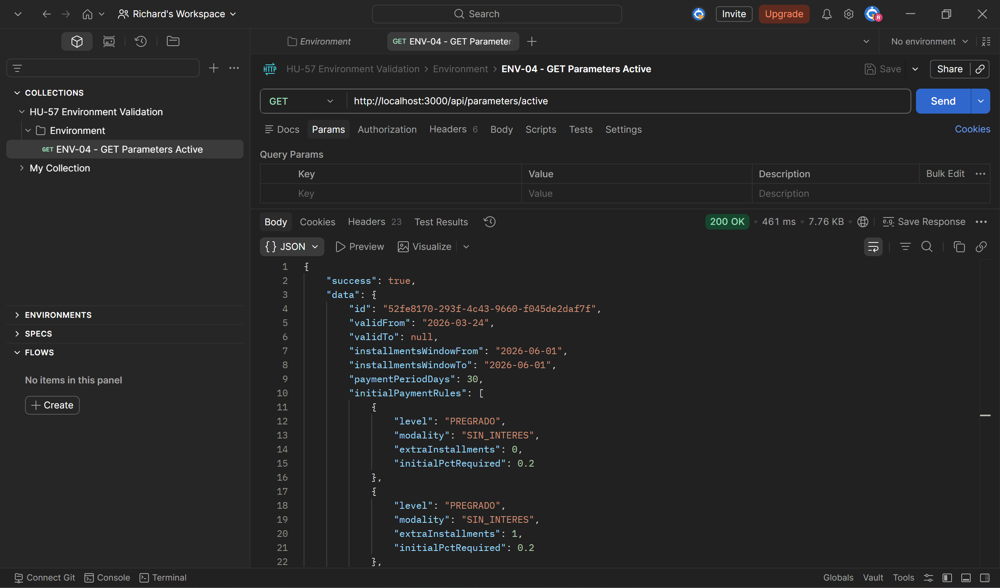

---

#### ENV-05

| Campo | Detalle |
|---|---|
| ID | `ENV-05` |
| Objetivo | Confirmar que la conexion a BD es util para HU-57 y que existen los datos base minimos para continuar |
| Herramienta usada | `Terminal / logs` y `BD` |
| Accion ejecutada | Se revisaron los logs del backend para confirmar conexion util a MySQL y luego se ejecutaron consultas de solo lectura sobre `parameter_versions`, `users`, `level_configs` y `level_rate_rules` |
| Resultado esperado | La conexion a BD es util, las consultas responden correctamente y se puede determinar el estado real de admin fallback, estudiante de prueba, parametros activos y configuraciones de interes |
| Resultado obtenido | Se confirmo conexion util a MySQL desde logs, presencia de `parameter_versions = 2`, existencia de `admin@upb.edu.co` activo con rol `ADMIN`, existencia de `level_configs = 6` y `level_rate_rules = 36`; el estudiante esperado `juantest@upb.edu.co` no existe, pero si existe un estudiante activo alternativo `richardcarvajalb@gmail.com` con rol `STUDENT` |
| Estado | `PASS` |
| Evidencia asociada | `environment/ENV-05_backend_db_connection_log_01.png`, `environment/ENV-05_backend_db_connection_log_02.png`, `environment/ENV-05_db_base_data_check_01.png`, `environment/ENV-05_db_base_data_check_02.png`, `environment/ENV-05_db_base_data_check_03.png` |
| Observaciones | Se documenta como restriccion que `juantest@upb.edu.co` no esta sembrado en BD; antes de los casos que dependan de ese usuario debe definirse si se crea ese estudiante o si se usara el estudiante existente `richardcarvajalb@gmail.com` |

Evidencia visual:

Logs de backend:

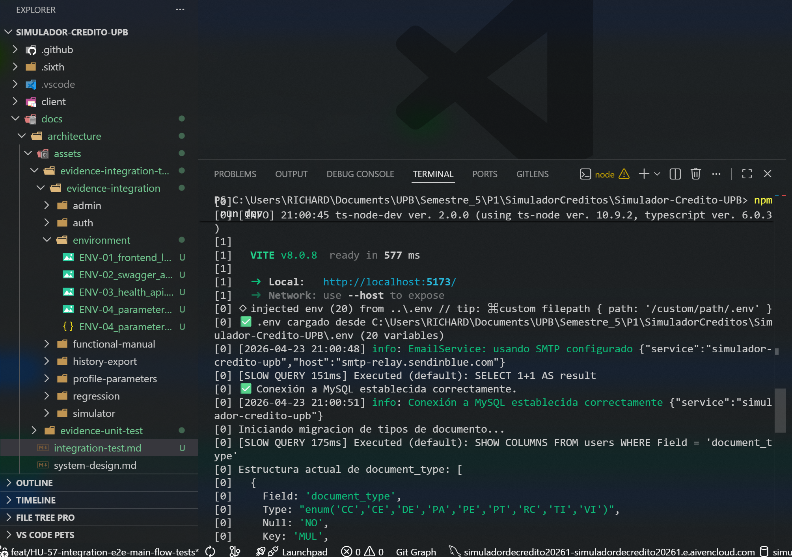

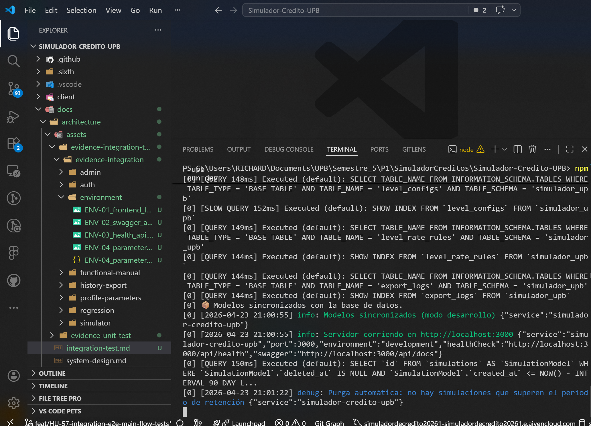

Validacion en BD:

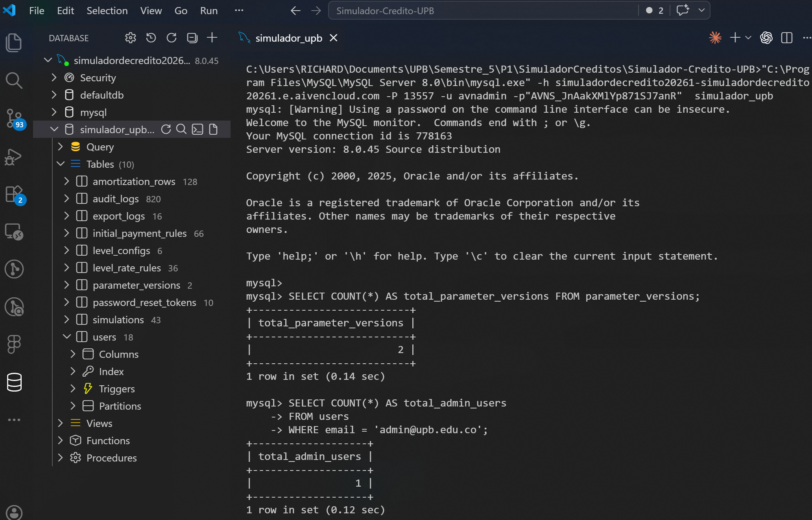

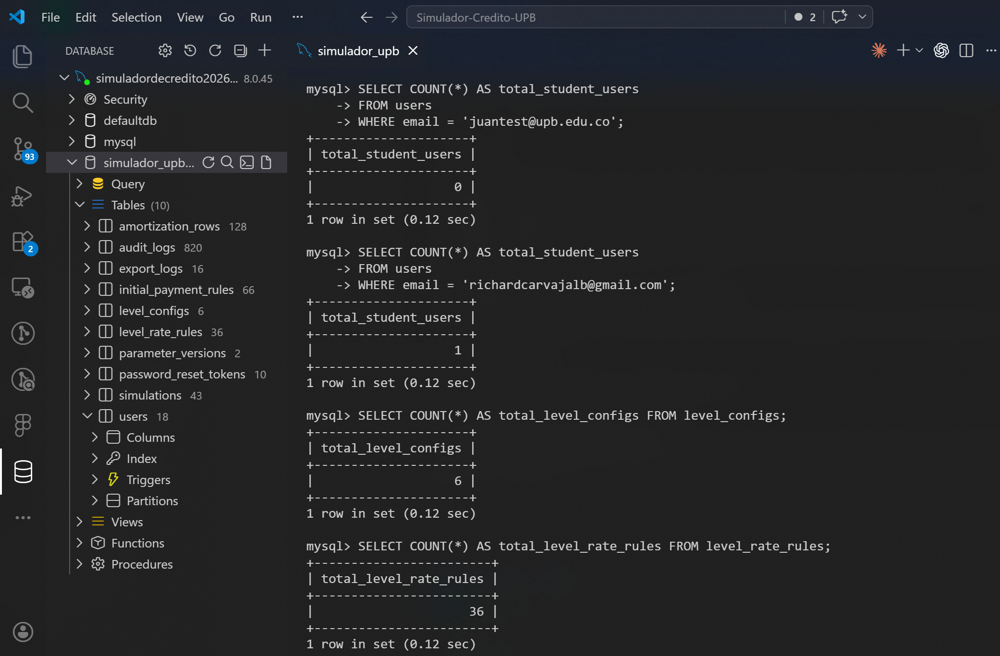

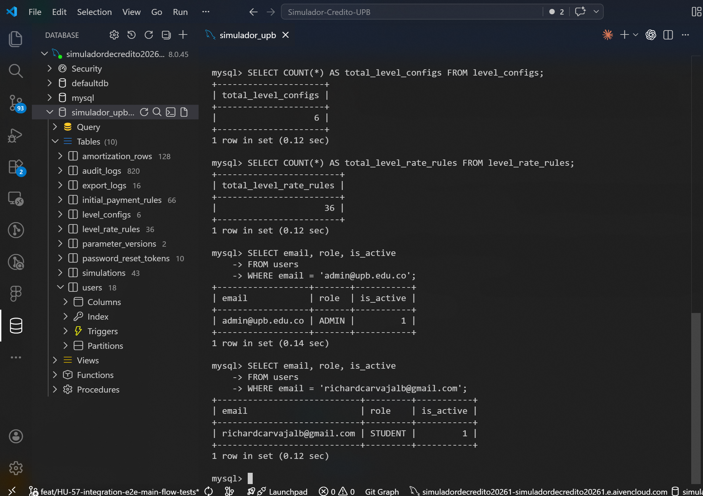

---

#### ENV-06

| Campo | Detalle |
|---|---|
| ID | `ENV-06` |
| Objetivo | Consolidar las dependencias y restricciones operativas pendientes antes de iniciar HU-56 y HU-57 |
| Herramienta usada | `Terminal / logs`, `BD` y revision manual de datos |
| Accion ejecutada | Se consolido la informacion validada en ambiente para confirmar admin fallback activo, disponibilidad de configuracion tecnica para casos con interes, ausencia del usuario esperado `juantest@upb.edu.co` y decision operativa temporal sobre el estudiante autenticado a utilizar |
| Resultado esperado | El ambiente queda declarado como utilizable, con restricciones explicitamente documentadas antes de iniciar la ejecucion de casos |
| Resultado obtenido | El ambiente quedo utilizable; se confirmo admin fallback activo, existencia de configuracion tecnica para casos con interes y ausencia del usuario esperado `juantest@upb.edu.co`; se definio usar temporalmente `richardcarvajalb@gmail.com` como estudiante alternativo activo; SMTP permanece pendiente de validacion funcional |
| Estado | `PASS CON OBSERVACION` |
| Evidencia asociada | `Soportado por ENV-05` |
| Observaciones | Decision operativa temporal: usar `richardcarvajalb@gmail.com` para los casos de estudiante autenticado mientras `juantest@upb.edu.co` no exista; SMTP continua como dependencia no verificada en esta etapa |

Nota operativa:

Decisión operativa temporal: para los casos que requieran estudiante autenticado se usará provisionalmente `richardcarvajalb@gmail.com`, ya que el usuario esperado `juantest@upb.edu.co` no existe actualmente en la base de datos. Esta sustitución no bloquea el ambiente, pero debe mantenerse documentada para no confundir la trazabilidad de los casos de auth e integración. SMTP sigue pendiente de validación funcional y se conserva como dependencia no verificada en esta etapa.

---

## 4. Datos Previos / Precondiciones

### 4.1 Base comun para HU-57

| Item | Detalle base |
|---|---|
| Ambiente objetivo | Ambiente local estable y accesible para frontend, backend y BD |
| Parametros activos | Version activa de parametros disponible para consultas publicas y simulaciones |
| Usuario estudiante | Usuario de prueba disponible para login, simulacion, historial, export y perfil |
| Usuario admin | Admin seed disponible; considerar fallback local para login administrativo |
| Datos para historial | Simulaciones previas guardadas para validar listado, detalle y export |
| Flujos de recuperacion | Soporte por correo, identificacion, token y evidencia complementaria en log/BD si aplica |
| Casos con interes | LevelConfigs y LevelRateRules activos cuando el caso lo requiera |
| Soporte de evidencias | Carpeta `docs/architecture/assets/evidence-integration-test/evidence-integration/` preparada por bloques |

### 4.2 Datos registrados para la ejecucion

| Campo | Detalle |
|---|---|
| Credenciales y roles usados | Admin local `admin@upb.edu.co` con rol `ADMIN`; estudiantes reales observados en ambiente `richardcarvajalb@gmail.com` (`David Ricardo Carvajal Barragan`) y `vanecasti@gmail.com` (`Maria Alejandra Hernandez Castillo`); adicionalmente se usaron actores `Anonimo` e `Invitado` en flujos publicos |
| Payloads base / IDs / filtros | Caso nominal recurrente de simulacion: `Pregrado`, `Estudiante Continuo`, matricula `6.700.000`, beca `20%`, cuota inicial `25%`, modalidad `Con intereses (1% M.V.)`, periodo `2026-02`, primera cuota `Junio 2026`, `6` cuotas; filtros usados en UI y admin: `Nombre Completo = David`, `Periodo Académico = 2026-02` |
| IDs de simulacion a reutilizar | Simulacion reutilizada en regresion y detalle/export: `5a86bb55-7650-403e-805b-9e77b83cbfa1`; version activa de parametros utilizada en integracion/admin: `52fe8170-293f-4c43-9660-f045de2daf7f` |
| Tokens o sesiones de referencia | JWT de estudiante y admin observados en `localStorage[token]` durante `F-03`, `R-01` y `R-06`; por seguridad no se replica el token completo en markdown |
| VersionId / configId / paymentCount aplicables | Version activa `52fe8170-293f-4c43-9660-f045de2daf7f`; pagos observados entre `1` y `6`; helper visible de maximo `4` cuotas para escenario con interes; maximos visibles por nivel documentados en `I-16`, `F-11` y `R-07` |
| Archivos de apoyo esperados | JSON de respuestas Postman/admin, capturas UI por bloque, archivos `PDF` y `CSV` exportados (`F-08`, `F-10`, `F-12`, `R-05`), y soportes de logs/BD en `environment/` |

---

### 4.3 Gate HU-56 ejecutado

#### U-01

| Campo | Detalle |
|---|---|
| ID | `U-01` |
| Objetivo | Validar la regla base del motor financiero para modalidad sin interes, confirmando que la cuota lineal se calcula correctamente como financiado dividido entre `(n-1)` |
| Herramienta usada | `Terminal` |
| Accion ejecutada | Se ejecuto la prueba puntual de `SimulationEngine.test.ts` en modo serial para validar el caso nominal sin interes |
| Resultado esperado | La prueba pasa correctamente y evidencia que la cuota lineal se calcula como financiado / `(n-1)`, con schedule coherente e intereses en cero |
| Resultado obtenido | La prueba paso correctamente; se observo el bloque `Sin interes (cuota lineal)` con validaciones exitosas sobre generacion de filas, cuota lineal, interes cero, balance final en cero y consistencia del total pagado |
| Estado | `PASS` |
| Evidencia asociada | `assets/evidence-unit-test/U-01_simulation_engine_sin_interes_01.png`, `assets/evidence-unit-test/U-01_simulation_engine_sin_interes_02.png`, `assets/evidence-unit-test/U-01_simulation_engine_sin_interes_output.txt` |
| Observaciones | La salida tambien mostro otras pruebas del mismo archivo, pero para este caso se toma como evidencia principal el bloque de modalidad sin interes y el resumen final `1 passed / 25 passed` |

Evidencia visual:

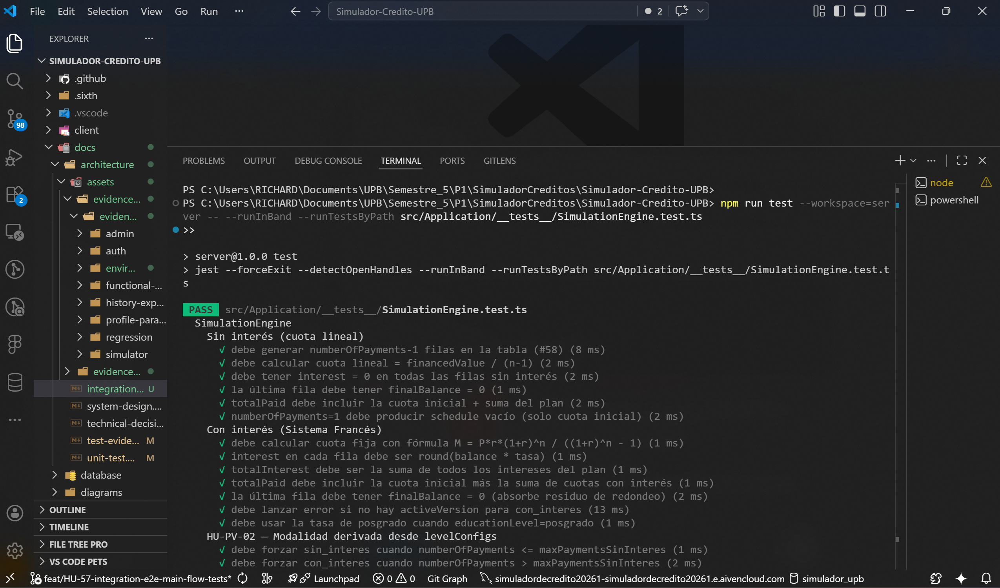

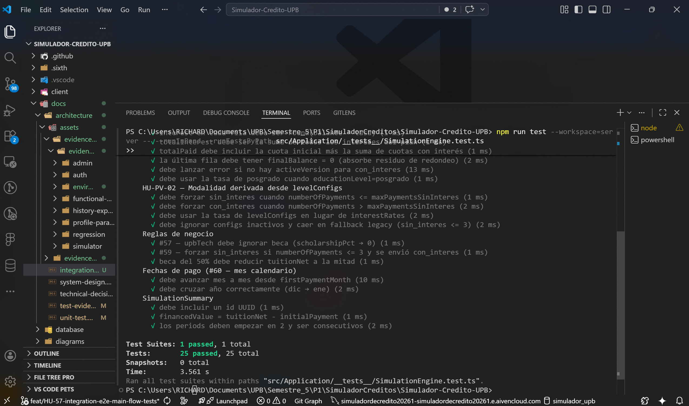

---

#### U-02

| Campo | Detalle |
|---|---|
| ID | `U-02` |
| Objetivo | Validar que el motor financiero calcule correctamente una amortizacion francesa con interes, aplicando PMT coherente y manteniendo consistencia en capital, interes y saldo final |
| Herramienta usada | `Terminal` |
| Accion ejecutada | Se ejecuto la prueba puntual de `SimulationEngine.test.ts` en modo serial para validar el bloque con interes y amortizacion francesa |
| Resultado esperado | La prueba pasa correctamente y evidencia calculo PMT coherente, intereses mayores a cero, amortizacion consistente y saldo final en cero |
| Resultado obtenido | La prueba paso correctamente; se observo el bloque `Con interes (Sistema Frances)` con validaciones exitosas sobre cuota fija por formula PMT, calculo de intereses por fila, totalInterest, totalPaid, saldo final en cero y uso correcto de tasa por nivel |
| Estado | `PASS` |
| Evidencia asociada | `assets/evidence-unit-test/U-02_simulation_engine_pmt_01.png`, `assets/evidence-unit-test/U-02_simulation_engine_pmt_02.png`, `assets/evidence-unit-test/U-02_simulation_engine_pmt_output.txt` |
| Observaciones | La salida tambien mostro otros bloques del mismo archivo, pero para este caso se toma como evidencia principal el bloque de amortizacion francesa con interes y el resumen final `1 passed / 25 passed` |

Evidencia visual:

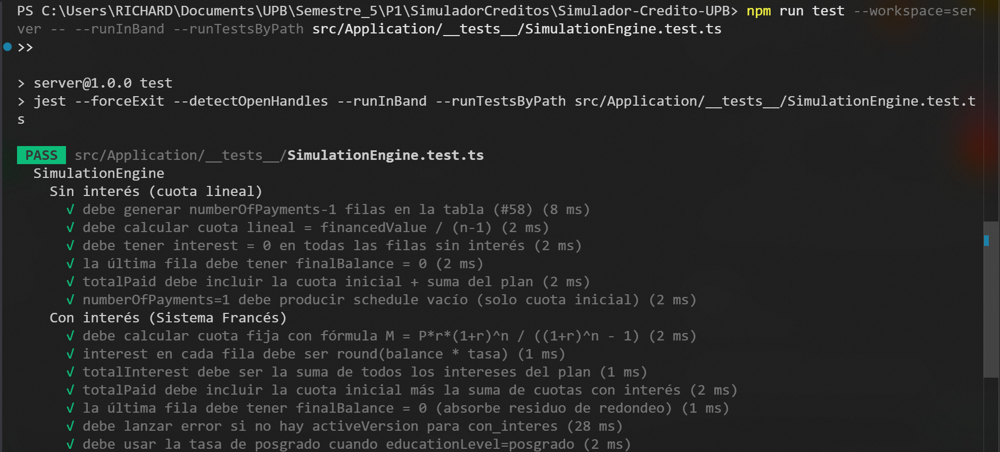

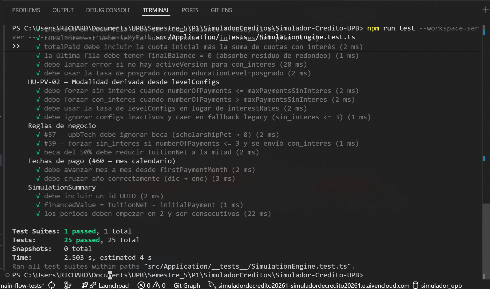

---

#### U-03

| Campo | Detalle |
|---|---|
| ID | `U-03` |
| Objetivo | Validar que la regla institucional de UPB Tech ignore la beca en el calculo base de la simulacion, manteniendo consistencia del valor financiado y del resumen final |
| Herramienta usada | `Terminal` |
| Accion ejecutada | Se ejecuto la prueba puntual de `SimulationEngine.test.ts` en modo serial para validar el bloque asociado a la regla UPB Tech |
| Resultado esperado | La prueba pasa correctamente y evidencia que UPB Tech ignora la beca, manteniendo coherencia en el valor financiado y el resumen final |
| Resultado obtenido | La prueba paso correctamente; se observo dentro del bloque `Reglas de negocio` la validacion `#57 - upbTech debe ignorar beca (scholarshipPct -> 0)`, junto con el resumen final exitoso de la suite |
| Estado | `PASS` |
| Evidencia asociada | `assets/evidence-unit-test/U-03_simulation_engine_upbtech_01.png`, `assets/evidence-unit-test/U-03_simulation_engine_upbtech_02.png`, `assets/evidence-unit-test/U-03_simulation_engine_upbtech_output.txt` |
| Observaciones | La salida tambien mostro otros bloques del mismo archivo, pero para este caso se toma como evidencia principal la regla de negocio de UPB Tech y el resumen final `1 passed / 25 passed` |

Evidencia visual:

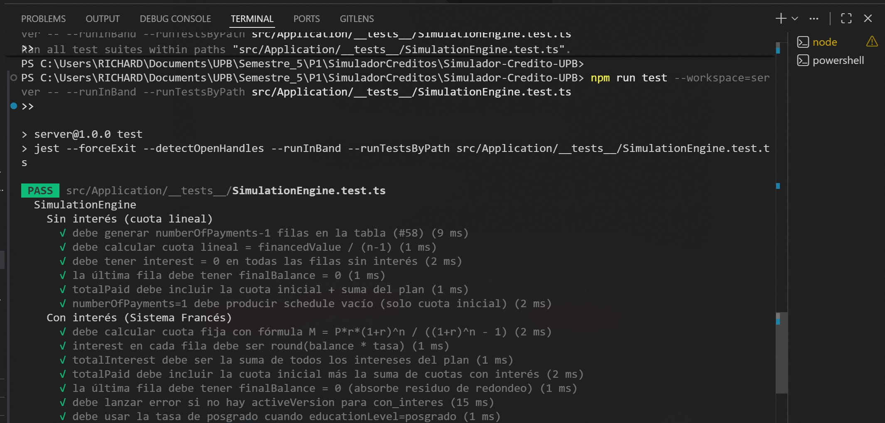

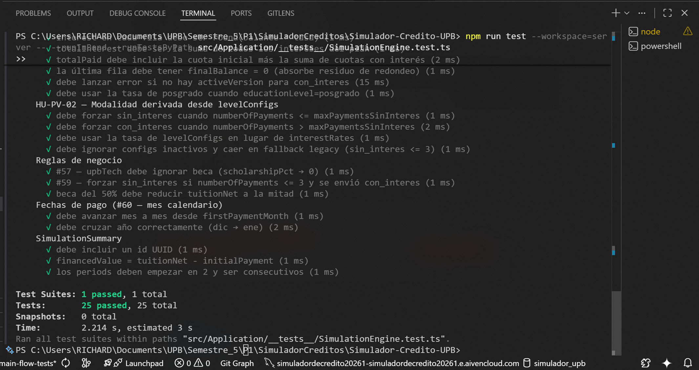

---

#### U-04

| Campo | Detalle |
|---|---|
| ID | `U-04` |
| Objetivo | Validar que SimulationService aplique correctamente la regla de cuota inicial minima para pregrado y rechace entradas por debajo del umbral permitido |
| Herramienta usada | `Terminal` |
| Accion ejecutada | Se ejecuto la prueba puntual de `SimulationService.test.ts` en modo serial para validar la regla de cuota inicial minima en pregrado |
| Resultado esperado | La prueba pasa correctamente y evidencia que el servicio rechaza entradas de pregrado con cuota inicial inferior al minimo permitido |
| Resultado obtenido | La prueba paso correctamente; se observo en el bloque `SimulationService` la validacion `rechaza pregrado cuando la cuota inicial es menor al 20%`, junto con otras validaciones relacionadas del servicio y el resumen final exitoso de la suite |
| Estado | `PASS` |
| Evidencia asociada | `assets/evidence-unit-test/U-04_simulation_service_min_initial_pregrado_01.png`, `assets/evidence-unit-test/U-04_simulation_service_min_initial_pregrado_output.txt` |
| Observaciones | La salida mostro mas validaciones del mismo archivo de servicio, pero para este caso se toma como evidencia principal la regla de rechazo de pregrado por cuota inicial menor al 20% y el resumen final `1 passed / 6 passed` |

Evidencia visual:

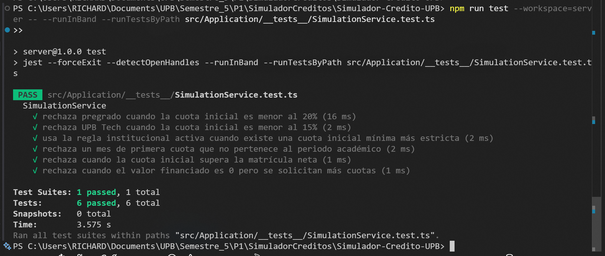

---

#### U-05

| Campo | Detalle |
|---|---|
| ID | `U-05` |
| Objetivo | Validar que SimulationService aplique correctamente la regla de cuota inicial minima para UPB Tech y rechace entradas por debajo del 15% o del minimo institucional activo si es mas estricto |
| Herramienta usada | `Terminal` |
| Accion ejecutada | Se ejecuto la prueba puntual de `SimulationService.test.ts` en modo serial para validar la regla de cuota inicial minima en UPB Tech |
| Resultado esperado | La prueba pasa correctamente y evidencia que el servicio rechaza entradas UPB Tech con cuota inicial inferior al minimo permitido |
| Resultado obtenido | La prueba paso correctamente; se observo en el bloque `SimulationService` la validacion `rechaza UPB Tech cuando la cuota inicial es menor al 15%`, junto con el resumen final exitoso de la suite |
| Estado | `PASS` |
| Evidencia asociada | `assets/evidence-unit-test/U-05_simulation_service_min_initial_upbtech_01.png`, `assets/evidence-unit-test/U-05_simulation_service_min_initial_upbtech_output.txt` |
| Observaciones | Ademas de la validacion principal de UPB Tech, la salida mostro como contexto la regla institucional activa cuando existe una cuota minima mas estricta; para este caso se toma como evidencia principal el rechazo de UPB Tech por cuota inicial menor al 15% y el resumen final `1 passed / 6 passed` |

Evidencia visual:

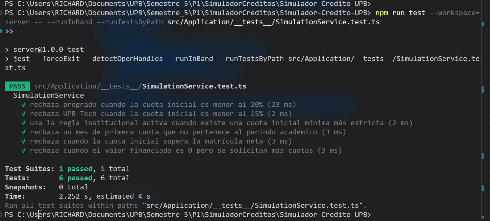

---

#### U-06

| Campo | Detalle |
|---|---|
| ID | `U-06` |
| Objetivo | Validar que SimulationEngine fuerce correctamente la modalidad sin interes cuando el numero de cuotas sea menor o igual a 3, aun si el caso de entrada intenta usar interes |
| Herramienta usada | `Terminal` |
| Accion ejecutada | Se ejecuto la prueba puntual de `SimulationEngine.test.ts` en modo serial para validar la regla de forzar sin_interes en cuotas cortas |
| Resultado esperado | La prueba pasa correctamente y evidencia que el motor desactiva el interes cuando numberOfPayments <= 3, aun si la entrada intenta usar interes |
| Resultado obtenido | La prueba paso correctamente; se observo en el bloque `HU-PV-02 - Modalidad derivada desde levelConfigs` la validacion `debe forzar sin_interes cuando numberOfPayments <= maxPaymentsSinInteres`, junto con el resumen final exitoso de la suite |
| Estado | `PASS` |
| Evidencia asociada | `assets/evidence-unit-test/U-06_simulation_engine_force_no_interest_01.png`, `assets/evidence-unit-test/U-06_simulation_engine_force_no_interest_output.txt` |
| Observaciones | Ademas de la validacion principal, la salida mostro la regla complementaria para con_interes cuando el numero de cuotas supera el maximo sin interes; para este caso la evidencia principal es el forzado de sin_interes en cuotas cortas y el resumen final `1 passed / 25 passed` |

Evidencia visual:

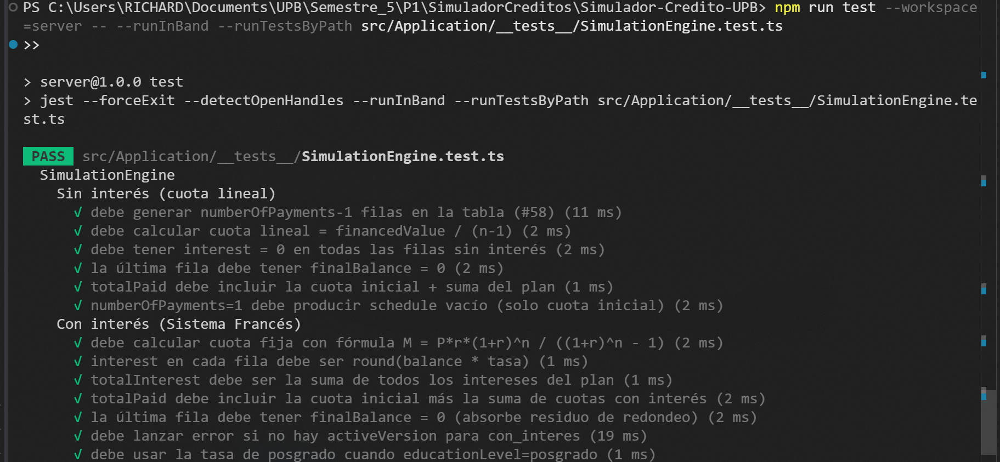

---

#### U-07

| Campo | Detalle |
|---|---|
| ID | `U-07` |
| Objetivo | Validar que SimulationEngine deje el saldo final exactamente en cero al cierre del plan, absorbiendo correctamente cualquier residuo de redondeo en la ultima fila |
| Herramienta usada | `Terminal` |
| Accion ejecutada | Se ejecuto la prueba puntual de `SimulationEngine.test.ts` en modo serial para validar la correccion del saldo final en la ultima fila del plan |
| Resultado esperado | La prueba pasa correctamente y evidencia que la ultima fila del schedule deja finalBalance = 0, absorbiendo el residuo de redondeo si aplica |
| Resultado obtenido | La prueba paso correctamente; en la salida de `SimulationEngine.test.ts` se observaron explicitamente las validaciones `la ultima fila debe tener finalBalance = 0` y `la ultima fila debe tener finalBalance = 0 (absorbe residuo de redondeo)`, junto con el resumen final exitoso de la suite |
| Estado | `PASS` |
| Evidencia asociada | `assets/evidence-unit-test/U-07_simulation_engine_final_balance_zero_01.png`, `assets/evidence-unit-test/U-07_simulation_engine_final_balance_zero_02.png`, `assets/evidence-unit-test/U-07_simulation_engine_final_balance_zero_output.txt` |
| Observaciones | La evidencia muestra el cierre exacto del saldo tanto en el contexto general del plan como en el caso donde se absorbe residuo de redondeo en la ultima fila; el resultado final de la suite fue `1 passed / 25 passed` |

Evidencia visual:

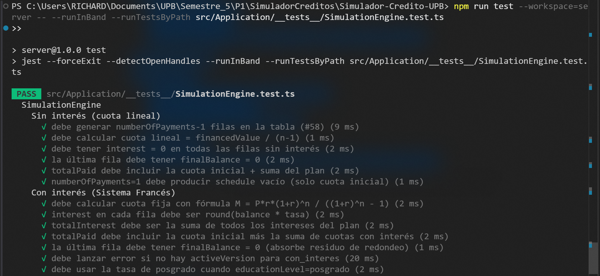

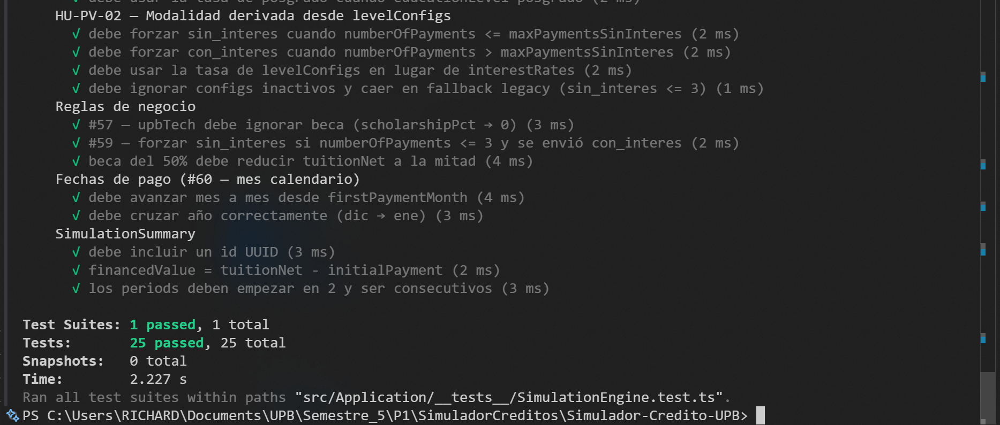

---

#### U-08

| Campo | Detalle |
|---|---|
| ID | `U-08` |
| Objetivo | Validar que `SimulationEngine` mantenga consistencia entre los totales calculados del plan, incluyendo capital, intereses y total pagado en el `SimulationSummary` |
| Herramienta usada | `Terminal` |
| Accion ejecutada | Se ejecuto la prueba puntual de `SimulationEngine.test.ts` en modo serial para validar la coherencia de capital, intereses y total pagado en el resumen |
| Resultado esperado | La prueba pasa correctamente y evidencia que `totalPaid`, `totalInterest` y los agregados del plan coinciden con el detalle del schedule |
| Resultado obtenido | La prueba paso correctamente; en la salida de `SimulationEngine.test.ts` se observaron explicitamente las validaciones `totalInterest debe ser la suma de todos los intereses del plan` y `totalPaid debe incluir la cuota inicial mas la suma de cuotas con interes`, ademas del bloque `SimulationSummary`, con resumen final exitoso de la suite |
| Estado | `PASS` |
| Evidencia asociada | `assets/evidence-unit-test/U-08_simulation_engine_totals_consistency_01.png`, `assets/evidence-unit-test/U-08_simulation_engine_totals_consistency_02.png`, `assets/evidence-unit-test/U-08_simulation_engine_totals_consistency_output.txt` |
| Observaciones | La evidencia muestra consistencia entre los totales agregados del plan y el resumen calculado; se observan validaciones de intereses totales, total pagado y bloque `SimulationSummary`; el resultado final fue `1 passed / 25 passed` |

Evidencia visual:

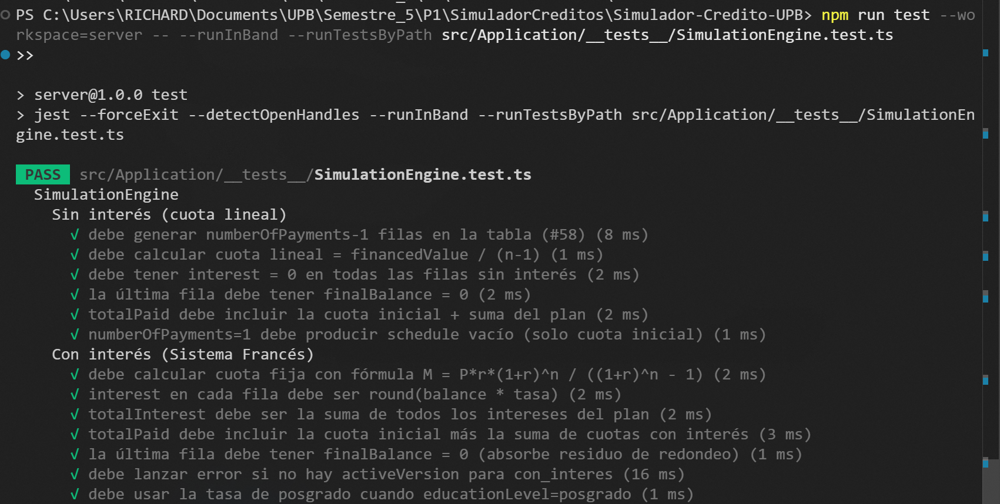

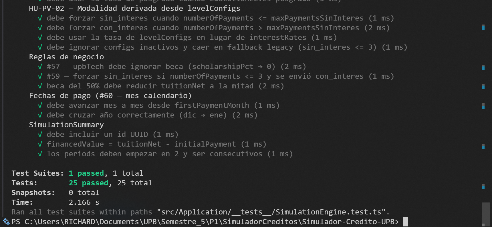

---

#### U-09

| Campo | Detalle |
|---|---|
| ID | `U-09` |
| Objetivo | Validar que SimulationEngine y ParameterVersion manejen correctamente fechas y periodo academico validos, especialmente la construccion de periods y el mes inicial permitido |
| Herramienta usada | `Terminal` |
| Accion ejecutada | Se ejecuto la prueba puntual de `SimulationEngine.test.ts` en modo serial para validar reglas de fechas de pago, mes calendario y construccion de periods |
| Resultado esperado | La prueba pasa correctamente y evidencia que los periods son coherentes, el mes inicial es valido y la configuracion temporal del plan respeta el periodo academico |
| Resultado obtenido | La prueba paso correctamente; en la salida de `SimulationEngine.test.ts` se observaron explicitamente las validaciones `debe avanzar mes a mes desde firstPaymentMonth`, `debe cruzar ano correctamente (dic -> ene)` y dentro de `SimulationSummary` la validacion `los periods deben empezar en 2 y ser consecutivos`; el resumen final de la suite fue exitoso |
| Estado | `PASS` |
| Evidencia asociada | `assets/evidence-unit-test/U-09_simulation_engine_periods_dates_01.png`, `assets/evidence-unit-test/U-09_simulation_engine_periods_dates_02.png`, `assets/evidence-unit-test/U-09_simulation_engine_periods_dates_output.txt` |
| Observaciones | La evidencia muestra validacion correcta del comportamiento temporal del motor; se observaron reglas de avance mes a mes, cruce de ano y construccion consecutiva de periods; resultado final `1 passed / 25 passed` |

Evidencia visual:

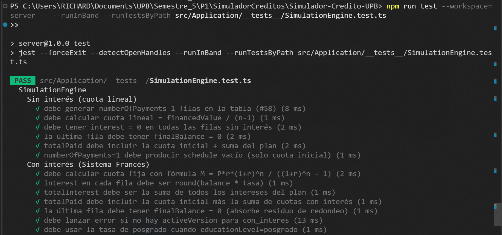

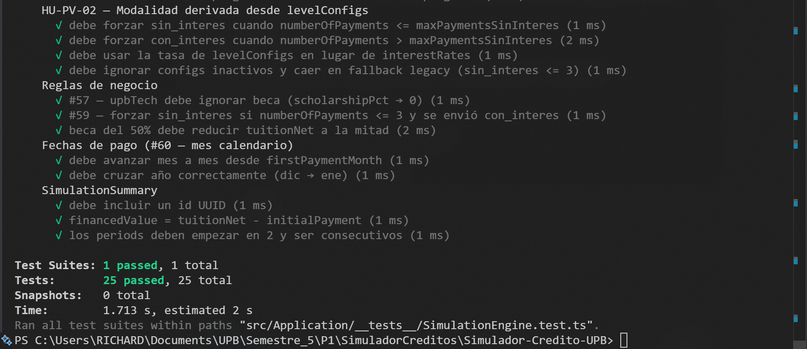

---

#### U-10

| Campo | Detalle |
|---|---|
| ID | `U-10` |
| Objetivo | Validar los bordes de calculo de FrenchAmortizationStrategy, especialmente escenarios limite de capital, tasa y numero de cuotas |
| Herramienta usada | `Terminal` |
| Accion ejecutada | Se ejecuto la prueba puntual de `FrenchAmortizationStrategy.test.ts` en modo serial para validar escenarios limite de capital, tasa y numero de cuotas |
| Resultado esperado | La prueba pasa correctamente y evidencia manejo controlado de casos borde en la estrategia francesa |
| Resultado obtenido | La prueba paso correctamente; en la salida de `FrenchAmortizationStrategy.test.ts` se observaron explicitamente validaciones de borde sobre principal 0, numero de cuotas 0, tasa 0, tasa practicamente 0, ausencia de tasa para el numero de cuotas solicitado y error controlado cuando no existe una version activa para resolver la tasa; el resumen final de la suite fue exitoso |
| Estado | `PASS` |
| Evidencia asociada | `assets/evidence-unit-test/U-10_french_amortization_strategy_edges_01.png`, `assets/evidence-unit-test/U-10_french_amortization_strategy_edges_output.txt` |
| Observaciones | La evidencia muestra que la estrategia francesa maneja correctamente escenarios limite sin producir resultados incoherentes; se observa retorno controlado en casos 0 y error esperado cuando falta version activa; resultado final `1 passed / 6 passed` |

Evidencia visual:

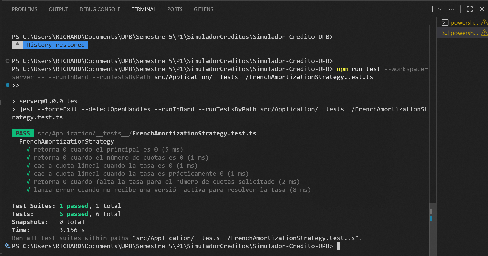

---

#### U-11

| Campo | Detalle |
|---|---|
| ID | `U-11` |
| Objetivo | Validar los bordes de calculo de NoInterestStrategy, incluyendo distribucion lineal P/n y escenarios limite |
| Herramienta usada | `Terminal` |
| Accion ejecutada | Se ejecuto la prueba puntual de `NoInterestStrategy.test.ts` en modo serial para validar la distribucion lineal y casos borde de principal y numero de cuotas |
| Resultado esperado | La prueba pasa correctamente y evidencia manejo estable de la estrategia sin interes en escenarios nominales y limite |
| Resultado obtenido | La prueba paso correctamente; en la salida de `NoInterestStrategy.test.ts` se observaron explicitamente validaciones sobre el calculo lineal P / n, retorno en 0 cuando el principal es 0 y retorno en 0 cuando el numero de cuotas es 0; el resumen final de la suite fue exitoso |
| Estado | `PASS` |
| Evidencia asociada | `assets/evidence-unit-test/U-11_no_interest_strategy_edges_01.png`, `assets/evidence-unit-test/U-11_no_interest_strategy_edges_output.txt` |
| Observaciones | La evidencia muestra que la estrategia sin interes maneja correctamente el reparto lineal y los escenarios limite sin producir resultados incoherentes; resultado final `1 passed / 3 passed` |

Evidencia visual:

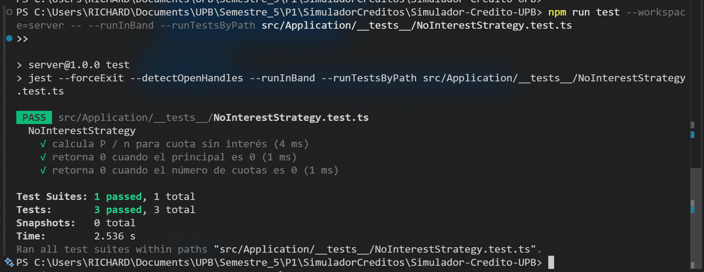

---

#### U-12

| Campo | Detalle |
|---|---|
| ID | `U-12` |
| Objetivo | Validar los esquemas criticos de entrada con Zod, especialmente SimulationInputSchema y RegisterUserSchema |
| Herramienta usada | `Terminal` |
| Accion ejecutada | Se ejecuto inicialmente una ruta incorrecta de test (`schemas.test.ts`), la cual produjo error `ENOENT`; posteriormente se corrigio la ruta y se ejecuto en modo serial `ValidationSchemas.test.ts` para validar rechazo controlado de payloads invalidos de simulacion y registro |
| Resultado esperado | La prueba pasa correctamente y evidencia que los schemas rechazan entradas invalidas de forma controlada |
| Resultado obtenido | Hubo un intento previo invalido por ruta incorrecta del archivo de test, sin ejecucion real de pruebas funcionales; luego se ejecuto correctamente `ValidationSchemas.test.ts` y la suite paso en estado `PASS`, evidenciando rechazo controlado de payload invalido de simulacion para pregrado con cuota inicial menor al 20% y rechazo de registro con formato de documento invalido para el tipo seleccionado |
| Estado | `PASS` |
| Evidencia asociada | `assets/evidence-unit-test/U-12_wrong_path_error_01.png`, `assets/evidence-unit-test/U-12_wrong_path_error_output.txt`, `assets/evidence-unit-test/U-12_zod_critical_schemas_01.png`, `assets/evidence-unit-test/U-12_zod_critical_schemas_output.txt` |
| Observaciones | Se deja constancia de que el primer intento fallo por usar una ruta inexistente (`src/Application/__tests__/schemas.test.ts`), generando `ENOENT`; este fallo corresponde a error de ejecucion y no a defecto funcional del sistema. La evidencia valida del caso se obtuvo al rerunear contra `src/Application/__tests__/ValidationSchemas.test.ts`, donde el bloque `Validation Schemas` paso correctamente con `4 passed` |

Evidencia visual:

Intento invalido:

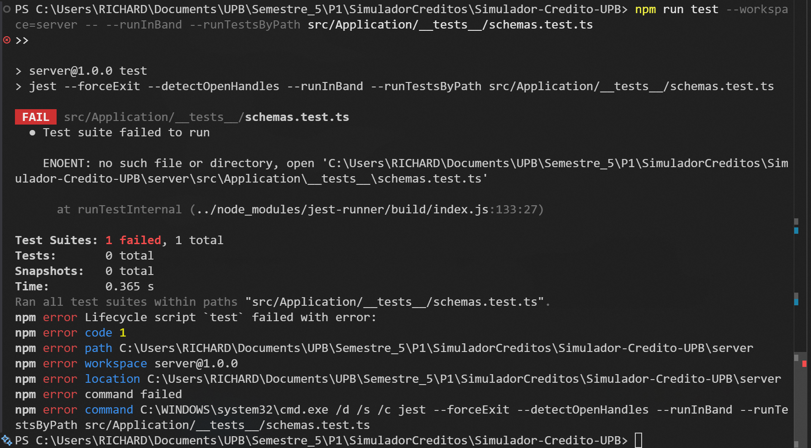

Ejecucion valida:

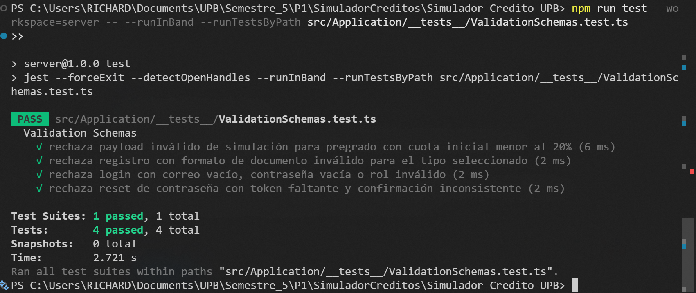

---

#### U-13

| Campo | Detalle |
|---|---|
| ID | `U-13` |
| Objetivo | Validar el esquema LoginUserInputSchema, asegurando rechazo controlado cuando el login trae correo vacio, contrasena vacia o rol invalido |
| Herramienta usada | `Terminal` |
| Accion ejecutada | Se ejecuto la prueba puntual de `ValidationSchemas.test.ts` en modo serial para validar rechazo controlado de login con correo vacio, contrasena vacia o rol invalido |
| Resultado esperado | La prueba pasa correctamente y evidencia que LoginUserInputSchema rechaza entradas invalidas de login de forma controlada |
| Resultado obtenido | La prueba paso correctamente en estado PASS; dentro del bloque `Validation Schemas` se observo la validacion `rechaza login con correo vacio, contrasena vacia o rol invalido`, confirmando rechazo controlado del schema ante entradas invalidas |
| Estado | `PASS` |
| Evidencia asociada | `assets/evidence-unit-test/U-13_login_user_input_schema_invalid_01.png`, `assets/evidence-unit-test/U-13_login_user_input_schema_invalid_output.txt` |
| Observaciones | Se deja constancia de que la evidencia proviene del archivo `src/Application/__tests__/ValidationSchemas.test.ts`, dentro del bloque `Validation Schemas`, y que el resumen final mostro `1 passed` y `4 passed` |

Evidencia visual:

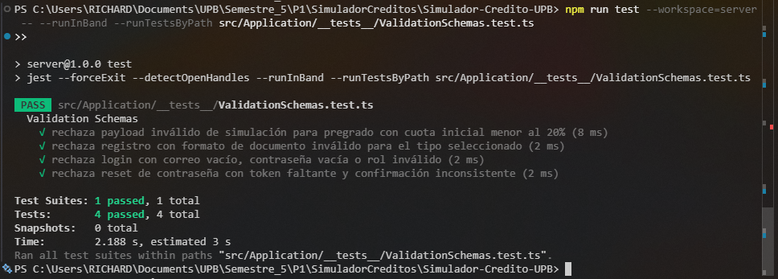

---

#### U-14

| Campo | Detalle |
|---|---|
| ID | `U-14` |
| Objetivo | Validar el esquema ResetPasswordInputSchema, asegurando rechazo controlado cuando el reset trae token faltante y confirmacion inconsistente |
| Herramienta usada | `Terminal` |
| Accion ejecutada | Se ejecuto la prueba puntual de `ValidationSchemas.test.ts` en modo serial para validar rechazo controlado de reset con token faltante y confirmacion inconsistente |
| Resultado esperado | La prueba pasa correctamente y evidencia que ResetPasswordInputSchema rechaza entradas invalidas de reset de forma controlada |
| Resultado obtenido | La prueba paso correctamente en estado PASS; dentro del bloque `Validation Schemas` se observo la validacion `rechaza reset de contrasena con token faltante y confirmacion inconsistente`, confirmando rechazo controlado del schema ante entradas invalidas |
| Estado | `PASS` |
| Evidencia asociada | `assets/evidence-unit-test/U-14_reset_password_input_schema_invalid_01.png`, `assets/evidence-unit-test/U-14_reset_password_input_schema_invalid_output.txt` |
| Observaciones | Se deja constancia de que la evidencia proviene del archivo `src/Application/__tests__/ValidationSchemas.test.ts`, dentro del bloque `Validation Schemas`, y que el resumen final mostro `1 passed` y `4 passed` |

Evidencia visual:

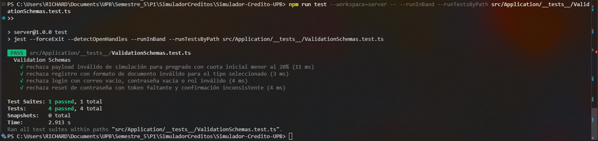

Nota de cierre del Gate HU-56:

El Gate HU-56 quedo completado. El siguiente bloque de trabajo corresponde a HU-57 Integracion API. En esta actualizacion documental no debe ejecutarse todavia ningun caso nuevo.

---

## 5. Casos de Integracion API

### 5.1 Nomenclatura y plantilla de diligenciamiento

| Prefijo | Uso |
|---|---|
| `I-xx` | Caso de integracion API |
| `F-xx` | Caso funcional / manual |
| `R-xx` | Caso de regresion basica |

| Campo | Referencia de diligenciamiento consolidada |
|---|---|
| ID del caso | `I-xx` segun orden oficial del bloque |
| Que valida | Operacion HTTP o flujo API priorizado de HU-57, con comprobacion de `status`, body y trazabilidad |
| Precondiciones | Ambiente activo, endpoint accesible, autenticacion o rol aplicado cuando corresponda y datos base preparados |
| Datos de prueba | Payload, query, filtro, id o token utilizado durante la ejecucion real |
| Pasos | Solicitud ejecutada indicando metodo, ruta y verificacion posterior de respuesta o impacto |
| Resultado esperado | Comportamiento funcional esperado del endpoint y estructura minima de respuesta |
| Resultado obtenido | Resumen honesto de la respuesta observada, incluyendo `status`, campos relevantes e impacto posterior cuando aplique |
| Estado | Resultado final del caso (`PASS`, `FAIL` o `BLOQUEADO`) segun evidencia |
| Evidencia recopilada | Ruta exacta a capturas, JSON, archivos exportados o soportes complementarios del bloque |
| Observaciones | Restricciones reales del ambiente, ids reutilizados, manejo de tokens y notas de trazabilidad posteriores |

### 5.2 Bloque `auth`

Carpeta de soporte: `docs/architecture/assets/evidence-integration-test/evidence-integration/auth/`

| ID | Caso | Endpoint(s) reales | Actor | Evidencia esperada | Prioridad | Orden |
|---|---|---|---|---|---|---|
| `I-01` | Registro valido | `POST /api/auth/register` | Visitante | Body + captura/verificacion posterior | Alta | 1 |
| `I-02` | Login estudiante OK | `POST /api/auth/login` | Estudiante | Body + token decodificado | Alta | 2 |
| `I-03` | Login admin fallback | `POST /api/auth/login` | Admin | Body + nota de fallback | Alta | 3 |
| `I-03A` | Sesion actual | `GET /api/auth/me` | Estudiante / Admin | Body + token + validacion de rol | Alta | 3A |
| `I-03B` | Cierre de sesion | `POST /api/auth/logout` | Estudiante / Admin | Body + captura de logout + evidencia de redireccion | Media | 3B |
| `I-04` | Credenciales invalidas | `POST /api/auth/login` | Cualquiera | Body + status | Alta | 4 |
| `I-05` | Recover hint por identificacion | `POST /api/auth/recover-hint` | Estudiante | Body + log/BD/hint enmascarado | Media | 5 |
| `I-05A` | Forgot password por correo | `POST /api/auth/forgot-password` | Estudiante | Body + log/BD o evidencia de correo | Media | 5A |
| `I-05B` | Forgot password por identificacion | `POST /api/auth/forgot-password-by-id` | Estudiante | Body + log/BD | Media | 5B |
| `I-06` | Reset password | `POST /api/auth/reset-password` | Estudiante | Body + login posterior | Media | 6 |

#### I-01

| Campo | Detalle |
|---|---|
| ID | `I-01` |
| Objetivo | Validar el registro valido de usuario en la API, confirmando creacion correcta de cuenta nueva con correo y documento no existentes |
| Herramienta usada | `Postman` |
| Accion ejecutada | Se ejecuto una solicitud `POST` a `/api/auth/register` con payload valido de registro y datos unicos no existentes previamente |
| Resultado esperado | El endpoint responde exitosamente y confirma la creacion correcta del usuario sin errores de validacion |
| Resultado obtenido | El endpoint respondio con estado `201 Created` y body `{ "message": "Usuario registrado exitosamente" }`, confirmando que el usuario fue creado correctamente con correo y documento no existentes previamente |
| Estado | `PASS` |
| Evidencia asociada | `assets/evidence-integration-test/evidence-integration/auth/I-01_register_valid_postman_01.png`, `assets/evidence-integration-test/evidence-integration/auth/I-01_register_valid_response.json` |
| Observaciones | Se deja constancia de que se uso el correo `juantest57@upb.edu.co` y el documento `1099001234`, y que la respuesta fue exitosa sin errores de validacion ni conflicto por duplicidad |

Evidencia visual:

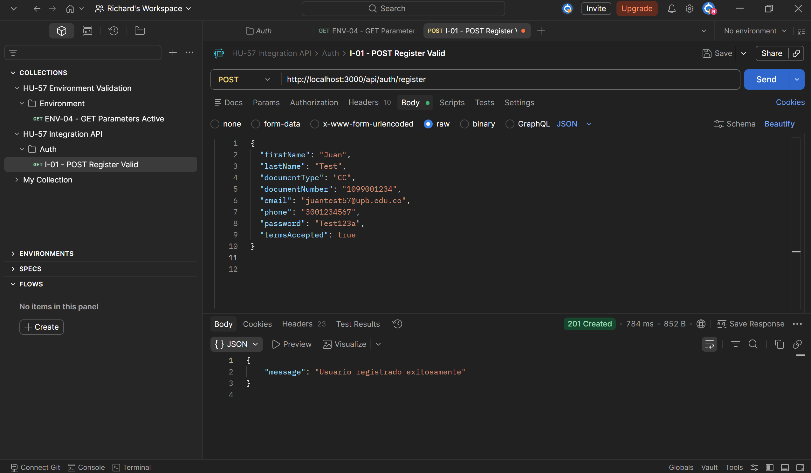

---

#### I-02

| Campo | Detalle |
|---|---|
| ID | `I-02` |
| Objetivo | Validar que el login de estudiante funcione correctamente y que la API devuelva autenticacion valida para un usuario STUDENT |
| Herramienta usada | `Postman` |
| Accion ejecutada | Se ejecuto una solicitud `POST` a `/api/auth/login` con credenciales validas del usuario `juantest57@upb.edu.co` y rol `STUDENT` |
| Resultado esperado | El endpoint responde `200 OK` y devuelve autenticacion valida para continuar casos autenticados |
| Resultado obtenido | El endpoint respondio con estado `200 OK`, devolvio un objeto `user` coherente con el usuario autenticado y un token JWT valido para continuar pruebas autenticadas |
| Estado | `PASS` |
| Evidencia asociada | `assets/evidence-integration-test/evidence-integration/auth/I-02_login_student_ok_postman_01.png`, `assets/evidence-integration-test/evidence-integration/auth/I-02_login_student_ok_postman_02.png`, `assets/evidence-integration-test/evidence-integration/auth/I-02_login_student_ok_response.json` |
| Observaciones | Se reutilizo el usuario creado en `I-01`; correo usado: `juantest57@upb.edu.co`; rol validado: `STUDENT`; la respuesta devolvio token JWT presente y usuario autenticado correctamente; el token queda disponible como soporte para los siguientes casos autenticados, pero no debe copiarse completo en el markdown; no hubo error de credenciales ni error de validacion |

Evidencia visual:

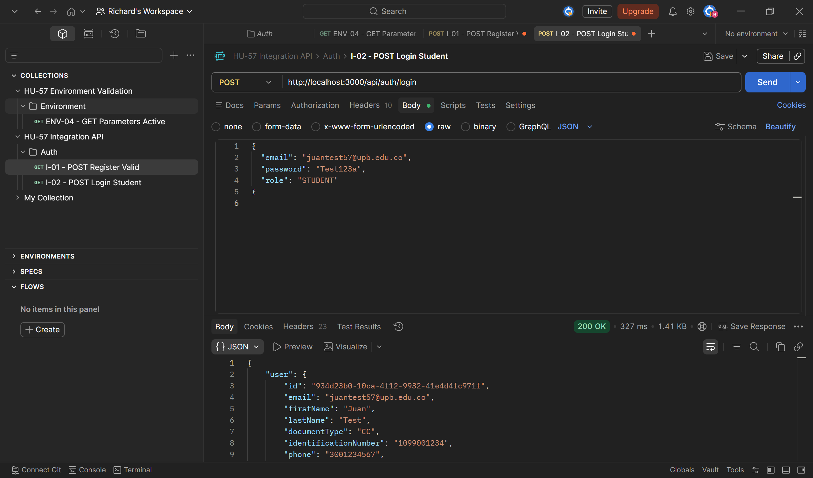

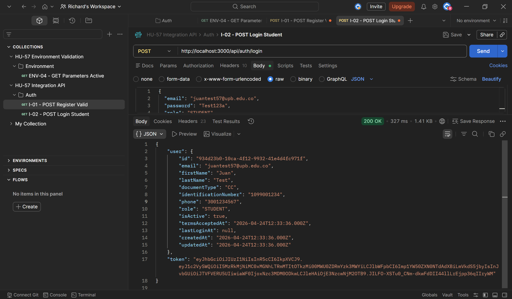

---

#### I-03

| Campo | Detalle |
|---|---|
| ID | `I-03` |
| Objetivo | Validar que el login administrativo funcione correctamente por fallback local a BD cuando LDAP real no este integrado |
| Herramienta usada | `Postman` |
| Accion ejecutada | Se ejecuto una solicitud `POST` a `/api/auth/login` con credenciales validas del admin local `admin@upb.edu.co` y rol `ADMIN` |
| Resultado esperado | El endpoint responde `200 OK` y devuelve autenticacion valida para el admin, aun cuando LDAP real no este integrado en este ambiente |
| Resultado obtenido | El endpoint respondio con estado `200 OK`, devolvio un objeto `user` coherente con el administrador autenticado y un token JWT valido, confirmando acceso administrativo exitoso en el ambiente actual |
| Estado | `PASS` |
| Evidencia asociada | `assets/evidence-integration-test/evidence-integration/auth/I-03_login_admin_fallback_postman_01.png`, `assets/evidence-integration-test/evidence-integration/auth/I-03_login_admin_fallback_postman_02.png`, `assets/evidence-integration-test/evidence-integration/auth/I-03_login_admin_fallback_response.json` |
| Observaciones | Correo usado: `admin@upb.edu.co`; rol validado: `ADMIN`; hubo token JWT presente en respuesta; el usuario autenticado fue el admin local existente del ambiente; la evidencia respalda fallback local operativo; no hubo error de credenciales ni error de validacion; el token no debe copiarse completo en el markdown |

Evidencia visual:

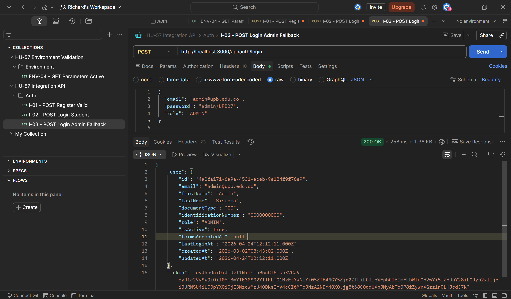

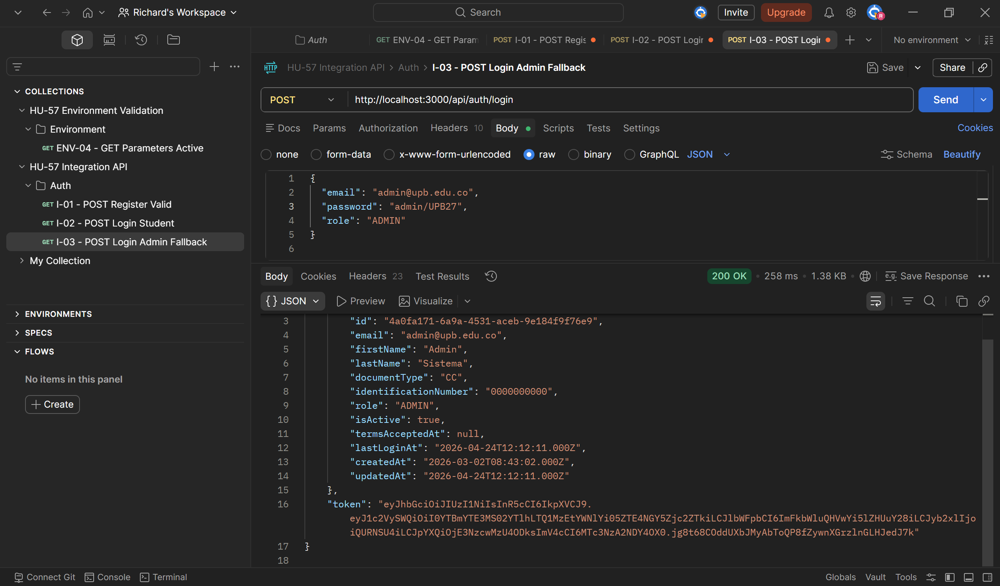

---

#### I-03A

| Campo | Detalle |
|---|---|
| ID | `I-03A` |
| Objetivo | Validar que `GET /api/auth/me` recupere correctamente la sesion actual usando un JWT valido y devuelva datos coherentes del usuario autenticado |
| Herramienta usada | `Postman` |
| Accion ejecutada | Se ejecuto una solicitud `GET` a `http://localhost:3000/api/auth/me` usando un JWT valido en el header `Authorization: Bearer` |
| Resultado esperado | El endpoint responde `200 OK` y devuelve datos coherentes del usuario autenticado sin reenviar credenciales |
| Resultado obtenido | Respondio `200 OK` y devolvio correctamente el usuario autenticado `juantest57@upb.edu.co` con rol `STUDENT`, estado activo y datos coherentes con la sesion iniciada previamente |
| Estado | `PASS` |
| Evidencia asociada | `assets/evidence-integration-test/evidence-integration/auth/I-03A_auth_me_postman_01.png`, `assets/evidence-integration-test/evidence-integration/auth/I-03A_auth_me_response.json` |
| Observaciones | Se utilizo el token JWT obtenido en `I-02` para el usuario `juantest57@upb.edu.co`; la API devolvio correctamente la sesion actual con rol `STUDENT`; no se expone el JWT completo en el documento |

Evidencia visual:

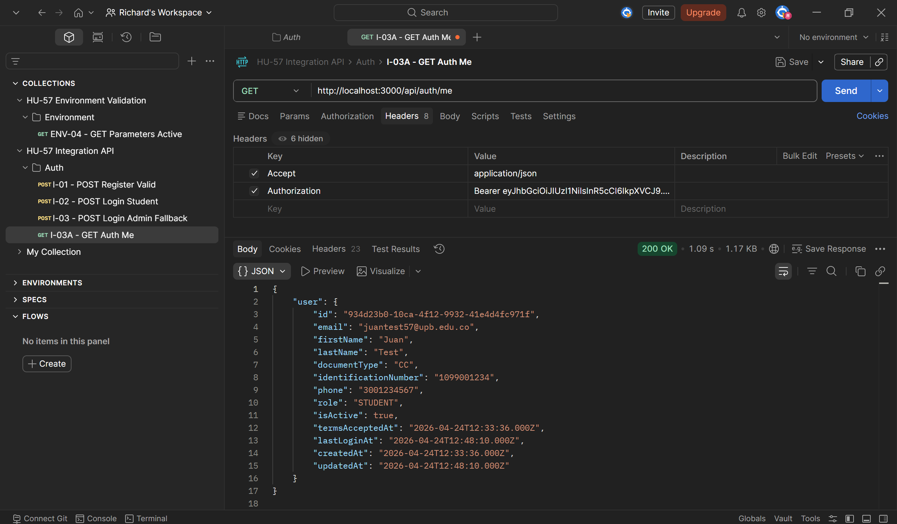

---

#### I-03B

| Campo | Detalle |
|---|---|
| ID | `I-03B` |
| Objetivo | Validar que el cierre de sesion responda correctamente y deje la sesion terminada de forma controlada para el usuario autenticado |
| Herramienta usada | `Postman` |
| Accion ejecutada | Se ejecuto una solicitud `POST` a `http://localhost:3000/api/auth/logout` usando un JWT valido en el header `Authorization: Bearer`; posteriormente se hizo una validacion de control reutilizando el mismo token en `GET /api/auth/me` |
| Resultado esperado | El endpoint responde exitosamente y confirma cierre de sesion de forma coherente |
| Resultado obtenido | El endpoint respondio `200 OK` con el mensaje `Sesion cerrada exitosamente.`; en la validacion posterior, el mismo token siguio siendo aceptado por `GET /api/auth/me`, devolviendo todavia la sesion del usuario autenticado |
| Estado | `PASS CON OBSERVACION` |
| Evidencia asociada | `assets/evidence-integration-test/evidence-integration/auth/I-03B_logout_postman_01.png`, `assets/evidence-integration-test/evidence-integration/auth/I-03B_logout_post_check_01.png`, `assets/evidence-integration-test/evidence-integration/auth/I-03B_logout_response.json` |
| Observaciones | Se reutilizo el token del estudiante `juantest57@upb.edu.co`; el logout respondio correctamente, pero el JWT siguio siendo aceptado en la validacion posterior con `GET /api/auth/me`; se documenta como comportamiento compatible con autenticacion JWT stateless y no como defecto automatico del sistema |

Evidencia visual:

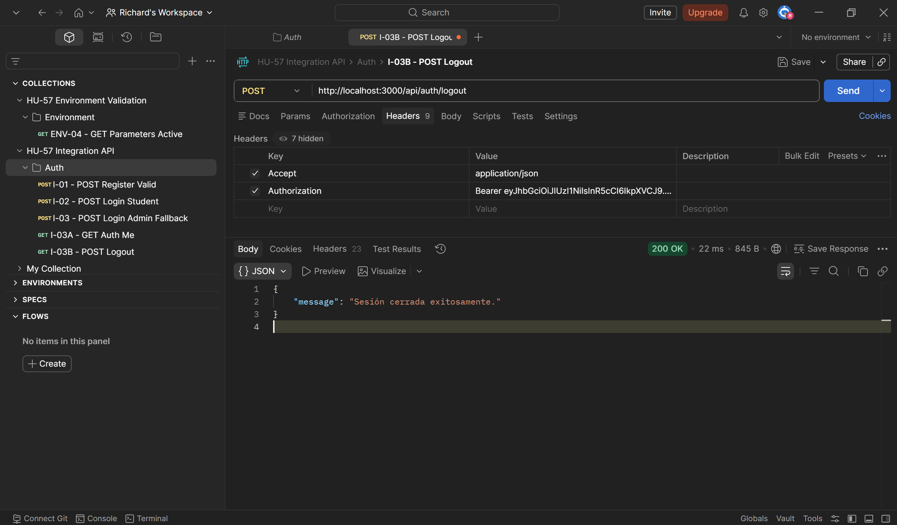

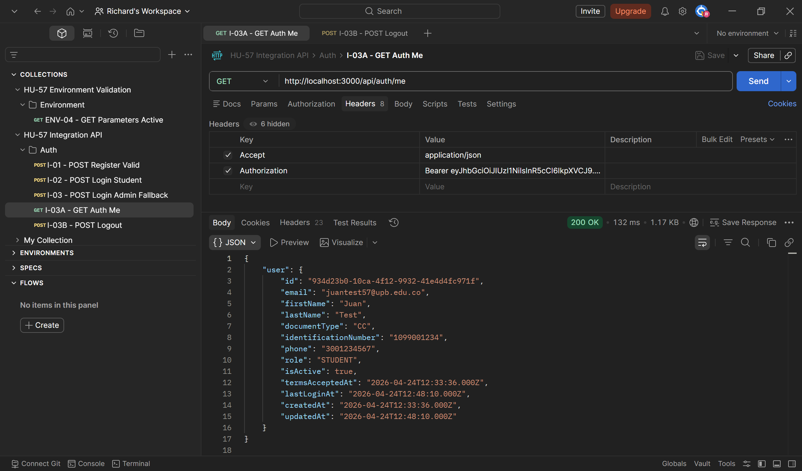

---

#### I-04

| Campo | Detalle |
|---|---|
| ID | `I-04` |
| Objetivo | Validar que la API rechace correctamente credenciales invalidas en login y devuelva una respuesta controlada, sin autenticar al usuario |
| Herramienta usada | `Postman` |
| Accion ejecutada | Se ejecuto una solicitud `POST` a `/api/auth/login` con credenciales invalidas de un usuario `STUDENT`, usando un correo existente y una contrasena incorrecta |
| Resultado esperado | El endpoint rechaza la autenticacion, devuelve error controlado y no entrega token ni sesion valida |
| Resultado obtenido | El endpoint respondio `401 Unauthorized` con `success: false` y un error controlado con mensaje `El correo electronico o la contrasena son incorrectos.`, `statusCode: 401` y `errorCode: INVALID_CREDENTIALS`; no se devolvio token ni usuario autenticado |
| Estado | `PASS` |
| Evidencia asociada | `assets/evidence-integration-test/evidence-integration/auth/I-04_login_invalid_postman_01.png`, `assets/evidence-integration-test/evidence-integration/auth/I-04_login_invalid_response.json` |
| Observaciones | Se probo el correo `juantest57@upb.edu.co` con contrasena incorrecta `Test999x`; la API rechazo correctamente el acceso y no entrego autenticacion valida |

Evidencia visual:

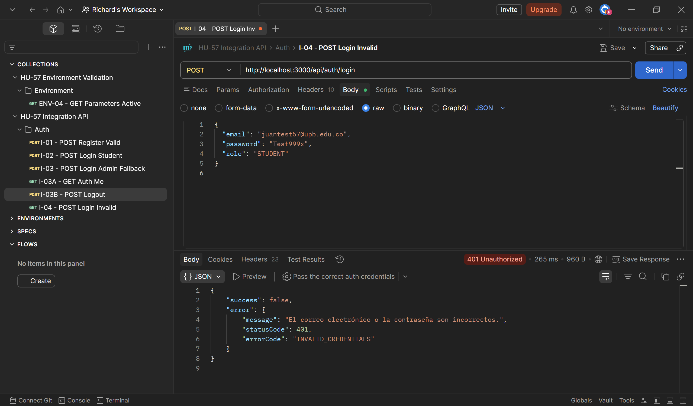

---

#### I-05

| Campo | Detalle |
|---|---|
| ID | `I-05` |
| Objetivo | Validar que `POST /api/auth/recover-hint` devuelva una pista controlada y enmascarada del correo cuando se consulta con una identificacion valida existente |
| Herramienta usada | `Postman` |
| Accion ejecutada | Se ejecuto una solicitud `POST` a `/api/auth/recover-hint` usando una identificacion valida existente del usuario previamente registrado; en un intento inicial se envio un nombre de campo incorrecto, y luego se corrigio el payload usando `identificationNumber` |
| Resultado esperado | El endpoint responde exitosamente y devuelve una pista enmascarada coherente del correo asociado, sin exponer innecesariamente el correo completo |
| Resultado obtenido | En el intento valido, el endpoint respondio `200 OK` con `success: true` y `maskedEmail: "ju*****@upb.edu.co"`; la respuesta fue coherente con el usuario asociado a la identificacion `1099001234` y no expuso el correo completo |
| Estado | `PASS` |
| Evidencia asociada | `assets/evidence-integration-test/evidence-integration/auth/I-05_recover_hint_postman_01.png`, `assets/evidence-integration-test/evidence-integration/auth/I-05_recover_hint_response.json` |
| Observaciones | Se uso la identificacion `1099001234`; en un intento previo invalido se envio `documentNumber` en lugar de `identificationNumber`, por lo que la API respondio `400 Bad Request` con `VALIDATION_ERROR`; ese intento queda solo como trazabilidad tecnica y no como defecto funcional del endpoint. Evidencia complementaria del intento previo: `assets/evidence-integration-test/evidence-integration/auth/I-05_recover_hint_wrong_field_01.png`, `assets/evidence-integration-test/evidence-integration/auth/I-05_recover_hint_wrong_field_response.json` |

Evidencia visual:

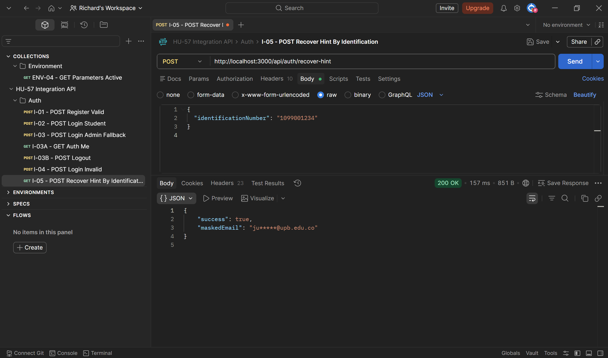

Trazabilidad tecnica del intento previo invalido:

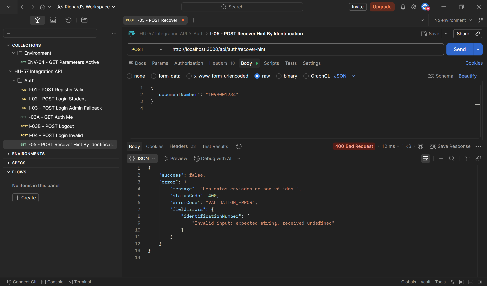

---

#### I-05A

| Campo | Detalle |
|---|---|
| ID | `I-05A` |
| Objetivo | Validar que `POST /api/auth/forgot-password` procese correctamente una solicitud de recuperacion por correo y genere una respuesta segura sin exponer informacion sensible |
| Herramienta usada | `Postman` |
| Accion ejecutada | Se ejecuto una solicitud `POST` a `/api/auth/forgot-password` usando el correo de un usuario existente previamente validado en los casos anteriores |
| Resultado esperado | El endpoint responde exitosamente con un mensaje seguro y coherente, sin exponer informacion sensible del proceso |
| Resultado obtenido | El endpoint respondio `200 OK` con el mensaje `Si el correo esta registrado, recibiras un enlace de recuperacion.`; adicionalmente, se verifico evidencia complementaria en BD mediante registro en `password_reset_tokens` asociado al correo consultado |
| Estado | `PASS` |
| Evidencia asociada | `assets/evidence-integration-test/evidence-integration/auth/I-05A_forgot_password_email_postman_01.png`, `assets/evidence-integration-test/evidence-integration/auth/I-05A_forgot_password_email_response.json`, `assets/evidence-integration-test/evidence-integration/auth/I-05A_forgot_password_email_bd_01.png` |
| Observaciones | Se uso el correo `juantest57@upb.edu.co`; el ambiente respondio con mensaje seguro sin exponer token en el body; como SMTP no es la evidencia principal del entorno, el soporte adicional se valido mediante BD, observando registro en `password_reset_tokens` con trazabilidad consistente del flujo y `used_at` aun en `NULL` |

Evidencia visual:

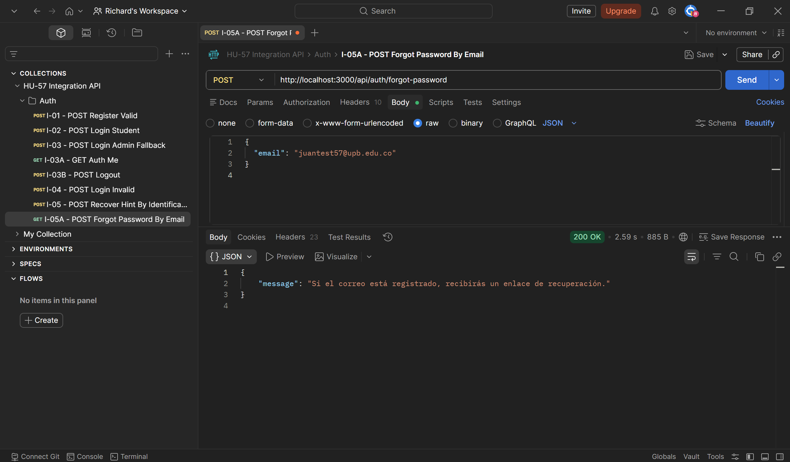

Evidencia complementaria:
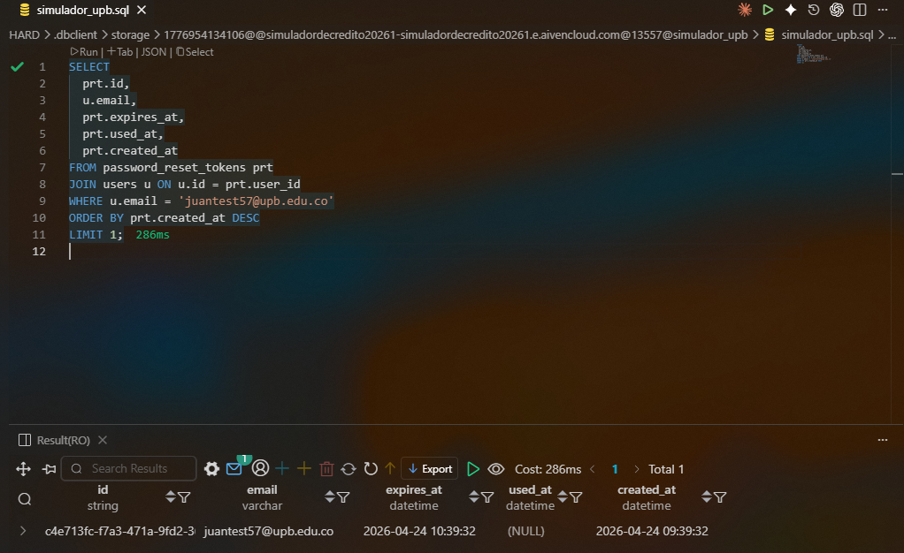

---

#### I-05B

| Campo | Detalle |
|---|---|
| ID | `I-05B` |
| Objetivo | Validar que `POST /api/auth/forgot-password-by-id` procese correctamente la recuperacion por identificacion y genere evidencia coherente del flujo sin exponer informacion sensible |
| Herramienta usada | `Postman` |
| Accion ejecutada | Se ejecuto una solicitud `POST` a `/api/auth/forgot-password-by-id` usando una identificacion valida existente del usuario previamente registrado |
| Resultado esperado | El endpoint responde exitosamente con un mensaje seguro y coherente, sin exponer informacion sensible del proceso |
| Resultado obtenido | El endpoint respondio `200 OK` con el mensaje `Si el numero de identificacion esta registrado, recibiras un enlace de recuperacion.`; adicionalmente, se verifico evidencia complementaria en BD mediante trazabilidad en `password_reset_tokens` asociada al usuario consultado |
| Estado | `PASS` |
| Evidencia asociada | `assets/evidence-integration-test/evidence-integration/auth/I-05B_forgot_password_by_id_postman_01.png`, `assets/evidence-integration-test/evidence-integration/auth/I-05B_forgot_password_by_id_response.json`, `assets/evidence-integration-test/evidence-integration/auth/I-05B_forgot_password_by_id_bd_01.png` |
| Observaciones | Se uso la identificacion `1099001234`; el endpoint devolvio un mensaje seguro sin exponer token en el body; la evidencia complementaria en BD mostro trazabilidad consistente para `juantest57@upb.edu.co`, con `expires_at` diligenciado y `used_at` en `NULL` |

Evidencia visual:

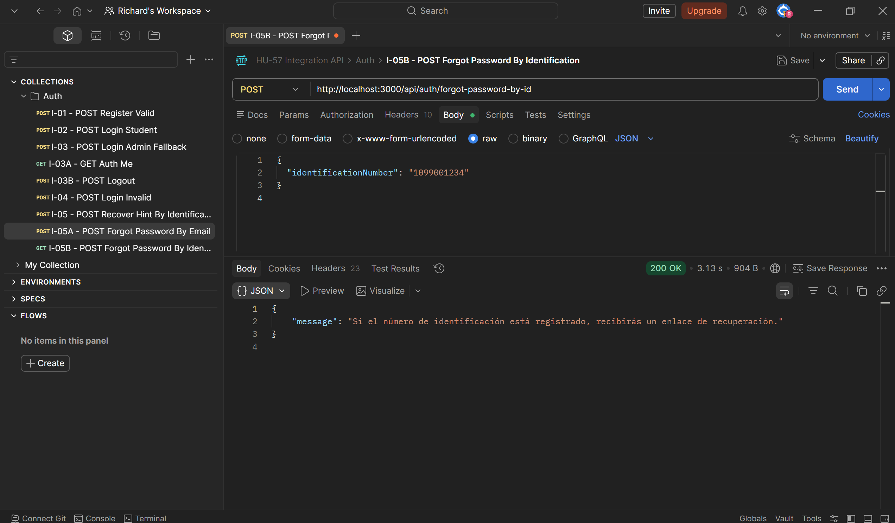

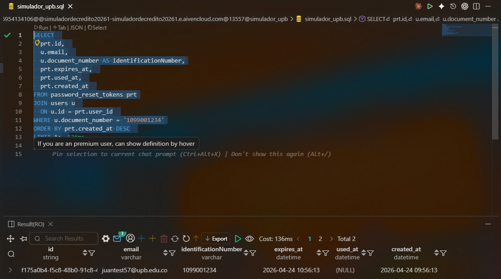

---

#### I-06

| Campo | Detalle |
|---|---|
| ID | `I-06` |
| Objetivo | Validar que `POST /api/auth/reset-password` consuma correctamente un token de recuperacion valido y permita establecer una nueva contrasena funcional |
| Herramienta usada | `Postman` |
| Accion ejecutada | Se ejecuto una solicitud `POST` a `/api/auth/reset-password` usando un token valido de recuperacion y una nueva contrasena de prueba; posteriormente se valido el login con la nueva credencial |
| Resultado esperado | El endpoint responde exitosamente, actualiza la contrasena y permite login posterior con la nueva clave |
| Resultado obtenido | El endpoint respondio `200 OK` con el mensaje `Contrasena actualizada exitosamente`; posteriormente el login del estudiante con la nueva contrasena fue exitoso y la evidencia complementaria en BD mostro el token de recuperacion como consumido mediante `used_at` |
| Estado | `PASS` |
| Evidencia asociada | `assets/evidence-integration-test/evidence-integration/auth/I-06_reset_password_postman_01.png`, `assets/evidence-integration-test/evidence-integration/auth/I-06_reset_password_response.json`, `assets/evidence-integration-test/evidence-integration/auth/I-06_reset_password_login_check_01.png`, `assets/evidence-integration-test/evidence-integration/auth/I-06_reset_password_bd_01.png` |
| Observaciones | Se utilizo un token valido obtenido previamente del flujo de recuperacion; por seguridad no debe exponerse completo en el markdown; la nueva contrasena de prueba permitio autenticacion posterior del usuario `juantest57@upb.edu.co`; la tabla `password_reset_tokens` evidencio el token consumido con `used_at` diligenciado |

Evidencia visual:

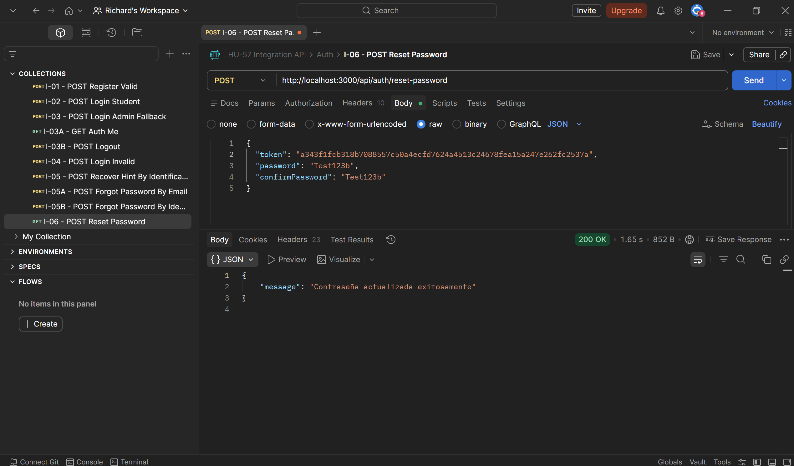

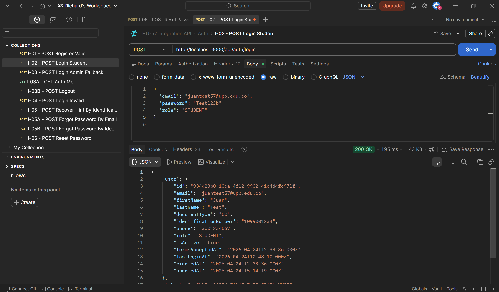

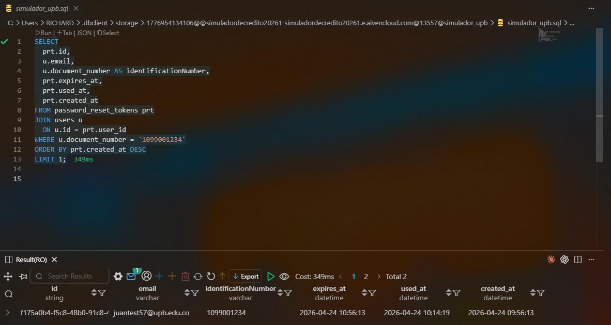

---

### 5.3 Bloque `simulator`

Carpeta de soporte: `docs/architecture/assets/evidence-integration-test/evidence-integration/simulator/`

| ID | Caso | Endpoint(s) reales | Actor | Evidencia esperada | Prioridad | Orden |
|---|---|---|---|---|---|---|
| `I-07` | Preview invitado | `POST /api/simulator/preview` + `GET /api/parameters/active` | Invitado | Body + comparacion con caso esperado | Alta | 7 |
| `I-08` | Preview estudiante | `POST /api/simulator/preview` | Estudiante | Body + token + summary | Alta | 8 |
| `I-09` | Guardar simulacion | `POST /api/simulator/save` | Estudiante | Body + consulta posterior en historial/BD | Alta | 9 |

#### I-07

| Campo | Detalle |
|---|---|
| ID | `I-07` |
| Objetivo | Validar preview publico de simulacion como invitado, sin requerir autenticacion |
| Herramienta usada | `Postman` |
| Accion ejecutada | Se ejecuto una solicitud `POST` a `/api/simulator/preview` sin enviar token de autenticacion, usando un caso nominal de simulacion como invitado |
| Resultado esperado | El endpoint responde `200 OK` y devuelve un preview coherente del caso sin exigir login |
| Resultado obtenido | El endpoint respondio `200 OK` y devolvio un summary completo con estructura coherente de simulacion, incluyendo schedule, periodicPayment, totalPaid y totalInterest; aunque el payload solicitaba `sin_interes`, la respuesta resolvio el caso como `con_interes` |
| Estado | `PASS` |
| Evidencia asociada | `assets/evidence-integration-test/evidence-integration/simulator/I-07_preview_guest_postman_01.png`, `assets/evidence-integration-test/evidence-integration/simulator/I-07_preview_guest_postman_02.png`, `assets/evidence-integration-test/evidence-integration/simulator/I-07_preview_guest_postman_03.png`, `assets/evidence-integration-test/evidence-integration/simulator/I-07_preview_guest_postman_04.png`, `assets/evidence-integration-test/evidence-integration/simulator/I-07_preview_guest_response.json` |
| Observaciones | No se utilizo autenticacion en la request. El payload enviado uso `interestMode = sin_interes`, pero la respuesta devolvio `interestMode = con_interes` con `totalInterest = 160530` y cuotas con interes en el schedule, por lo que el caso debe documentarse con base en el comportamiento real observado y no como caso sin interes puro |

Evidencia visual:

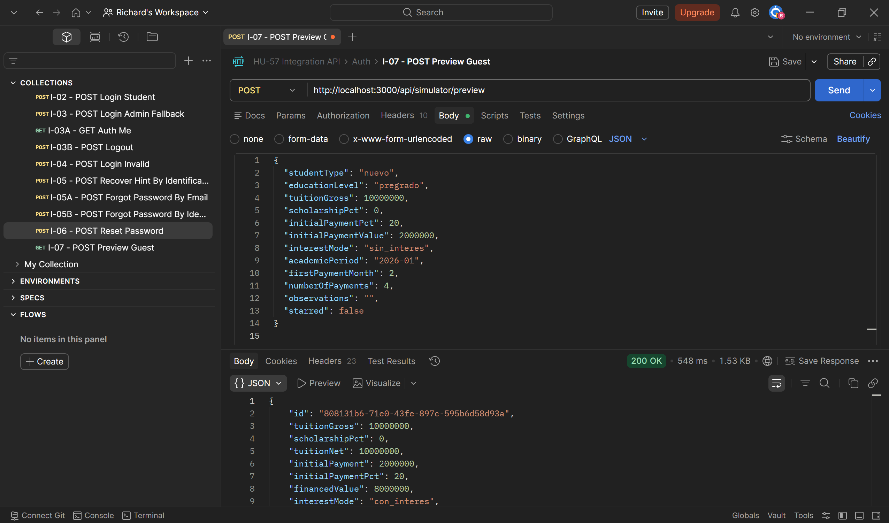

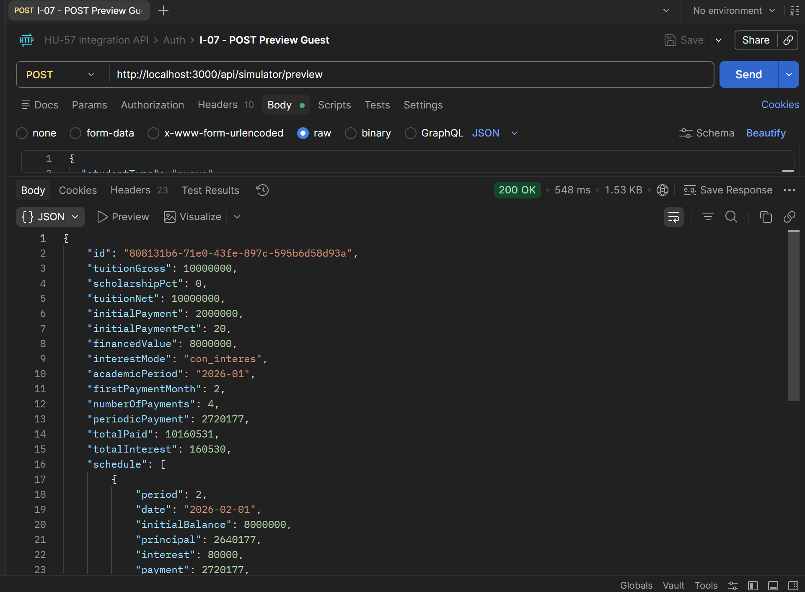

---

#### I-08

| Campo | Detalle |
|---|---|
| ID | `I-08` |
| Objetivo | Validar preview de simulacion para estudiante autenticado |
| Herramienta usada | `Postman` |
| Accion ejecutada | Se ejecuto una solicitud `POST` a `/api/simulator/preview` usando JWT valido de estudiante y un payload coherente de simulacion con interes |
| Resultado esperado | El endpoint responde `200 OK` y devuelve un preview coherente del caso autenticado |
| Resultado obtenido | El endpoint respondio `200 OK` y devolvio un `SimulationSummary` completo con estructura coherente del caso, incluyendo `interestMode = con_interes`, `periodicPayment = 2720177`, `totalPaid = 10160531`, `totalInterest = 160530` y `schedule` consistente |
| Estado | `PASS` |
| Evidencia asociada | `assets/evidence-integration-test/evidence-integration/simulator/I-08_preview_student_postman_01.png`, `assets/evidence-integration-test/evidence-integration/simulator/I-08_preview_student_postman_02.png`, `assets/evidence-integration-test/evidence-integration/simulator/I-08_preview_student_postman_03.png`, `assets/evidence-integration-test/evidence-integration/simulator/I-08_preview_student_postman_04.png`, `assets/evidence-integration-test/evidence-integration/simulator/I-08_preview_student_response.json` |
| Observaciones | El caso se ejecuto con token valido de estudiante. La respuesta devolvio un preview coherente con calculo `con_interes`, `schedule` visible y cierre correcto del saldo final en `0`. Los periodos visibles del schedule comienzan en `2`, `3` y `4`, lo cual es consistente con el modelo donde la cuota inicial no forma parte del schedule amortizado |

Evidencia visual:

---

#### I-09

| Campo | Detalle |
|---|---|
| ID | `I-09` |
| Objetivo | Validar guardado correcto de simulacion para estudiante autenticado |
| Herramienta usada | `Postman` |
| Accion ejecutada | Se ejecuto una solicitud `POST` a `/api/simulator/save` usando JWT valido de estudiante y un payload coherente de simulacion previamente validado |
| Resultado esperado | El endpoint responde exitosamente y confirma la persistencia correcta de la simulacion |
| Resultado obtenido | El endpoint respondio `200 OK` y devolvio confirmacion explicita de guardado con mensaje `Simulacion guardada exitosamente.`, identificador de simulacion, `createdAt` y un `summary` coherente con el caso enviado. Adicionalmente, la persistencia fue soportada con evidencia en BD vinculada al estudiante autenticado |
| Estado | `PASS` |
| Evidencia asociada | `assets/evidence-integration-test/evidence-integration/simulator/I-09_save_simulation_postman_01.png`, `assets/evidence-integration-test/evidence-integration/simulator/I-09_save_simulation_postman_02.png`, `assets/evidence-integration-test/evidence-integration/simulator/I-09_save_simulation_postman_03.png`, `assets/evidence-integration-test/evidence-integration/simulator/I-09_save_simulation_postman_04.png`, `assets/evidence-integration-test/evidence-integration/simulator/I-09_save_simulation_postman_05.png`, `assets/evidence-integration-test/evidence-integration/simulator/I-09_save_simulation_post_check_01.png`, `assets/evidence-integration-test/evidence-integration/simulator/I-09_save_simulation_response.json` |
| Observaciones | El caso se ejecuto con estudiante autenticado reutilizando el flujo validado en preview. La respuesta devolvio `id`, `createdAt`, mensaje de guardado exitoso y `summary` coherente. La persistencia posterior se verifico mediante evidencia complementaria en BD para el usuario `juantest57@upb.edu.co` |

Evidencia visual:

---

### 5.4 Bloque `history-export`

Carpeta de soporte: `docs/architecture/assets/evidence-integration-test/evidence-integration/history-export/`

| ID | Caso | Endpoint(s) reales | Actor | Evidencia esperada | Prioridad | Orden |
|---|---|---|---|---|---|---|
| `I-10` | Historial propio | `GET /api/simulator/history` | Estudiante | Body + conteo/listado | Alta | 10 |
| `I-11` | Detalle propio y ajeno | `GET /api/simulator/history/:id` | Estudiante | Body + status comparado | Alta | 11 |
| `I-12` | Export PDF estudiante | `GET /api/simulator/history/:id/export/pdf` | Estudiante | Headers + archivo | Alta | 12 |

#### I-10

| Campo | Detalle |
|---|---|
| ID | `I-10` |
| Objetivo | Validar consulta correcta del historial propio del estudiante autenticado |
| Herramienta usada | `Postman` |
| Accion ejecutada | Se ejecuto una solicitud `GET` a `/api/simulator/history` usando JWT valido de estudiante y parametros basicos de paginacion |
| Resultado esperado | El endpoint responde `200 OK` y devuelve solo simulaciones del usuario autenticado, con estructura de listado coherente |
| Resultado obtenido | El endpoint respondio `200 OK` y devolvio una estructura paginada con `items`, `page`, `pageSize`, `total` y `totalPages`. Se observo un unico registro en el historial, correspondiente al estudiante autenticado `juantest57@upb.edu.co`, y dicho registro coincide con la simulacion previamente guardada en I-09 |
| Estado | `PASS` |
| Evidencia asociada | `assets/evidence-integration-test/evidence-integration/history-export/I-10_history_own_postman_01.png`, `assets/evidence-integration-test/evidence-integration/history-export/I-10_history_own_response.json` |
| Observaciones | Se utilizo JWT valido de estudiante. La respuesta mostro `items = 1`, `page = 1`, `pageSize = 10`, `total = 1` y `totalPages = 1`. El item recuperado incluyo el id `f182edd4-6058-4dc2-bccb-d7eee4ce329d`, coincidente con I-09, junto con datos coherentes como `studentEmail`, `modality = CON_INTERES`, `financedValue = 8000000`, `initialPaymentValue = 2000000`, `firstPaymentDate = 2026-02-01` y `academicPeriod = 2026-01` |

Evidencia visual:

---

#### I-11

| Campo | Detalle |
|---|---|
| ID | `I-11` |
| Objetivo | Validar consulta de detalle propio y rechazo de detalle ajeno en `GET /api/simulator/history/:id` |
| Herramienta usada | `Postman` |
| Accion ejecutada | Se ejecutaron solicitudes `GET` a `/api/simulator/history/:id` usando JWT valido de estudiante, primero con un id propio y luego con un id ajeno |
| Resultado esperado | El endpoint devuelve `200 OK` para una simulacion propia y rechaza de forma controlada el acceso a una simulacion ajena |
| Resultado obtenido | Para el id propio `f182edd4-6058-4dc2-bccb-d7eee4ce329d` el endpoint respondio `200 OK` con el detalle completo de la simulacion, incluyendo summary, schedule y datos del estudiante asociado. Para el id ajeno o no accesible `4a1ca08c-2ad7-4c9f-b80b-fe841bcadeed` el sistema respondio `404 Not Found` con el mensaje `Simulacion no encontrada.` |
| Estado | `PASS` |
| Evidencia asociada | `assets/evidence-integration-test/evidence-integration/history-export/I-11_history_detail_own_01.png`, `assets/evidence-integration-test/evidence-integration/history-export/I-11_history_detail_foreign_01.png`, `assets/evidence-integration-test/evidence-integration/history-export/I-11_history_detail_own_response.json`, `assets/evidence-integration-test/evidence-integration/history-export/I-11_history_detail_foreign_response.json` |
| Observaciones | Se utilizo JWT valido de estudiante. El id propio usado fue `f182edd4-6058-4dc2-bccb-d7eee4ce329d`, coincidente con la simulacion persistida en I-09 y visible en I-10. El detalle mostro datos coherentes del caso guardado, incluyendo `financedValue = 8000000`, `interestMode = con_interes`, `numberOfPayments = 4`, `totalPaid = 10160531`, `totalInterest = 160530` y cierre del schedule con `finalBalance = 0`. Para el id `4a1ca08c-2ad7-4c9f-b80b-fe841bcadeed` el rechazo fue controlado con `404`, lo cual es valido para este caso segun la implementacion real y sin exposicion de datos ajenos |

Evidencia visual:

---

#### I-12

| Campo | Detalle |
|---|---|
| ID | `I-12` |
| Objetivo | Validar exportacion PDF de una simulacion propia del estudiante |
| Herramienta usada | `Postman` |
| Accion ejecutada | Se ejecuto una solicitud `GET` a `/api/simulator/history/:id/export/pdf` usando JWT valido de estudiante sobre una simulacion propia previamente validada |
| Resultado esperado | El endpoint responde `200 OK` y devuelve un archivo PDF descargable correspondiente a la simulacion solicitada |
| Resultado obtenido | El endpoint respondio `200 OK` para el id propio `f182edd4-6058-4dc2-bccb-d7eee4ce329d`. Postman renderizo correctamente el contenido PDF en la vista previa y el documento mostro informacion coherente de la simulacion del estudiante, incluyendo datos personales, resumen financiero, distribucion capital vs intereses y cronograma de amortizacion |
| Estado | `PASS` |
| Evidencia asociada | `assets/evidence-integration-test/evidence-integration/history-export/I-12_export_pdf_student_postman_01.png`, `assets/evidence-integration-test/evidence-integration/history-export/I-12_export_pdf_student_file_01.png`, `assets/evidence-integration-test/evidence-integration/history-export/I-12_export_pdf_student_file_02.png` |
| Observaciones | Se utilizo JWT valido del estudiante autenticado y el id propio `f182edd4-6058-4dc2-bccb-d7eee4ce329d`. El PDF mostro datos coherentes del caso guardado previamente: estudiante `Juan Test`, correo `juantest57@upb.edu.co`, identificacion `1099001234`, modalidad `Con Intereses`, periodo `2026-01`, matricula bruta `10.000.000 COP`, cuota inicial `2.000.000 COP`, valor a financiar `8.000.000 COP`, cuota estimada `2.720.177 COP`, total a pagar `10.160.531 COP`, total intereses `160.530 COP` y cronograma con cierre en `Saldo Final = 0 COP` |

Evidencia visual:

---

### 5.5 Bloque `profile-parameters`

Carpeta de soporte: `docs/architecture/assets/evidence-integration-test/evidence-integration/profile-parameters/`

| ID | Caso | Endpoint(s) reales | Actor | Evidencia esperada | Prioridad | Orden |
|---|---|---|---|---|---|---|
| `I-13` | Perfil estudiante | `GET /api/users/me` + `PATCH /api/users/me` | Estudiante | Body antes/despues | Media | 13 |
| `I-13A` | Consulta rapida de simulaciones propias | `GET /api/users/me/simulations` | Estudiante | Body + comparacion con historial principal | Baja/Media | 13A |
| `I-14` | Parametros activos publicos | `GET /api/parameters/active` | Cualquiera | Body completo | Media | 14 |

#### I-13

| Campo | Detalle |
|---|---|
| ID | `I-13` |
| Objetivo | Validar consulta y actualizacion del perfil del estudiante autenticado mediante `GET /api/users/me` y `PATCH /api/users/me` |
| Herramienta usada | `Postman` |
| Accion ejecutada | Se ejecuto primero una solicitud `GET` a `/api/users/me` para obtener el perfil actual del estudiante autenticado, luego una solicitud `PATCH` sobre el mismo endpoint para actualizar un campo permitido, y finalmente un nuevo `GET` para verificar persistencia |
| Resultado esperado | El perfil se consulta correctamente, la actualizacion responde exitosamente y el cambio queda persistido |
| Resultado obtenido | El `GET` inicial respondio `200 OK` y mostro el perfil correcto del estudiante autenticado con telefono `3001234567`. Luego el `PATCH` respondio `200 OK` con el mensaje `Datos actualizados correctamente.` y devolvio el telefono actualizado a `3007654321`. Finalmente, el `GET` posterior respondio `200 OK` y confirmo que el nuevo telefono permanecio persistido como `3007654321` |
| Estado | `PASS` |
| Evidencia asociada | `assets/evidence-integration-test/evidence-integration/profile-parameters/I-13_profile_get_before_01.png`, `assets/evidence-integration-test/evidence-integration/profile-parameters/I-13_profile_patch_01.png`, `assets/evidence-integration-test/evidence-integration/profile-parameters/I-13_profile_get_after_01.png` |
| Observaciones | Se utilizo JWT valido del estudiante autenticado `juantest57@upb.edu.co`. El campo modificado fue `phone`, cambiando de `3001234567` a `3007654321`. El segundo `GET` confirmo la persistencia del cambio sin afectar la identidad ni el rol del usuario |

Evidencia visual:

---

#### I-13A

| Campo | Detalle |
|---|---|
| ID | `I-13A` |
| Objetivo | Validar consulta rapida de simulaciones propias del estudiante autenticado |
| Herramienta usada | `Postman` |
| Accion ejecutada | Se ejecuto una solicitud `GET` a `/api/users/me/simulations` usando JWT valido de estudiante para consultar las simulaciones propias |
| Resultado esperado | El endpoint responde `200 OK` y devuelve solo simulaciones del estudiante autenticado con estructura coherente |
| Resultado obtenido | El endpoint respondio `200 OK` y devolvio un arreglo `simulations` con una simulacion perteneciente al estudiante autenticado. La respuesta incluyo el registro con id `f182edd4-6058-4dc2-bccb-d7eee4ce329d`, `academicPeriod` `2026-01`, `numberOfPayments` `4`, `totalPaid` `10160531` y `createdAt` `2026-04-24T15:54:58.000Z`, manteniendo consistencia con la simulacion guardada previamente en `I-09` y consultada en `I-10` |
| Estado | `PASS` |
| Evidencia asociada | `assets/evidence-integration-test/evidence-integration/profile-parameters/I-13A_my_simulations_quick_01.png`, `assets/evidence-integration-test/evidence-integration/profile-parameters/I-13A_my_simulations_quick_response.json` |
| Observaciones | Se utilizo JWT valido del estudiante `juantest57@upb.edu.co`. El endpoint devolvio una vista resumida del listado de simulaciones, con menos detalle que `GET /api/simulator/history`, pero coherente con el historial principal y con la simulacion persistida en `I-09` |

Evidencia visual:

---

#### I-14

| Campo | Detalle |
|---|---|
| ID | `I-14` |
| Objetivo | Validar consulta publica de parametros activos mediante `GET /api/parameters/active` |
| Herramienta usada | `Postman` |
| Accion ejecutada | Se ejecuto una solicitud `GET` a `/api/parameters/active` sin autenticacion para consultar la version activa de parametros |
| Resultado esperado | El endpoint responde `200 OK` y devuelve una estructura coherente de parametros activos utilizables por el simulador |
| Resultado obtenido | El endpoint respondio `200 OK` sin requerir autenticacion y devolvio una respuesta JSON con `success: true` y una estructura publica de parametros activos. En el body se observaron campos como `id`, `validFrom`, `validTo`, `installmentsWindowFrom`, `installmentsWindowTo`, `paymentPeriodDays` e `initialPaymentRules`, lo que evidencia una configuracion activa coherente y consumible por el simulador |
| Estado | `PASS` |
| Evidencia asociada | `assets/evidence-integration-test/evidence-integration/profile-parameters/I-14_parameters_active_public_01.png`, `assets/evidence-integration-test/evidence-integration/profile-parameters/I-14_parameters_active_public_response.json` |
| Observaciones | La consulta se realizo como acceso publico sin token. La respuesta devolvio una version activa visible de parametros y se observaron reglas dentro de `initialPaymentRules`, manteniendo consistencia con la validacion ambiental previa de parametros activos |

Evidencia visual:

---

### 5.6 Bloque `admin`

Carpeta de soporte: `docs/architecture/assets/evidence-integration-test/evidence-integration/admin/`

| ID | Caso | Endpoint(s) reales | Actor | Evidencia esperada | Prioridad | Orden |
|---|---|---|---|---|---|---|
| `I-15` | Admin users | `GET /api/admin/users`, `GET /api/admin/users/:id`, `GET /api/admin/users/:id/simulations`, `GET /api/admin/users/export/csv` | Admin | Body + archivo CSV | Alta | 15 |
| `I-16` | Admin parameters | `GET /api/admin/parameters`, `GET /api/admin/parameters/active`, `GET /api/admin/parameters/:id`, `POST /api/admin/parameters`, `PUT /api/admin/parameters/:id`, `PATCH /api/admin/parameters/:id/activate` | Admin | Body + evidencia de impacto posterior | Alta | 16 |
| `I-16A` | Configuracion fina de reglas por nivel y cuota | `GET /api/admin/parameters/:versionId/level-configs`, `POST /api/admin/parameters/:versionId/level-configs`, `PATCH /api/admin/level-configs/:id/deactivate`, `POST /api/admin/level-configs/:id/reactivate`, `PATCH /api/admin/level-configs/:configId/rates/:paymentCount` | Admin | Body + simulacion posterior que evidencie el impacto | Alta | 16A |
| `I-17` | Admin simulations | `GET /api/admin/simulations`, `GET /api/admin/simulations/:id`, `DELETE /api/admin/simulations/:id`, `GET /api/admin/simulations/:id/export/pdf`, `GET /api/admin/simulations/:id/export/csv` | Admin | Body + headers + archivo | Alta | 17 |
| `I-18` | Restricciones por rol y token | `GET /api/admin/users`, `GET /api/simulator/history` | Student / token invalido | Body + status | Alta | 18 |

---

#### I-15

| Campo | Detalle |
|---|---|
| ID | `I-15` |
| Objetivo | Validar consulta administrativa de usuarios, detalle de estudiante, simulaciones asociadas y exportacion CSV |
| Herramienta usada | `Postman` |
| Accion ejecutada | Se ejecutaron solicitudes `GET` a `/api/admin/users`, `/api/admin/users/:id`, `/api/admin/users/:id/simulations` y `/api/admin/users/export/csv` con JWT valido de administrador |
| Resultado esperado | Los endpoints debian responder exitosamente y permitir listar estudiantes, consultar detalle, ver simulaciones asociadas y exportar el listado |
| Resultado obtenido | Los endpoints respondieron `200 OK` de forma coherente en las cuatro subconsultas administrativas. El listado general devolvio `success: true` con `data.items` e incluyo al estudiante `Juan Test` (`juantest57@upb.edu.co`, `1099001234`). El detalle del usuario `934d23b0-10ca-4f12-9932-41e4d4fc971f` devolvio informacion consistente del estudiante, incluyendo `phone = 3007654321`, `role = STUDENT` e `isActive = true`. La consulta de simulaciones del usuario devolvio el registro `f182edd4-6058-4dc2-bccb-d7eee4ce329d` con `academicPeriod = 2026-01`, `numberOfPayments = 4`, `totalPaid = 10160531` y `createdAt = 2026-04-24T15:54:58.000Z`. La exportacion devolvio correctamente contenido CSV/texto con columnas visibles y presencia del usuario `juantest57@upb.edu.co` |
| Estado | `PASS` |
| Evidencia asociada | `assets/evidence-integration-test/evidence-integration/admin/I-15_admin_users_list_01.png`, `assets/evidence-integration-test/evidence-integration/admin/I-15_admin_users_list_response.json`, `assets/evidence-integration-test/evidence-integration/admin/I-15_admin_user_detail_01.png`, `assets/evidence-integration-test/evidence-integration/admin/I-15_admin_user_detail_response.json`, `assets/evidence-integration-test/evidence-integration/admin/I-15_admin_user_simulations_01.png`, `assets/evidence-integration-test/evidence-integration/admin/I-15_admin_user_simulations_response.json`, `assets/evidence-integration-test/evidence-integration/admin/I-15_admin_users_export_csv_01.png`, `assets/evidence-integration-test/evidence-integration/admin/I-15_admin_users_export.txt` |
| Observaciones | Se uso JWT valido de administrador. El usuario consultado fue `juantest57@upb.edu.co`, con `userId = 934d23b0-10ca-4f12-9932-41e4d4fc971f`, y la simulacion asociada observada fue `f182edd4-6058-4dc2-bccb-d7eee4ce329d`, coincidente con la persistida en casos previos. El caso se documenta como un bloque administrativo compuesto por cuatro subconsultas coherentes entre si |

Evidencia visual:

---

#### I-16

| Campo | Detalle |
|---|---|
| ID | `I-16` |
| Objetivo | Validar gestion administrativa de parametros financieros existentes, incluyendo listado de versiones, consulta de version activa, consulta por id, actualizacion de la version operativa y verificacion posterior de su estado activo |
| Herramienta usada | `Postman` |
| Accion ejecutada | Se ejecutaron solicitudes `GET` a `/api/admin/parameters`, `/api/admin/parameters/active` y `/api/admin/parameters/:id` para identificar y consultar la version operativa vigente; posteriormente se ejecuto una solicitud `PUT` a `/api/admin/parameters/52fe8170-293f-4c43-9660-f045de2daf7f` para actualizar la version existente, una solicitud `PATCH` a `/api/admin/parameters/52fe8170-293f-4c43-9660-f045de2daf7f/activate` para activar o confirmar activacion sobre la misma version, y finalmente una nueva consulta `GET` a `/api/admin/parameters/active` para verificar el resultado posterior |
| Resultado esperado | Los endpoints administrativos responden exitosamente y permiten listar versiones, consultar la activa, consultar una version especifica por id, actualizar la version operativa existente y confirmar posteriormente el estado activo resultante |
| Resultado obtenido | Todas las subconsultas validadas respondieron `200 OK` con `success: true`. El listado en `/api/admin/parameters` devolvio dos versiones en `data`, incluyendo la version operativa `52fe8170-293f-4c43-9660-f045de2daf7f` con `validFrom = 2026-03-24`, `validTo = null` e `isActive = true`, asi como una version historica no activa. La consulta a `/api/admin/parameters/active` y la consulta por id a `/api/admin/parameters/52fe8170-293f-4c43-9660-f045de2daf7f` devolvieron coherentemente la misma version activa con estructura utilizable por el simulador, incluyendo `installmentsWindowFrom`, `installmentsWindowTo`, `paymentPeriodDays`, `initialPaymentRules` y `levelConfigs`. La actualizacion por `PUT` respondio exitosamente con el mensaje `Parametros actualizados correctamente. El cambio ha quedado registrado y aplicara a simulaciones futuras.`, y en la respuesta se observaron ajustes visibles en `initialPaymentRules`, incluyendo `PREGRADO / CON_INTERES / extraInstallments = 3 / initialPctRequired = 0.25`, `POSGRADO / CON_INTERES / extraInstallments = 3 / initialPctRequired = 0.3` y reglas coherentes para `UPB_Tech`. La activacion posterior respondio `200 OK` con el mensaje `Version activada correctamente.` sobre el mismo id `52fe8170-293f-4c43-9660-f045de2daf7f`, y la verificacion final en `/api/admin/parameters/active` confirmo que la version activa siguio siendo esa misma, ya con `validFrom = 2026-04-24` y con las reglas actualizadas visibles en la respuesta |
| Estado | `PASS` |
| Evidencia asociada | `assets/evidence-integration-test/evidence-integration/admin/I-16_admin_parameters_list_01.png`, `assets/evidence-integration-test/evidence-integration/admin/I-16_admin_parameters_list_response.json`, `assets/evidence-integration-test/evidence-integration/admin/I-16_admin_parameters_active_before_01.png`, `assets/evidence-integration-test/evidence-integration/admin/I-16_admin_parameters_active_before_response.json`, `assets/evidence-integration-test/evidence-integration/admin/I-16_admin_parameters_by_id_01.png`, `assets/evidence-integration-test/evidence-integration/admin/I-16_admin_parameters_by_id_response.json`, `assets/evidence-integration-test/evidence-integration/admin/I-16_admin_parameters_update_01.png`, `assets/evidence-integration-test/evidence-integration/admin/I-16_admin_parameters_update_response.json`, `assets/evidence-integration-test/evidence-integration/admin/I-16_admin_parameters_activate_01.png`, `assets/evidence-integration-test/evidence-integration/admin/I-16_admin_parameters_activate_response.json`, `assets/evidence-integration-test/evidence-integration/admin/I-16_admin_parameters_active_after_01.png`, `assets/evidence-integration-test/evidence-integration/admin/I-16_admin_parameters_active_after_response.json` |
| Observaciones | Se utilizo JWT valido de administrador y se trabajo sobre la version operativa existente `52fe8170-293f-4c43-9660-f045de2daf7f`. En esta ejecucion hubo intentos previos de crear una nueva version, pero no quedaron incorporados como evidencia principal del caso porque el ambiente ya tenia una version activa abierta con `validTo = null`, lo que producia solapamiento de vigencias para los rangos futuros intentados. Por ello, el bloque final valido de `I-16` quedo centrado en gestion sobre la version operativa existente, sin marcar ese comportamiento como `FAIL` ni como bug confirmado del backend |

Evidencia visual:

---

#### I-16A

| Campo | Detalle |
|---|---|
| ID | `I-16A` |
| Objetivo | Validar que la version activa de parametros modificada administrativamente siga siendo visible desde el endpoint publico y disponible para consumo del simulador |
| Herramienta usada | `Postman` |
| Accion ejecutada | Se ejecuto una solicitud `GET` a `/api/parameters/active` como consulta publica, sin autenticacion, para verificar la version activa expuesta despues de la gestion administrativa realizada en `I-16` |
| Resultado esperado | El endpoint debia responder `200 OK` sin requerir token y devolver la version activa publica coherente con la configuracion administrativa vigente |
| Resultado obtenido | El endpoint respondio `200 OK` como consulta publica sin requerir autenticacion y devolvio una respuesta JSON con `success: true` y una estructura publica coherente en `data`. El `id` activo observado fue `52fe8170-293f-4c43-9660-f045de2daf7f`, coincidente con la version activa validada previamente en `I-16`, y en la respuesta se observaron campos estructurales utilizables por el simulador como `validFrom`, `validTo`, `installmentsWindowFrom`, `installmentsWindowTo`, `paymentPeriodDays` e `initialPaymentRules` |
| Estado | `PASS` |
| Evidencia asociada | `assets/evidence-integration-test/evidence-integration/admin/I-16A_parameters_active_public_after_admin_01.png`, `assets/evidence-integration-test/evidence-integration/admin/I-16A_parameters_active_public_after_admin_response.json` |
| Observaciones | La consulta se realizo como acceso publico sin JWT ni header `Authorization`. El id activo observado fue `52fe8170-293f-4c43-9660-f045de2daf7f`, y hubo coherencia entre la vista publica y la validacion administrativa previa realizada en `I-16` |

Evidencia visual:

---

#### I-17

| Campo | Detalle |
|---|---|
| ID | `I-17` |
| Objetivo | Validar gestion administrativa de simulaciones, incluyendo listado general, consulta de detalle, exportacion PDF, exportacion CSV y eliminacion logica controlada |
| Herramienta usada | `Postman` |
| Accion ejecutada | Se ejecutaron solicitudes `GET` a `/api/admin/simulations`, `/api/admin/simulations/:id`, `/api/admin/simulations/:id/export/pdf` y `/api/admin/simulations/:id/export/csv`, seguidas de una solicitud `DELETE` a `/api/admin/simulations/:id` con JWT valido de administrador, y una verificacion posterior del listado administrativo |
| Resultado esperado | Los endpoints debian responder exitosamente y permitir listar simulaciones, consultar su detalle, exportarlas en PDF y CSV, eliminarlas logicamente de forma controlada y reflejar el cambio en una validacion posterior |
| Resultado obtenido | Los endpoints respondieron `200 OK` de forma coherente en todas las subconsultas del bloque administrativo. El listado general devolvio `success: true` con estructura paginada en `data.items` e incluyo la simulacion `f182edd4-6058-4dc2-bccb-d7eee4ce329d` correspondiente a `Juan Test` (`juantest57@upb.edu.co`), con `modality = CON_INTERES`, `educationLevel = PREGRADO`, `studentType = NUEVO`, `financedValue = 8000000`, `initialPaymentValue = 2000000`, `firstPaymentDate = 2026-02-01`, `numberOfPayments = 4` y `academicPeriod = 2026-01`. El detalle de `/api/admin/simulations/f182edd4-6058-4dc2-bccb-d7eee4ce329d` devolvio `success: true` con informacion completa y consistente, incluyendo `summary`, `schedule`, `userId = 934d23b0-10ca-4f12-9932-41e4d4fc971f` y datos del estudiante asociado. La exportacion PDF respondio correctamente y Postman mostro preview coherente de la simulacion del estudiante. La exportacion CSV/texto tambien respondio `200 OK` y el contenido visible tipo `Campo,Valor` incluyo datos como `Nombre completo, Juan Test`, `Correo electronico, juantest57@upb.edu.co`, `Numero de identificacion, 1099001234`, `Nivel educativo, Pregrado`, `Tipo de estudiante, Nuevo`, `Modalidad, Con Intereses` y `Periodo academico, 2026-01`. La eliminacion controlada respondio `200 OK` con `success: true` y el mensaje `Simulación eliminada correctamente.`. Finalmente, la verificacion posterior del listado confirmo que la simulacion `f182edd4-6058-4dc2-bccb-d7eee4ce329d` ya no aparecia en la consulta administrativa normal y que el total paso de `27` a `26`, manteniendose visibles otras simulaciones activas como `4a1ca08c-2ad7-4c9f-b80b-fe841bcadeed` |
| Estado | `PASS` |
| Evidencia asociada | `assets/evidence-integration-test/evidence-integration/admin/I-17_admin_simulations_list_01.png`, `assets/evidence-integration-test/evidence-integration/admin/I-17_admin_simulations_list_response.json`, `assets/evidence-integration-test/evidence-integration/admin/I-17_admin_simulation_detail_01.png`, `assets/evidence-integration-test/evidence-integration/admin/I-17_admin_simulation_detail_response.json`, `assets/evidence-integration-test/evidence-integration/admin/I-17_admin_simulation_export_pdf_01.png`, `assets/evidence-integration-test/evidence-integration/admin/I-17_admin_simulation_export_csv_01.png`, `assets/evidence-integration-test/evidence-integration/admin/I-17_admin_simulation_export_csv_file_01.txt`, `assets/evidence-integration-test/evidence-integration/admin/I-17_admin_simulation_delete_01.png`, `assets/evidence-integration-test/evidence-integration/admin/I-17_admin_simulation_delete_response.json`, `assets/evidence-integration-test/evidence-integration/admin/I-17_admin_simulation_post_delete_check_01.png`, `assets/evidence-integration-test/evidence-integration/admin/I-17_admin_simulation_post_delete_check_response.json` |
| Observaciones | Se uso JWT valido de administrador. La simulacion gestionada fue `f182edd4-6058-4dc2-bccb-d7eee4ce329d`, perteneciente al estudiante `juantest57@upb.edu.co`, y la eliminacion logica quedo reflejada correctamente en la consulta posterior. En este caso la exportacion PDF quedo soportada mediante captura del preview en Postman, mientras que la exportacion CSV/texto se conservo como archivo `I-17_admin_simulation_export_csv_file_01.txt` |

Evidencia visual:

---

#### I-18

| Campo | Detalle |
|---|---|
| ID | `I-18` |
| Objetivo | Validar restricciones de acceso por rol y autenticacion en endpoints protegidos |
| Herramienta usada | `Postman` |
| Accion ejecutada | Se ejecuto una solicitud `GET` a `/api/admin/users` usando un token de estudiante en intento de acceso a recurso administrativo, y una solicitud `GET` a `/api/simulator/history` usando un token invalido explicito, para comprobar rechazo controlado de accesos no permitidos |
| Resultado esperado | El sistema debia rechazar de forma controlada el acceso indebido a recursos protegidos y no exponer informacion sensible |
| Resultado obtenido | En el primer subcaso, el endpoint `/api/admin/users` respondio `401 Unauthorized` con `success: false` y mensaje `La sesión ha expirado`. En el segundo subcaso, `/api/simulator/history` respondio `401 Unauthorized` con `success: false` y mensaje `Token inválido o expirado`. En ambos casos se rechazo el acceso de forma controlada, no se devolvieron datos protegidos y no hubo fuga de informacion |
| Estado | `PASS` |
| Evidencia asociada | `assets/evidence-integration-test/evidence-integration/admin/I-18_admin_users_with_student_token_01.png`, `assets/evidence-integration-test/evidence-integration/admin/I-18_admin_users_with_student_token_response.json`, `assets/evidence-integration-test/evidence-integration/admin/I-18_history_invalid_token_01.png`, `assets/evidence-integration-test/evidence-integration/admin/I-18_history_invalid_token_response.json` |
| Observaciones | En el primer subcaso se utilizo un token de estudiante, pero la respuesta fue `401` por sesion expirada, por lo que no se aislo una validacion pura de rol; aun asi, el acceso fue rechazado correctamente y sin fuga de datos. En el segundo subcaso se uso `Bearer token_invalido_prueba` y el backend rechazo el acceso con `401`, confirmando proteccion del historial ante token invalido |

Evidencia visual:

---

## 6. Casos Funcionales / Manuales

Plantilla de diligenciamiento para cada caso manual:

| Campo | Referencia de diligenciamiento consolidada |
|---|---|
| ID del caso | `F-xx` segun matriz oficial HU-57 |
| Pantalla / componente | Vista, modulo o componente visible realmente involucrado en la navegacion |
| Que valida | Comportamiento funcional/manual, restriccion o transicion visible requerida por HU-57 |
| Precondiciones | Actor correcto, sesion segun el caso, ambiente operativo y ruta accesible |
| Datos de prueba | Credenciales, formularios, filtros, botones, rutas o casos nominales usados durante la ejecucion manual |
| Pasos | Secuencia ejecutada desde la interfaz, respetando navegacion real y sin inventar interacciones no evidenciadas |
| Resultado esperado | Estado funcional y visual esperado de la pantalla destino o del flujo revisado |
| Resultado obtenido | Descripcion puntual de lo observado en las capturas, rutas, mensajes, elementos visibles y estabilidad del flujo |
| Estado | Resultado final del caso (`PASS`, `FAIL` o `BLOQUEADO`) segun evidencia |
| Evidencia recopilada | Rutas exactas de capturas, archivos exportados o soportes de almacenamiento/sesion |
| Observaciones | Notas sobre actor, consistencia visual, restricciones del flujo y cualquier limitacion real del ambiente |

Carpeta de soporte: `docs/architecture/assets/evidence-integration-test/evidence-integration/functional-manual/`

| ID | Pantalla / componente | Actor | Accion | Evidencia esperada | Prioridad | Orden |
|---|---|---|---|---|---|---|
| `F-01` | `LandingPage` | Anonimo | Usar navegacion inicial | Capturas de navegacion | Media | 1 |
| `F-02` | `RegisterPage` | Anonimo | Registrar estudiante | Capturas de exito y error | Alta | 2 |
| `F-03` | `LoginPage` | Estudiante / Admin | Iniciar sesion | Capturas + storage/estado de sesion | Alta | 3 |
| `F-03A` | `UpbHeader` | Estudiante / Admin | Cerrar sesion | Captura + storage limpio + evidencia de redireccion | Media | 3A |
| `F-04` | `ForgotPasswordPage` + `ResetPasswordPage` | Anonimo | Recuperar y restablecer contrasena | Capturas + evidencia de token/log | Alta | 4 |
| `F-05` | `GuestCreateSimulationPage` + `SimulationForm` | Invitado | Simular sin autenticacion | Capturas del resultado y restriccion | Alta | 5 |
| `F-06` | `CreateSimulationPage` + `SimulationForm` + `SimulationResultsPreview` | Estudiante | Simular autenticado | Capturas de formulario, resumen y errores | Alta | 6 |
| `F-07` | `StudentHistoryPage` + `StudentHistoryDetailPage` | Estudiante | Consultar historial y detalle | Capturas del listado y detalle | Alta | 7 |
| `F-08` | `StudentHistoryDetailPage` | Estudiante | Exportar PDF | Archivo + captura | Alta | 8 |
| `F-09` | `UserProfilePage` | Estudiante | Actualizar perfil | Capturas antes/despues | Media | 9 |
| `F-10` | `AdminStudentsPage` + `AdminStudentProfilePage` | Admin | Listar, filtrar, editar estudiantes y consultar sus simulaciones | Capturas + archivo CSV | Alta | 10 |
| `F-11` | `AdminParametersPage` | Admin | Consultar, crear, editar y activar parametros; gestionar level configs y tasas por numero de cuotas | Capturas antes/despues + simulacion de verificacion | Alta | 11 |
| `F-12` | `AdminSimulationsPage` + `AdminSimulationDetailPage` | Admin | Listar, filtrar, ver detalle, eliminar y exportar | Capturas + archivos | Alta | 12 |
| `F-13` | `ProtectedRoute` | Anonimo / Student | Intentar navegar a rutas protegidas | Capturas de redireccion/restriccion | Alta | 13 |
| `F-14` | `SimulationCharts` / `UpbHeader` / navegacion visible | Student / Admin | Validar soporte visual y navegacion | Capturas de pantallas clave | Media | 14 |
| `F-15` | `MainStudentPage` | Estudiante | Verificar carga inicial y navegacion | Capturas de la vista inicial y navegacion | Baja/Media | 15 |
| `F-16` | `AdminMainPage` | Admin | Verificar carga inicial y navegacion | Capturas de la vista inicial y navegacion | Baja/Media | 16 |

---

#### F-01

| Campo | Detalle |
|---|---|
| ID del caso | `F-01` |
| Pantalla / componente | `LandingPage` |
| Que valida | Carga inicial de la landing y navegacion publica visible para usuario anonimo |
| Precondiciones | Frontend local disponible en `http://localhost:5173/` y usuario sin sesion iniciada |
| Datos de prueba | Navegacion manual sobre accesos publicos visibles en la landing |
| Pasos | Se abrio la landing en `http://localhost:5173/`, se verifico su carga visual inicial y posteriormente se ejecuto una navegacion publica hacia la ruta de login visible en la interfaz |
| Resultado esperado | La landing debia cargar correctamente, mostrar identidad visual coherente y permitir navegacion publica inicial sin autenticacion |
| Resultado obtenido | La landing cargo correctamente en `http://localhost:5173/`, mostro branding UPB, el encabezado principal `Simulador de Crédito Educativo`, texto introductorio y accesos publicos visibles como `Registrarme`, `Iniciar sesión` y `Entrar como invitado`, ademas de enlaces superiores y sociales visibles en la interfaz. Adicionalmente, se evidencio navegacion correcta hacia `http://localhost:5173/login`, donde cargo la pantalla de inicio de sesion con tabs `Estudiante` y `Administrador`, campos de correo y contrasena, boton `Ingresar`, botones publicos `Registrarme` y `Entrar como invitado`, y enlace `¿Olvidaste tu contraseña?` |
| Estado | `PASS` |
| Evidencia recopilada | `assets/evidence-integration-test/evidence-integration/functional-manual/F-01_landingpage_initial_01.png`, `assets/evidence-integration-test/evidence-integration/functional-manual/F-01_landingpage_navigation_01.png` |
| Observaciones | La validacion se realizo como usuario anonimo, sin token ni sesion iniciada. Los accesos publicos visibles fueron identificados correctamente y la transicion evidenciada hacia `/login` fue coherente. No se observaron errores visuales graves, pantalla en blanco, componentes rotos ni navegacion muerta en las capturas suministradas |

Evidencia visual:

---

#### F-02

| Campo | Detalle |
|---|---|
| ID del caso | `F-02` |
| Pantalla / componente | `LoginPage` |
| Que valida | Carga correcta de la pantalla de login y visibilidad de sus controles publicos para usuario anonimo |
| Precondiciones | Frontend local disponible en `http://localhost:5173/login` y usuario sin sesion iniciada |
| Datos de prueba | Navegacion manual sobre la pantalla de login sin autenticacion |
| Pasos | Se abrio directamente la ruta `/login`, se verifico la carga visual de la pagina, se revisaron los tabs y controles visibles del formulario, y se observo tambien un estado visual de validacion del formulario sin salir de la misma pantalla |
| Resultado esperado | `LoginPage` debia cargar correctamente, mostrar tabs, campos, botones publicos y enlace de recuperacion, sin requerir autenticacion previa ni presentar errores visuales graves |
| Resultado obtenido | La pantalla cargo correctamente en `http://localhost:5173/login`, mostro tabs `Estudiante` y `Administrador`, campos de correo y contrasena, boton `Ingresar`, botones publicos `Registrarme` y `Entrar como invitado`, asi como el enlace `¿Olvidaste tu contraseña?`. La tab `Estudiante` aparecio seleccionada por defecto. Adicionalmente, en una segunda evidencia se observaron mensajes de validacion visibles del formulario como `El correo es requerido` y `La contraseña es requerida`, sin afectacion visual grave de la interfaz |
| Estado | `PASS` |
| Evidencia recopilada | `assets/evidence-integration-test/evidence-integration/functional-manual/F-02_loginpage_initial_01.png`, `assets/evidence-integration-test/evidence-integration/functional-manual/F-02_loginpage_tabs_01.png` |
| Observaciones | La validacion se realizo como usuario anonimo, sin token ni sesion iniciada. La tab `Estudiante` aparecio seleccionada por defecto y la interfaz mantuvo consistencia visual aun en el estado donde se mostraron mensajes de validacion del formulario |

Evidencia visual:

---

#### F-03

| Campo | Detalle |
|---|---|
| ID del caso | `F-03` |
| Pantalla / componente | `LoginPage` |
| Que valida | Comportamiento visual del formulario de login ante datos invalidos y mensajes visibles de validacion o rechazo |
| Precondiciones | Frontend local disponible en `http://localhost:5173/login` y usuario sin sesion iniciada |
| Datos de prueba | Interaccion manual sobre el formulario de login con correo en formato invalido y posterior intento con credenciales incorrectas |
| Pasos | Se abrio la ruta `/login`, se interactuo manualmente con el formulario, primero se observo validacion visual del correo por formato invalido y despues se evidencio un mensaje controlado de rechazo del formulario, manteniendose la pantalla estable durante la validacion |
| Resultado esperado | `LoginPage` debia mantenerse estable, mostrar mensajes visibles de validacion o rechazo ante entradas invalidas, conservar tabs, campos y botones publicos, y no presentar errores visuales graves ni navegacion inesperada |
| Resultado obtenido | En la primera evidencia se observo el mensaje `El correo electrónico no es válido` dentro de la misma pantalla `http://localhost:5173/login`. En la segunda evidencia se observo el mensaje `El correo electrónico o la contraseña son incorrectos.`. En ambos casos la pantalla permanecio en `/login`, sin ruptura visual ni navegacion inesperada, y se mantuvieron visibles las tabs `Estudiante` y `Administrador`, los campos del formulario y los botones publicos |
| Estado | `PASS` |
| Evidencia recopilada | `assets/evidence-integration-test/evidence-integration/functional-manual/F-03_loginpage_empty_submit_01.png`, `assets/evidence-integration-test/evidence-integration/functional-manual/F-03_loginpage_validation_state_01.png` |
| Observaciones | La validacion se realizo como usuario anonimo, sin token ni sesion iniciada. La tab `Estudiante` permanecio visible y la interfaz mantuvo consistencia visual durante la validacion, tanto en el estado con correo invalido como en el estado con mensaje de rechazo controlado |

Evidencia visual:

---

#### F-04

| Campo | Detalle |
|---|---|
| ID del caso | `F-04` |
| Pantalla / componente | `LoginPage` y pantalla destino del estudiante autenticado |
| Que valida | Inicio de sesion exitoso de estudiante desde `LoginPage`, con navegacion posterior correcta |
| Precondiciones | Frontend local disponible en `http://localhost:5173/login`, backend operativo, usuario estudiante valido y sin sesion previa activa |
| Datos de prueba | Credenciales validas del estudiante usadas en la prueba funcional/manual |
| Pasos | Se abrio la ruta `/login`, se verifico que la tab `Estudiante` estuviera seleccionada, se diligenciaron los campos del formulario, se ejecuto el envio del login, se observo navegacion posterior a la ruta autenticada del estudiante y se verifico la carga correcta de la pantalla destino |
| Resultado esperado | El login del estudiante debia ejecutarse correctamente, no debia mostrarse mensaje de error visible, la aplicacion debia navegar a una vista autenticada coherente, debian cargarse elementos propios del flujo del estudiante y no debian aparecer errores visuales graves ni redireccion erronea |
| Resultado obtenido | La evidencia previa mostro el formulario correctamente diligenciado en la tab `Estudiante`, con los campos de correo electronico y contrasena completos, sin mensaje de error visible antes del envio. La evidencia posterior mostro navegacion exitosa hacia `http://localhost:5173/student/main`, donde se observo una pantalla autenticada estable con elementos coherentes del flujo del estudiante, incluyendo botones `Crear Nueva Simulación` y `Historial de Simulaciones`, encabezado institucional superior, menu o avatar de usuario visible, saludo en el menu desplegado y opcion `Cerrar sesión` disponible |
| Estado | `PASS` |
| Evidencia recopilada | `assets/evidence-integration-test/evidence-integration/functional-manual/F-04_login_student_submit_01.png`, `assets/evidence-integration-test/evidence-integration/functional-manual/F-04_login_student_success_01.png` |
| Observaciones | Se trabajo con usuario estudiante en un flujo funcional/manual desde navegador. La navegacion posterior fue coherente con autenticacion exitosa, la evidencia disponible no muestra error visible en el login y la interfaz mantuvo consistencia visual en el acceso autenticado |

Evidencia visual:

---

#### F-05

| Campo | Detalle |
|---|---|
| ID del caso | `F-05` |
| Pantalla / componente | `GuestCreateSimulationPage`, `SimulationForm` y `SimulationResultsPreview` |
| Que valida | Preview de simulacion visible para usuario invitado y restriccion de acciones que requieren autenticacion |
| Precondiciones | Frontend local disponible en `http://localhost:5173/guest/simulator/create`, backend operativo, parametros activos del simulador disponibles y usuario sin sesion iniciada |
| Datos de prueba | Caso nominal de invitado con estudiante nuevo, nivel `Pregrado`, valor de matricula `6.700.000 COP`, beca/descuento `20%`, cuota inicial `20%`, modalidad `Sin intereses (0%)`, periodo academico `2026-02`, primera cuota en `Junio 2026`, `3` cuotas y observacion `Prueba funcional manual F-05 invitado` |
| Pasos | Se abrio la ruta `/guest/simulator/create` sin autenticacion, se diligencio el formulario de simulacion como invitado, se revisaron los datos academicos, financieros y de modalidad, se ejecuto `Calcular Simulación`, se verifico el resumen calculado y se comprobo la restriccion visible para guardar o exportar simulaciones |
| Resultado esperado | El invitado debia poder calcular una simulacion nominal y visualizar el preview del resultado sin iniciar sesion; la aplicacion debia mostrar el resumen, tabla de amortizacion y mensaje de restriccion, sin permitir guardar ni exportar la simulacion como invitado |
| Resultado obtenido | La evidencia mostro la ruta `http://localhost:5173/guest/simulator/create` cargada correctamente con el formulario de simulacion disponible para invitado. Se observaron datos diligenciados para estudiante nuevo, nivel `Pregrado`, valor de matricula `6.700.000`, beca/descuento `20%`, cuota inicial `1.340.000 COP (20%)`, modalidad `Sin intereses (0%)`, periodo `2026-02`, primera cuota `Junio 2026` y `3` cuotas. Tras calcular, se visualizo el bloque `Resumen de la Simulación` con valores consistentes: valor matricula `6.700.000 COP`, cuota inicial `1.340.000 COP (20%)`, total financiado `5.360.000 COP`, modalidad `Sin intereses (0%)`, valor cuota estimada `2.680.000 COP`, total a pagar `6.700.000 COP` y total intereses `0 COP`. Tambien se observo grafica, tabla de amortizacion, observacion diligenciada, boton `Nueva simulación` y banner `Modo invitado: para guardar o exportar tus simulaciones debes iniciar sesión`; no se evidencio boton de guardar ni accion de exportacion disponible para el invitado |
| Estado | `PASS` |
| Evidencia recopilada | `assets/evidence-integration-test/evidence-integration/functional-manual/F-05_guest_preview_result_01.png`, `assets/evidence-integration-test/evidence-integration/functional-manual/F-05_guest_preview_result_02.png`, `assets/evidence-integration-test/evidence-integration/functional-manual/F-05_guest_preview_result_03.png` |
| Observaciones | La validacion se realizo como actor invitado, sin token ni sesion iniciada. El flujo permitio calcular y visualizar el resultado, pero mantuvo restringidas las acciones propias del usuario autenticado mediante mensaje informativo. No se observaron errores visuales graves, pantalla en blanco, ruptura de layout ni redireccion indebida hacia login antes del calculo |

Evidencia visual:

---

#### F-06

| Campo | Detalle |
|---|---|
| ID del caso | `F-06` |
| Pantalla / componente | `CreateSimulationPage`, `SimulationForm` y `SimulationResultsPreview` |
| Que valida | Simulacion visible del estudiante autenticado en escenario nominal, escenario con interes, escenario `UPB Tech` y validacion minima controlada del formulario |
| Precondiciones | Frontend local disponible en `http://localhost:5173/simulator/create`, backend operativo, parametros activos del simulador disponibles y estudiante con sesion autenticada previa |
| Datos de prueba | Casos ejecutados con estudiante autenticado sobre `Pregrado` sin intereses, `Pregrado` con intereses, `UPB Tech` con cuota inicial del `15%` y un envio incompleto del formulario con `Con intereses` sin numero de cuotas |
| Pasos | Se accedio como estudiante autenticado al formulario de simulacion, se diligencio un caso nominal sin intereses, se calculo y reviso el resumen; luego se ejecuto un caso con intereses, posteriormente un caso `UPB Tech`, y finalmente se provoco una validacion minima dejando incompleto el numero de cuotas para observar el mensaje controlado del formulario |
| Resultado esperado | El estudiante autenticado debia poder usar el formulario de simulacion, calcular escenarios nominales y con interes, observar reglas visibles especiales para `UPB Tech`, ver el resumen calculado con opcion de guardar simulacion y recibir mensajes de validacion controlados ante errores minimos del formulario |
| Resultado obtenido | Las evidencias mostraron la ruta `http://localhost:5173/simulator/create` cargada correctamente para un estudiante autenticado, con encabezado institucional y avatar de usuario visibles. En el caso nominal `Pregrado` sin intereses se observo matricula `6.700.000 COP`, beca/descuento `20%`, cuota inicial `1.072.000 COP (20%)`, periodo `2026-02`, primera cuota `Junio 2026`, `3` cuotas y un resumen consistente con total financiado `4.288.000 COP`, valor cuota estimada `2.144.000 COP`, total a pagar `5.360.000 COP` y total intereses `0 COP`; ademas se visualizaron tabla de amortizacion, observacion diligenciada, banner de matricula neta aplicada y botones `Guardar simulación` y `Nueva simulación`. En el caso con interes se observo modalidad `Con intereses (1% M.V.)`, cuota inicial `1.340.000 COP (25%)`, `5` cuotas y resumen con total financiado `4.020.000 COP`, valor cuota estimada `1.030.250 COP`, total a pagar `5.461.000 COP` y total intereses `101.001 COP`. En el escenario `UPB Tech` se evidencio que `Beca / Descuento` aparece deshabilitado o no aplicable, con mensaje `Beca / Descuento no aplica para el nivel de formación UPB Tech`, cuota inicial predeterminada al `15%`, valor `1.005.000 COP` y resumen con total financiado `5.695.000 COP`, valor cuota estimada `1.459.521 COP`, total a pagar `6.843.084 COP` y total intereses `143.083 COP`. Finalmente, en el caso de error minimo, al mantener `Con intereses` y no diligenciar el numero de cuotas, el formulario mostro el mensaje controlado `Ingresa el número de cuotas (mínimo 1).` sin ruptura visual ni salida de la pantalla |
| Estado | `PASS` |
| Evidencia recopilada | `assets/evidence-integration-test/evidence-integration/functional-manual/F-06_student_simulation_nominal_result_01.png`, `assets/evidence-integration-test/evidence-integration/functional-manual/F-06_student_simulation_nominal_result_02.png`, `assets/evidence-integration-test/evidence-integration/functional-manual/F-06_student_simulation_nominal_result_03.png`, `assets/evidence-integration-test/evidence-integration/functional-manual/F-06_student_simulation_interest_result_01.png`, `assets/evidence-integration-test/evidence-integration/functional-manual/F-06_student_simulation_interest_result_02.png`, `assets/evidence-integration-test/evidence-integration/functional-manual/F-06_student_simulation_upbtech_result_01.png`, `assets/evidence-integration-test/evidence-integration/functional-manual/F-06_student_simulation_upbtech_result_02.png`, `assets/evidence-integration-test/evidence-integration/functional-manual/F-06_student_simulation_validation_error_01.png` |
| Observaciones | La validacion se realizo con estudiante autenticado y no como invitado. Las capturas evidencian comportamiento coherente entre formulario y preview, presencia de opcion de guardado propia del flujo autenticado, reglas visibles de `UPB Tech` y manejo controlado del error minimo del formulario. No se observaron errores visuales graves, pantallas en blanco ni redireccion inesperada durante la ejecucion del caso |

Evidencia visual:

---

#### F-07

| Campo | Detalle |
|---|---|
| ID del caso | `F-07` |
| Pantalla / componente | `StudentHistoryPage` y `StudentHistoryDetailPage` |
| Que valida | Consulta visible del historial del estudiante autenticado y acceso correcto al detalle de una simulacion propia |
| Precondiciones | Frontend local disponible, backend operativo, estudiante con sesion autenticada y al menos una simulacion propia visible en historial |
| Datos de prueba | Historial real del estudiante autenticado con al menos dos simulaciones visibles y apertura de una simulacion propia en detalle |
| Pasos | Se accedio con estudiante autenticado a la ruta `/student/history`, se verifico la carga del listado de simulaciones, se revisaron registros visibles del historial y posteriormente se abrio el detalle de una simulacion propia para validar su informacion resumida y financiera |
| Resultado esperado | El estudiante autenticado debia poder consultar su historial, visualizar simulaciones propias en el listado y abrir el detalle de una simulacion guardada sin errores visuales, sin redireccion inesperada y con informacion coherente entre listado y detalle |
| Resultado obtenido | La evidencia mostro la ruta `http://localhost:5173/student/history` cargada correctamente con el encabezado `Historial de Simulaciones`, mensaje `Sin filtros activos — mostrando todas mis simulaciones`, boton `Filtrar` y una tabla con registros visibles del mismo estudiante. Se observaron dos simulaciones listadas con fechas `24/04/2026` y `13/04/2026`, correo `vanecasti@gmail.com`, modalidad `Con interés`, periodo `2026-02` y valores financiados visibles, ademas del control `Ver Simulación`. Posteriormente se accedio al detalle en una ruta del tipo `http://localhost:5173/student/history/<id>`, donde cargo correctamente la pantalla `Información de la Simulación`. En el detalle se observaron datos del estudiante y de la simulacion como nombre `Maria Alejandra Hernandez Castillo`, correo `vanecasti@gmail.com`, documento `VI123456`, nivel educativo `Pregrado`, tipo de estudiante `Nuevo`, modalidad `Con Intereses`, fecha de creacion `24 de abril de 2026`, periodo `2026-02`, matricula bruta `6.700.000 COP`, beca `20%`, matricula neta `5.360.000 COP`, cuota inicial `1.340.000 COP (25%)`, valor a financiar `4.020.000 COP`, tasa mensual `1.00% M.V.` y `5` cuotas. Una segunda evidencia del mismo detalle mostro el resumen de cuotas, grafica `Capital vs Intereses`, cronograma de amortizacion de 4 cuotas posteriores, banner de matricula neta aplicada y el boton `Exportar como PDF`, manteniendo coherencia visual con la simulacion seleccionada desde historial |
| Estado | `PASS` |
| Evidencia recopilada | `assets/evidence-integration-test/evidence-integration/functional-manual/F-07_student_history_list_01.png`, `assets/evidence-integration-test/evidence-integration/functional-manual/F-07_student_history_detail_01.png`, `assets/evidence-integration-test/evidence-integration/functional-manual/F-07_student_history_detail_02.png` |
| Observaciones | La validacion se realizo con estudiante autenticado y sobre simulaciones propias visibles en historial. El flujo listado a detalle fue estable, no se observaron datos de otro usuario ni pantallas en blanco, y el detalle mantuvo consistencia con una simulacion `Con Intereses` del mismo estudiante |

Evidencia visual:

---

#### F-08

| Campo | Detalle |
|---|---|
| ID del caso | `F-08` |
| Pantalla / componente | `StudentHistoryDetailPage` |
| Que valida | Exportacion PDF desde el detalle de una simulacion propia del estudiante |
| Precondiciones | Frontend local disponible, backend operativo, estudiante con sesion autenticada, historial accesible y detalle de una simulacion propia cargado correctamente |
| Datos de prueba | Simulacion propia del estudiante visible en el detalle de historial, con boton `Exportar como PDF` disponible |
| Pasos | Se accedio con estudiante autenticado al detalle de una simulacion propia en la ruta `/student/history/<id>`, se verifico la carga del detalle, se confirmo la visibilidad del boton `Exportar como PDF`, se ejecuto la exportacion y se reviso la evidencia de descarga correcta del archivo generado |
| Resultado esperado | El estudiante autenticado debia poder exportar en PDF una simulacion propia desde su detalle, generando o descargando el archivo sin errores visuales, sin redireccion inesperada y manteniendo estable la interfaz del detalle |
| Resultado obtenido | La primera evidencia mostro el detalle de la simulacion cargado en una ruta del tipo `http://localhost:5173/student/history/<id>`, con cronograma de amortizacion, resumen grafico y boton `Exportar como PDF` visible. Tras ejecutar la accion, la segunda evidencia mostro el panel de descargas del navegador con el archivo `simulacion-upb-Maria-Alejandra-Hernandez-Castillo-VI123456.pdf`, junto con el mensaje visual `PDF descargado correctamente.`. Adicionalmente, se confirmo la existencia del archivo de evidencia `F-08_student_export_pdf_file_01.pdf`, reconocido como documento PDF de una pagina. El contenido visible del PDF generado mantuvo coherencia con la simulacion exportada, incluyendo datos del estudiante, informacion de financiacion, resumen financiero, distribucion capital vs intereses y cronograma de amortizacion |
| Estado | `PASS` |
| Evidencia recopilada | `assets/evidence-integration-test/evidence-integration/functional-manual/F-08_student_export_pdf_entry_01.png`, `assets/evidence-integration-test/evidence-integration/functional-manual/F-08_student_export_pdf_result_01.png`, `assets/evidence-integration-test/evidence-integration/functional-manual/F-08_student_export_pdf_file_01.pdf` |
| Observaciones | La exportacion se realizo desde una simulacion propia del estudiante autenticado. La descarga fue visible desde el navegador y el archivo PDF resultante quedo disponible como evidencia del caso. No se observaron errores visuales graves ni fallos de generacion durante la exportacion |

Evidencia visual:

---

#### F-09

| Campo | Detalle |
|---|---|
| ID del caso | `F-09` |
| Pantalla / componente | `UserProfilePage` |
| Que valida | Actualizacion visible del perfil del estudiante autenticado desde la interfaz |
| Precondiciones | Frontend local disponible en `http://localhost:5173/student/profile`, backend operativo, estudiante con sesion autenticada y perfil accesible con al menos un campo editable visible |
| Datos de prueba | Actualizacion del campo `Número Celular` del estudiante desde `3017866667` hacia `3017887563` |
| Pasos | Se accedio con estudiante autenticado a la ruta `/student/profile`, se verifico la carga del perfil, se activo el modo de edicion, se revisaron los datos visibles, se modifico el campo `Número Celular`, se ejecutaron los cambios con `Guardar cambios` y se verifico posteriormente la persistencia visual del nuevo valor junto con la confirmacion mostrada por la interfaz |
| Resultado esperado | El estudiante autenticado debia poder abrir su perfil, editar un dato permitido, guardar la actualizacion y ver reflejado el nuevo valor en la interfaz sin errores visuales ni redireccion inesperada |
| Resultado obtenido | La evidencia previa mostro la ruta `http://localhost:5173/student/profile` cargada correctamente con el encabezado `Datos Personales` y el bloque `Información Personal` en modo de edicion. Se observaron campos institucionales y personales visibles, incluyendo `Tipo Documento`, `N° Documento`, `Nombre Completo`, `Apellidos`, correo institucional no editable y `Número Celular` con el valor `3017866667`, ademas del boton `Guardar cambios`. La evidencia posterior mostro la misma pantalla ya fuera del modo de edicion, con el valor `3017887563` reflejado en `Número Celular` y el mensaje visible `Datos actualizados correctamente.`. La interfaz se mantuvo estable y el nuevo dato quedo persistido visualmente en el perfil |
| Estado | `PASS` |
| Evidencia recopilada | `assets/evidence-integration-test/evidence-integration/functional-manual/F-09_student_profile_before_update_01.png`, `assets/evidence-integration-test/evidence-integration/functional-manual/F-09_student_profile_after_update_01.png` |
| Observaciones | La validacion se realizo con estudiante autenticado sobre su propio perfil. El correo institucional permanecio como campo no editable, mientras que `Número Celular` pudo modificarse correctamente. No se observaron errores visuales graves, pantalla en blanco ni perdida de sesion durante la actualizacion |

Evidencia visual:

---

#### F-10

| Campo | Detalle |
|---|---|
| ID del caso | `F-10` |
| Pantalla / componente | `AdminStudentsPage` y `AdminStudentProfilePage` |
| Que valida | Gestion visible de estudiantes por administrador, incluyendo filtro de listado, apertura de perfil y exportacion CSV |
| Precondiciones | Frontend local disponible en `http://localhost:5173/admin/students`, backend operativo, administrador con sesion autenticada y existencia de estudiantes visibles en el sistema |
| Datos de prueba | Filtro aplicado por `Nombre Completo: David`, apertura del perfil del estudiante `David Eduardo Florez Duran` y exportacion del archivo CSV del listado admin |
| Pasos | Se accedio con administrador autenticado a la ruta `/admin/students`, se verifico la carga del listado, se aplico filtro por nombre completo, se revisaron los resultados visibles, se abrio el perfil de un estudiante filtrado y posteriormente se ejecuto la exportacion CSV del listado para comprobar su generacion |
| Resultado esperado | El administrador debia poder listar estudiantes, aplicar filtros por nombre o identificacion, abrir el perfil de un estudiante visible y exportar el listado en CSV sin errores visuales ni fallos funcionales |
| Resultado obtenido | La primera evidencia mostro la ruta `http://localhost:5173/admin/students` cargada correctamente con el encabezado `Gestión de Estudiantes`, el listado tabular visible y el filtro activo `Nombre Completo: David`. El resultado filtrado mostro tres registros coherentes, incluyendo `David Eduardo Florez Duran`, `Jose David Mora Patino` y `David Ricardo Carvajal Barragan`, junto con numero de documento, tipo de documento, correo electronico, numero celular y fecha de registro visibles. La segunda evidencia mostro la apertura del perfil del estudiante en una ruta del tipo `http://localhost:5173/admin/students/<id>`, con el encabezado `Perfil del Estudiante`, estado `Activo` e informacion consistente del registro seleccionado, incluyendo documento `1097783551`, nombre `David Eduardo`, apellido `Florez Duran`, correo `davideduardoflorez10@gmail.com`, numero celular `3158780557` y fecha de registro `3 de marzo de 2026`. Las evidencias de exportacion mostraron el panel de descargas del navegador con el archivo `estudiantes-upb-2026-04-25.csv` y posteriormente el archivo abierto en hoja de calculo, donde se observaron columnas `N° Documento`, `Tipo Doc.`, `Nombre Completo`, `Correo Electrónico`, `Número Celular` y `Fecha Registro`, con los mismos registros filtrados del listado. Adicionalmente, se confirmo la existencia del archivo de evidencia `F-10_admin_students_export_csv_file_01.csv` como texto CSV UTF-8 |
| Estado | `PASS` |
| Evidencia recopilada | `assets/evidence-integration-test/evidence-integration/functional-manual/F-10_admin_students_list_filter_01.png`, `assets/evidence-integration-test/evidence-integration/functional-manual/F-10_admin_student_profile_01.png`, `assets/evidence-integration-test/evidence-integration/functional-manual/F-10_admin_students_export_csv_01.png`, `assets/evidence-integration-test/evidence-integration/functional-manual/F-10_admin_students_export_csv_02.png`, `assets/evidence-integration-test/evidence-integration/functional-manual/F-10_admin_students_export_csv_file_01.csv` |
| Observaciones | La validacion se realizo con administrador autenticado en el modulo de gestion de estudiantes. El filtro por nombre completo respondio de forma coherente, el perfil cargado correspondio al registro seleccionado y la exportacion CSV quedo visible tanto en la descarga del navegador como en el archivo abierto posteriormente. No se observaron errores visuales graves, pantallas en blanco ni redireccion inesperada |

Evidencia visual:

---

#### F-11

| Campo | Detalle |
|---|---|
| ID del caso | `F-11` |
| Pantalla / componente | `AdminParametersPage` y simulacion de verificacion posterior |
| Que valida | Parametrizacion visible del simulador desde admin, incluyendo consulta de configuracion activa, ajuste de reglas por nivel y verificacion funcional posterior sobre el simulador |
| Precondiciones | Frontend local disponible en `http://localhost:5173/admin/parameters`, backend operativo, administrador con sesion autenticada y parametros activos visibles en el modulo |
| Datos de prueba | Revision de version activa del parametrizador, validacion del estado de `Pregrado`, `Posgrado` y `UPB Tech`, observacion de cuota inicial minima y verificacion posterior en simulador publico con modalidad con intereses |
| Pasos | Se accedio con administrador autenticado a la ruta `/admin/parameters`, se reviso la configuracion activa inicial, se inspeccionaron reglas por nivel y limites de cuotas, se observaron valores visibles antes de la actualizacion, se aplicaron cambios desde la interfaz de parametros y posteriormente se ejecuto una simulacion de verificacion para comprobar el impacto de la configuracion activa sobre el formulario del simulador |
| Resultado esperado | El administrador debia poder consultar y actualizar parametros visibles del simulador, manteniendo una configuracion activa coherente por nivel y modalidad, y el simulador debia reflejar posteriormente esas reglas en la interfaz de verificacion |
| Resultado obtenido | Las evidencias iniciales mostraron la ruta `http://localhost:5173/admin/parameters` cargada correctamente con el encabezado `Parámetros del Simulador` y la seccion `Versión activa`. Antes de la actualizacion se observaron reglas visibles por nivel: en `Pregrado` activo, maximo `3` cuotas sin interes y `6` con interes, con tasas `0` para 1-3 pagos y `1` para 4-6 pagos; en `Posgrado` activo, maximo `3` cuotas sin interes y `4` con interes, con tasa `1` visible para `4 pagos` y campos `N/A` en pagos `5` y `6`; y en `UPB Tech` activo con maximo `3` sin interes y `6` con interes. Tambien se observo la seccion `Cuota Inicial Mínima` con valores `20%` para sin intereses en `Pregrado y Posgrado`, `25%` para con intereses en `Pregrado y Posgrado`, y `15%` para `UPB Tech` tanto sin como con intereses. Las evidencias posteriores mostraron el mensaje `Parámetros actualizados correctamente.` y la configuracion resultante donde `Pregrado` permanecio activo con maximo `6` con interes, `Posgrado` quedo activo con maximo `6` con interes y `UPB Tech` aparecio `Inactivo`, junto con el aviso `Este nivel está deshabilitado. Los estudiantes no podrán crear simulaciones para UPB Tech.`. La simulacion de verificacion en `http://localhost:5173/guest/simulator/create` mostro el selector `Nivel de formación` con `UPB Tech (No disponible)` y, para `Estudiante Continuo` en modalidad `Con intereses`, el helper `Máximo 4 cuota(s). El número de cuotas incluye la cuota inicial.`, evidenciando que la configuracion activa impacta efectivamente las restricciones visibles del simulador |
| Estado | `PASS` |
| Evidencia recopilada | `assets/evidence-integration-test/evidence-integration/functional-manual/F-11_admin_parameters_before_01.png`, `assets/evidence-integration-test/evidence-integration/functional-manual/F-11_admin_parameters_before_02.png`, `assets/evidence-integration-test/evidence-integration/functional-manual/F-11_admin_parameters_before_03.png`, `assets/evidence-integration-test/evidence-integration/functional-manual/F-11_admin_parameters_after_01.png`, `assets/evidence-integration-test/evidence-integration/functional-manual/F-11_admin_parameters_after_02.png`, `assets/evidence-integration-test/evidence-integration/functional-manual/F-11_admin_parameters_after_03.png`, `assets/evidence-integration-test/evidence-integration/functional-manual/F-11_admin_parameters_verification_simulation_01.png`, `assets/evidence-integration-test/evidence-integration/functional-manual/F-11_admin_parameters_verification_simulation_02.png` |
| Observaciones | La validacion se realizo desde el panel administrativo y se complemento con una comprobacion funcional posterior en el simulador. Las evidencias disponibles permiten afirmar que la parametrizacion visible por nivel fue consultada y modificada correctamente, y que al menos dos efectos quedaron reflejados en el simulador: `UPB Tech` no disponible y limite visible de cuotas para el escenario con interes. No se observaron errores visuales graves, pantallas en blanco ni redireccion inesperada durante el caso |

Evidencia visual:

---

#### F-12

| Campo | Detalle |
|---|---|
| ID del caso | `F-12` |
| Pantalla / componente | `AdminSimulationsPage` y `AdminSimulationDetailPage` |
| Que valida | Gestion visible de simulaciones desde admin, incluyendo filtro del listado, acceso al detalle, exportacion disponible en PDF/CSV y eliminacion confirmada desde la interfaz |
| Precondiciones | Frontend local disponible en `http://localhost:5173/admin/simulations`, backend operativo, administrador con sesion autenticada y simulaciones visibles en el modulo de gestion |
| Datos de prueba | Filtrado manual por periodo academico `2026-02`, seleccion de una simulacion visible del estudiante `Carlos Figueroa`, apertura de detalle, despliegue de opciones de exportacion y confirmacion de eliminacion desde el flujo administrativo |
| Pasos | Se accedio con administrador autenticado al listado de simulaciones en `/admin/simulations`, se aplico un filtro por periodo academico, se revisaron los resultados visibles del listado, se abrio el detalle de una simulacion especifica, se inspeccionaron los datos financieros y el resumen calculado, se desplego la opcion `Exportar Simulación` con alternativas PDF y CSV, y posteriormente se ejecuto el flujo de eliminacion mediante modal de confirmacion hasta observar el mensaje final de exito en el listado |
| Resultado esperado | El administrador debia poder consultar el listado de simulaciones, aplicar filtros, abrir el detalle de una simulacion, disponer de opciones de exportacion y confirmar la eliminacion desde la interfaz sin errores visuales graves |
| Resultado obtenido | La evidencia principal mostro la ruta `http://localhost:5173/admin/simulations` cargada con el encabezado `Gestión de Simulaciones` y el filtro `Período Académico: 2026-02`, dejando visible un listado coherente de simulaciones con acciones `Ver Simulación` y `Eliminar Simulación`. Al abrir el detalle se cargo correctamente la vista `Información de la Simulación` para el estudiante `Carlos Figueroa`, con datos visibles como correo `carlos@upb.edu.co`, documento `1029304850`, telefono `3206839102`, nivel `Pregrado`, modalidad `Con Intereses`, periodo `2026-02`, matricula bruta `8.200.000 COP`, cuota inicial `1.640.000 COP (20%)`, valor a financiar `6.560.000 COP`, tasa mensual `3.00% M.V.`, `6` cuotas y valor estimado por cuota `1.432.406 COP`. El resumen tambien mostro `Total a pagar: 8.802.030 COP` y `Total intereses: 602.031 COP`, junto con grafica y tabla de amortizacion. Posteriormente se visualizo el modal `Exportar Simulación` con opciones `Exportar como PDF` y `Exportar como Excel (CSV)`, y quedaron disponibles los archivos `F-12_admin_simulation_export_pdf_file_01.pdf` y `F-12_admin_simulation_export_csv_file_01.csv` como evidencia material de exportacion. Finalmente se abrio el modal `Eliminar Simulación`, se confirmo la accion desde la interfaz y el listado mostro el mensaje `Simulación eliminada correctamente.`, evidenciando que la eliminacion admin se reflejo correctamente en el estado posterior del modulo |
| Estado | `PASS` |
| Evidencia recopilada | `assets/evidence-integration-test/evidence-integration/functional-manual/F-12_admin_simulations_list_filter_01.png`, `assets/evidence-integration-test/evidence-integration/functional-manual/F-12_admin_simulation_detail_01.png`, `assets/evidence-integration-test/evidence-integration/functional-manual/F-12_admin_simulation_detail_02.png`, `assets/evidence-integration-test/evidence-integration/functional-manual/F-12_admin_simulation_delete_or_export_01.png`, `assets/evidence-integration-test/evidence-integration/functional-manual/F-12_admin_simulation_delete_or_export_02.png`, `assets/evidence-integration-test/evidence-integration/functional-manual/F-12_admin_simulation_delete_or_export_03.png`, `assets/evidence-integration-test/evidence-integration/functional-manual/F-12_admin_simulation_export_pdf_file_01.pdf`, `assets/evidence-integration-test/evidence-integration/functional-manual/F-12_admin_simulation_export_csv_file_01.csv` |
| Observaciones | La evidencia permite confirmar filtro, detalle, exportacion y eliminacion administrativa sobre una simulacion real. El flujo de borrado observado se resolvio mediante modal de confirmacion visible, no mediante captura de una razon escrita, por lo que la documentacion se mantuvo estrictamente alineada con lo que muestran las pantallas y archivos disponibles. No se observaron pantallas en blanco, ruptura de layout ni redireccion inesperada durante el caso |

Evidencia visual:

---

#### F-13

| Campo | Detalle |
|---|---|
| ID del caso | `F-13` |
| Pantalla / componente | `ProtectedRoute` sobre rutas protegidas de estudiante y administrador |
| Que valida | Restriccion de acceso directo a rutas privadas cuando no existe autenticacion activa, con redireccion coherente hacia la pantalla de login |
| Precondiciones | Frontend local disponible, backend operativo, navegador sin sesion activa y rutas protegidas operativas para estudiante y administrador |
| Datos de prueba | Intento manual de acceso directo a rutas privadas `http://localhost:5173/student/main`, rutas equivalentes del bloque estudiante y `http://localhost:5173/admin/main`, junto con rutas equivalentes del bloque administrador, sin token ni sesion persistida |
| Pasos | Se intento abrir manualmente desde la barra del navegador rutas protegidas del estudiante y del administrador sin autenticacion previa, observando el comportamiento de la aplicacion ante el acceso directo a `/student/...` y `/admin/...` y verificando la pantalla finalmente cargada |
| Resultado esperado | La aplicacion debia impedir el acceso a vistas privadas cuando no existiera sesion activa, redirigiendo de forma estable y coherente hacia `login` sin exponer contenido protegido |
| Resultado obtenido | Las evidencias mostraron intentos de acceso directo a `http://localhost:5173/student/main` y `http://localhost:5173/admin/main` desde la barra del navegador, y en ambos casos la aplicacion resolvio el flujo hacia `http://localhost:5173/login`. La pantalla resultante correspondio a `Iniciar Sesión`, con tabs `Estudiante` y `Administrador`, campos de correo y contraseña, boton `Ingresar`, botones publicos `Registrarme` y `Entrar como invitado`, y enlace `¿Olvidaste tu contraseña?`. No se visualizaron ni el panel principal del estudiante ni el panel principal del administrador, confirmando que `ProtectedRoute` restringe correctamente el acceso directo a rutas privadas sin sesion activa |
| Estado | `PASS` |
| Evidencia recopilada | `assets/evidence-integration-test/evidence-integration/functional-manual/F-13_protected_student_route_redirect_01.png`, `assets/evidence-integration-test/evidence-integration/functional-manual/F-13_protected_student_route_redirect_02.png`, `assets/evidence-integration-test/evidence-integration/functional-manual/F-13_protected_student_route_redirect_03.png`, `assets/evidence-integration-test/evidence-integration/functional-manual/F-13_protected_student_route_redirect_04.png`, `assets/evidence-integration-test/evidence-integration/functional-manual/F-13_protected_admin_route_redirect_01.png`, `assets/evidence-integration-test/evidence-integration/functional-manual/F-13_protected_admin_route_redirect_02.png`, `assets/evidence-integration-test/evidence-integration/functional-manual/F-13_protected_admin_route_redirect_03.png`, `assets/evidence-integration-test/evidence-integration/functional-manual/F-13_protected_admin_route_redirect_04.png` |
| Observaciones | La validacion se hizo sin autenticacion previa y con acceso directo por URL. El comportamiento observado fue consistente entre rutas del bloque estudiante y admin: redireccion a `login` sin errores visuales graves, sin pantalla en blanco y sin exposicion de informacion protegida |

Evidencia visual:

---

#### F-14

| Campo | Detalle |
|---|---|
| ID del caso | `F-14` |
| Pantalla / componente | `SimulationResultsPreview`, encabezado del resumen y navegacion entre graficos del resultado |
| Que valida | Visualizacion de charts, encabezado y navegacion entre secciones graficas del resultado de una simulacion calculada |
| Precondiciones | Frontend local disponible, backend operativo, flujo de simulacion funcional y caso calculado con resultado completo visible en pantalla |
| Datos de prueba | Simulacion visible para el periodo `2027-01` con `6 cuota(s)`, valor matricula `6.700.000 COP`, cuota inicial `1.675.000 COP (25%)`, total financiado `5.025.000 COP` y modalidad `Con intereses (1% M.V.)` |
| Pasos | Se calculo una simulacion valida hasta obtener la vista `Resumen de la Simulación`, se verifico el encabezado del resultado con tarjetas resumen, se recorrieron las opciones graficas `Capital vs Intereses`, `Evolución del Saldo` y `Capital vs Interés`, y se observo el comportamiento visual del contenido resultante junto con la tabla de amortizacion ubicada debajo del bloque grafico |
| Resultado esperado | La aplicacion debia mostrar un encabezado estable del resumen, tarjetas con valores principales de la simulacion, graficos visibles y navegacion correcta entre las distintas vistas graficas sin errores visuales graves |
| Resultado obtenido | Las evidencias mostraron el encabezado `Resumen de la Simulación` para el periodo `2027-01` con `6 cuota(s)` y tarjetas resumen consistentes: `Valor matrícula 6.700.000 COP`, `Cuota inicial 1.675.000 COP (25%)`, `Total financiado 5.025.000 COP`, `Modalidad Con intereses (1% M.V.)`, `Número de cuotas 6`, `Valor cuota estimada 1.035.350 COP`, `Total a pagar 6.851.750 COP` y `Total intereses 151.749 COP`. Tambien se evidencio la navegacion funcional entre las pestañas graficas `Capital vs Intereses`, `Evolución del Saldo` y `Capital vs Interés`, mostrando respectivamente un grafico tipo dona con distribucion `Capital 97% / Intereses 3%`, una grafica lineal descendente del saldo por cuotas y una grafica de barras comparando capital e interes por periodo. Debajo del bloque grafico permanecio visible la seccion `Pago inicial (Cuota 1)` y la `Tabla de Amortización`, confirmando continuidad visual y navegacion estable dentro del resultado |
| Estado | `PASS` |
| Evidencia recopilada | `assets/evidence-integration-test/evidence-integration/functional-manual/F-14_charts_header_graph_section_navigation_01.png`, `assets/evidence-integration-test/evidence-integration/functional-manual/F-14_charts_header_graph_section_navigation_02.png`, `assets/evidence-integration-test/evidence-integration/functional-manual/F-14_charts_header_graph_section_navigation_03.png` |
| Observaciones | El caso permite comprobar no solo la presencia del encabezado y de los indicadores principales, sino tambien la respuesta correcta de la navegacion interna del bloque grafico. No se observaron pantallas en blanco, ruptura de layout ni superposiciones incoherentes durante el cambio entre vistas del resultado |

Evidencia visual:

---

#### F-15

| Campo | Detalle |
|---|---|
| ID del caso | `F-15` |
| Pantalla / componente | `StudentMainPage` y navegacion principal del estudiante hacia simulacion, historial y perfil |
| Que valida | Carga visible de la vista principal del estudiante y navegacion funcional hacia los modulos clave del flujo autenticado |
| Precondiciones | Frontend local disponible, backend operativo, estudiante con sesion autenticada y acceso correcto a `http://localhost:5173/student/main` |
| Datos de prueba | Sesion real de estudiante autenticado y navegacion manual desde la vista principal hacia `Crear Nueva Simulación`, `Historial de Simulaciones` y `Datos Personales` |
| Pasos | Se accedio con estudiante autenticado a la ruta `/student/main`, se verifico la carga de la vista principal, se identificaron los accesos visibles del panel principal y posteriormente se navego manualmente hacia el formulario de simulacion, el historial del estudiante y la pantalla de perfil para comprobar coherencia del flujo |
| Resultado esperado | La vista principal del estudiante debia cargar correctamente y permitir navegacion estable hacia simulacion, historial y perfil sin perdida de sesion ni errores visuales graves |
| Resultado obtenido | La evidencia inicial mostro la ruta `http://localhost:5173/student/main` con el encabezado `Nuestro Simulador Crédito Educativo`, imagen principal, accesos visibles `Crear Nueva Simulación` y `Historial de Simulaciones`, ademas de la navegacion superior institucional y el icono de perfil. Desde esta vista se logro navegar correctamente al formulario del simulador en `http://localhost:5173/simulator/create`, donde se observo `Formulario de Simulación` con secciones `Información Académica` y `Datos Financieros`; tambien se accedio al historial en `http://localhost:5173/student/history`, donde se visualizo `Historial de Simulaciones` con registros del estudiante autenticado; y finalmente se accedio al perfil en `http://localhost:5173/student/profile`, donde se mostro la pantalla `Datos Personales` con informacion del usuario y la opcion `Editar información`. El recorrido completo se mantuvo estable y sin evidencia de perdida de sesion |
| Estado | `PASS` |
| Evidencia recopilada | `assets/evidence-integration-test/evidence-integration/functional-manual/F-15_student_main_initial_view_01.png`, `assets/evidence-integration-test/evidence-integration/functional-manual/F-15_student_main_to_simulation_01.png`, `assets/evidence-integration-test/evidence-integration/functional-manual/F-15_student_main_to_history_01.png`, `assets/evidence-integration-test/evidence-integration/functional-manual/F-15_student_main_to_profile_01.png` |
| Observaciones | La vista principal del estudiante funciona como punto de entrada a los modulos principales del flujo autenticado. Las evidencias permiten confirmar navegacion coherente hacia simulacion, historial y perfil, sin pantallas en blanco, sin ruptura de layout y sin redireccion inesperada a login durante la sesion activa |

Evidencia visual:

---

#### F-16

| Campo | Detalle |
|---|---|
| ID del caso | `F-16` |
| Pantalla / componente | `AdminMainPage` y navegacion principal del administrador hacia estudiantes, parametros y simulaciones |
| Que valida | Carga visible de la vista principal del administrador y navegacion funcional hacia los modulos clave del flujo admin |
| Precondiciones | Frontend local disponible, backend operativo, administrador con sesion autenticada y acceso correcto a `http://localhost:5173/admin/main` |
| Datos de prueba | Sesion real de administrador autenticado y navegacion manual desde la vista principal hacia `Gestión de Estudiantes`, `Parámetros del Simulador` y `Gestión de Simulaciones` |
| Pasos | Se accedio con administrador autenticado a la ruta `/admin/main`, se verifico la carga de la vista principal del panel administrativo, se identificaron los accesos visibles del menu principal y posteriormente se navego manualmente hacia el listado de estudiantes, el modulo de parametros y el listado de simulaciones para comprobar coherencia del flujo |
| Resultado esperado | La vista principal del administrador debia cargar correctamente y permitir navegacion estable hacia estudiantes, parametros y simulaciones sin perdida de sesion ni errores visuales graves |
| Resultado obtenido | La evidencia inicial mostro la ruta `http://localhost:5173/admin/main` con el encabezado `Panel de Administración`, imagen principal y accesos visibles `Gestión de Estudiantes`, `Parámetros del Simulador` y `Gestión de Simulaciones`, ademas de la navegacion superior institucional y el icono de perfil. Desde esta vista se logro navegar correctamente al modulo de estudiantes en `http://localhost:5173/admin/students`, donde se observo `Gestión de Estudiantes` con el listado de registros y acciones visibles `Filtrar` y `CSV`; tambien se accedio al modulo de parametros en `http://localhost:5173/admin/parameters`, donde se mostro `Parámetros del Simulador`, `Versión activa` y el boton `Editar parámetros`; y finalmente se accedio al modulo de simulaciones en `http://localhost:5173/admin/simulations`, donde se visualizo `Gestión de Simulaciones` con el listado administrativo de simulaciones y la accion `Filtrar`. El recorrido completo se mantuvo estable y sin evidencia de perdida de sesion |
| Estado | `PASS` |
| Evidencia recopilada | `assets/evidence-integration-test/evidence-integration/functional-manual/F-16_admin_main_initial_view_01.png`, `assets/evidence-integration-test/evidence-integration/functional-manual/F-16_admin_main_to_students_01.png`, `assets/evidence-integration-test/evidence-integration/functional-manual/F-16_admin_main_to_parameters_01.png`, `assets/evidence-integration-test/evidence-integration/functional-manual/F-16_admin_main_to_simulations_01.png` |
| Observaciones | La vista principal del administrador funciona como punto de entrada a los modulos operativos del flujo admin. Las evidencias permiten confirmar navegacion coherente hacia estudiantes, parametros y simulaciones, sin pantallas en blanco, sin ruptura de layout y sin redireccion inesperada a login durante la sesion activa |

Evidencia visual:

---

## 7. Regresion Basica

Plantilla de diligenciamiento para regresion:

| Campo | Referencia de diligenciamiento consolidada |
|---|---|
| ID del caso | `R-xx` segun tabla de regresion basica final |
| Bloque afectado | Flujo principal que se desea revalidar despues del cierre de HU-57 |
| Cambio o hallazgo que motiva la reejecucion | Motivo funcional para confirmar estabilidad posterior de login, preview, guardado, detalle, exportacion, admin o parametros |
| Casos reejecutados | Accion concreta repetida para verificar continuidad operativa del bloque |
| Resultado esperado | Comportamiento estable esperado despues de haber completado la ejecucion principal de HU-57 |
| Resultado obtenido | Resumen real de UI, red, storage, archivos o persistencia observados durante la revalidacion |
| Estado | Resultado final del caso (`PASS`, `FAIL` o `BLOQUEADO`) segun evidencia |
| Evidencia recopilada | Ruta exacta de capturas, respuestas, headers, archivos descargados o soportes de sesion |
| Observaciones | Comentarios sobre consistencia, continuidad funcional y restricciones reales del ambiente durante la reejecucion |

Carpeta de soporte: `docs/architecture/assets/evidence-integration-test/evidence-integration/regression/`

| ID | Flujo minimo a revalidar | Objetivo de revalidacion | Evidencia esperada |
|---|---|---|---|
| `R-01` | Login estudiante | Confirmar que el acceso principal del estudiante sigue operativo despues de ejecutar HU-57 | Captura + body/token + estado de sesion |
| `R-02` | Preview de simulacion | Confirmar que el calculo visible y la respuesta API siguen coherentes | Body + captura/resumen |
| `R-03` | Guardado e historial | Confirmar que una simulacion nueva se guarda y aparece en historial | Body + listado posterior |
| `R-04` | Detalle de simulacion | Confirmar que el detalle de una simulacion guardada sigue accesible y consistente | Body/detalle + captura |
| `R-05` | Exportacion principal | Confirmar que la exportacion PDF principal sigue descargando correctamente | Headers + archivo + captura |
| `R-06` | Acceso a panel admin | Confirmar que el admin sigue ingresando y navegando a su panel | Captura + body/token + pantalla visible |
| `R-07` | Parametrizacion activa | Confirmar que la version activa sigue consultable y usable por el simulador | Body de parametros + simulacion/verificacion asociada |

#### R-01

| Campo | Detalle |
|---|---|
| ID del caso | `R-01` |
| Bloque afectado | Autenticacion principal de estudiante |
| Cambio o hallazgo que motiva la reejecucion | Cierre del bloque HU-57 funcional/manual y necesidad de confirmar que el acceso base del estudiante sigue estable despues de las validaciones previas |
| Casos reejecutados | Login estudiante con credenciales validas y verificacion posterior de sesion persistida |
| Resultado esperado | El estudiante debia poder autenticarse desde `http://localhost:5173/login`, navegar correctamente a su vista autenticada y conservar sesion activa visible en almacenamiento local |
| Resultado obtenido | La evidencia inicial mostro `http://localhost:5173/login` con la pestaña `Estudiante` activa, correo `vanecasti@gmail.com`, contraseña diligenciada y boton `Ingresar` listo para el envio. Tras ejecutar el login, la aplicacion redirigio correctamente a `http://localhost:5173/student/main`, mostrando la vista principal autenticada con el encabezado `Nuestro Simulador Crédito Educativo` y accesos visibles `Crear Nueva Simulación` e `Historial de Simulaciones`. La evidencia de sesion mostro DevTools en `Application > Local storage > http://localhost:5173` con la clave `token` presente, confirmando persistencia visible de la autenticacion en el navegador |
| Estado | `PASS` |
| Evidencia recopilada | `assets/evidence-integration-test/evidence-integration/regression/R-01_student_login_submit_01.png`, `assets/evidence-integration-test/evidence-integration/regression/R-01_student_login_success_01.png`, `assets/evidence-integration-test/evidence-integration/regression/R-01_student_login_session_01.png` |
| Observaciones | La revalidacion confirma que el flujo principal de acceso del estudiante sigue operativo despues del cierre de HU-57. Hubo redireccion correcta a la vista autenticada, continuidad de sesion y evidencia explicita del token en `localStorage`, sin pantalla en blanco ni error visible durante el caso |

Evidencia visual:

---

#### R-02

| Campo | Detalle |
|---|---|
| ID del caso | `R-02` |
| Bloque afectado | Preview de simulacion y respuesta de calculo |
| Cambio o hallazgo que motiva la reejecucion | Necesidad de confirmar que el flujo de calculo visible y la respuesta API del preview permanecen estables despues del cierre de HU-57 |
| Casos reejecutados | Diligenciamiento de formulario nominal, ejecucion de preview y verificacion posterior de respuesta `POST /api/simulator/preview` |
| Resultado esperado | La simulacion debia calcularse correctamente, mostrar un resumen coherente en interfaz y conservar correspondencia funcional con la respuesta del endpoint de preview |
| Resultado obtenido | La evidencia del formulario mostro un caso nominal diligenciado con `Estudiante Continuo`, nivel `Pregrado`, valor de matricula `6.700.000`, beca `20%`, cuota inicial `25%` equivalente a `1.340.000`, modalidad `Con intereses (1% mensual M.V.)`, periodo academico `2026-02 (Jun - Nov 2026)`, primera cuota `Junio 2026` y `6` cuotas. El resultado visible mostro `Resumen de la Simulación` para `Periodo 2026-02 - 6 cuota(s)` con valores coherentes: `Valor matrícula 6.700.000 COP`, `Cuota inicial 1.340.000 COP (25%)`, `Total financiado 4.020.000 COP`, `Modalidad Con intereses (1% M.V.)`, `Número de cuotas 6`, `Valor cuota estimada 828.280 COP`, `Total a pagar 5.481.400 COP` y `Total intereses 121.400 COP`, ademas del grafico `Capital vs Intereses` y la tabla de amortizacion. La evidencia de red mostro la solicitud `preview` a `http://localhost:5173/api/simulator/preview` mediante metodo `POST`, con `Status Code 200 OK`, confirmando que la respuesta del backend acompaño correctamente el resultado visible del preview |
| Estado | `PASS` |
| Evidencia recopilada | `assets/evidence-integration-test/evidence-integration/regression/R-02_preview_form_filled_01.png`, `assets/evidence-integration-test/evidence-integration/regression/R-02_preview_result_01.png`, `assets/evidence-integration-test/evidence-integration/regression/R-02_preview_response_01.png` |
| Observaciones | La revalidacion confirma estabilidad tanto en la interfaz como en la llamada principal de preview. El flujo mostro consistencia entre el formulario, el resumen calculado y la respuesta `200 OK` del endpoint, sin pantalla en blanco, sin error visible y sin incoherencias evidentes en los valores presentados |

Evidencia visual:

---

#### R-03

| Campo | Detalle |
|---|---|
| ID del caso | `R-03` |
| Bloque afectado | Guardado de simulacion e historial del estudiante |
| Cambio o hallazgo que motiva la reejecucion | Necesidad de confirmar que la persistencia de una simulacion nueva y su reflejo posterior en historial siguen estables despues del cierre de HU-57 |
| Casos reejecutados | Guardado de simulacion desde el resultado calculado y verificacion posterior del registro en `StudentHistoryPage` |
| Resultado esperado | La simulacion debia poder guardarse desde el flujo autenticado del estudiante y aparecer luego en el historial con datos coherentes respecto al caso ejecutado |
| Resultado obtenido | La evidencia previa al guardado mostro el resultado calculado en `http://localhost:5173/simulator/create` con tabla de amortizacion visible, observacion diligenciada y el boton `Guardar simulación` disponible junto a `Nueva simulación`. La evidencia posterior mostro la solicitud `save` hacia `http://localhost:5173/api/simulator/save` mediante metodo `POST`, con `Status Code 200 OK`, ademas del mensaje visible `Guardada exitosamente` en la interfaz, manteniendo el valor de matricula neta aplicada `5.360.000 COP (beca/descuento 20% aplicada)`. Finalmente, en `http://localhost:5173/student/history` se observo el registro ya persistido para `David Ricardo Carvajal Barragan`, con modalidad `Con interés`, periodo academico `2026-02`, valor financiado `4.020.000` y primera cuota en `junio de 2026`, confirmando que la simulacion guardada quedo reflejada correctamente en el historial |
| Estado | `PASS` |
| Evidencia recopilada | `assets/evidence-integration-test/evidence-integration/regression/R-03_save_simulation_before_submit_01.png`, `assets/evidence-integration-test/evidence-integration/regression/R-03_save_simulation_success_01.png`, `assets/evidence-integration-test/evidence-integration/regression/R-03_history_after_save_01.png` |
| Observaciones | La revalidacion confirma que el guardado principal del estudiante sigue operativo: el flujo mostro boton de guardado disponible, respuesta `200 OK`, confirmacion visual de exito y persistencia posterior en historial con valores consistentes. No se observaron perdida de sesion, pantallas en blanco ni errores visibles durante el caso |

Evidencia visual:

---

#### R-04

| Campo | Detalle |
|---|---|
| ID del caso | `R-04` |
| Bloque afectado | Historial del estudiante y detalle de simulacion guardada |
| Cambio o hallazgo que motiva la reejecucion | Necesidad de confirmar que el acceso al detalle de una simulacion propia sigue estable y consistente despues del cierre de HU-57 y de la revalidacion del guardado |
| Casos reejecutados | Seleccion de simulacion propia desde `StudentHistoryPage`, apertura del detalle y verificacion posterior de respuesta del endpoint asociado |
| Resultado esperado | El estudiante debia poder abrir el detalle de una simulacion propia desde historial, visualizando informacion consistente con el registro seleccionado y manteniendo sesion activa |
| Resultado obtenido | La evidencia inicial mostro `http://localhost:5173/student/history` con el registro seleccionado para `David Ricardo Carvajal Barragan`, modalidad `Con interés`, periodo academico `2026-02`, valor financiado `4.020.000` y primera cuota en `junio de 2026`. Al abrir el detalle, la aplicacion navego correctamente a `http://localhost:5173/student/history/5a86bb55-7650-403e-805b-9e77b83cbfa1`, mostrando `Información de la Simulación` con datos coherentes del mismo estudiante, incluyendo tipo `Continuo`, nivel `Pregrado`, modalidad `Con Intereses`, fecha de creacion `24 de abril de 2026`, periodo `2026-02`, matricula bruta `6.700.000 COP`, beca `20%`, matricula neta `5.360.000 COP`, cuota inicial `1.340.000 COP (25%)`, valor a financiar `4.020.000 COP`, tasa mensual `1.00% M.V.`, `6` cuotas y valor estimado `828.280 COP`. La segunda vista del detalle mostro el resumen de cuotas con `Total a pagar 5.481.400 COP`, `Total intereses 121.400 COP`, grafico `Capital vs Intereses`, cronograma de amortizacion y boton `Exportar como PDF`. La evidencia de red confirmo la solicitud `GET` a `http://localhost:5173/api/simulator/history/5a86bb55-7650-403e-805b-9e77b83cbfa1` con `Status Code 200 OK`, respaldando la carga correcta del detalle |
| Estado | `PASS` |
| Evidencia recopilada | `assets/evidence-integration-test/evidence-integration/regression/R-04_history_selected_record_01.png`, `assets/evidence-integration-test/evidence-integration/regression/R-04_detail_view_01.png`, `assets/evidence-integration-test/evidence-integration/regression/R-04_detail_view_02.png`, `assets/evidence-integration-test/evidence-integration/regression/R-04_detail_response_01.png` |
| Observaciones | La revalidacion confirma continuidad funcional entre historial y detalle: el registro seleccionado abre correctamente, conserva consistencia en valores y datos del estudiante, y la consulta del detalle responde `200 OK`. No se observaron pantalla en blanco, mezcla de datos ni perdida de sesion durante el caso |

Evidencia visual:

---

#### R-05

| Campo | Detalle |
|---|---|
| ID del caso | `R-05` |
| Bloque afectado | Exportacion PDF principal desde detalle de simulacion |
| Cambio o hallazgo que motiva la reejecucion | Necesidad de confirmar que la exportacion PDF del flujo principal del estudiante sigue operativa despues del cierre de HU-57 y de la revalidacion del detalle |
| Casos reejecutados | Apertura del detalle de una simulacion propia, ejecucion de `Exportar como PDF`, verificacion de descarga y comprobacion posterior de respuesta del endpoint de exportacion |
| Resultado esperado | El estudiante debia poder exportar en PDF una simulacion propia desde el detalle, obteniendo archivo descargado y respuesta de red coherente sin errores visibles |
| Resultado obtenido | La evidencia inicial mostro el detalle de la simulacion en `http://localhost:5173/student/history/5a86bb55-7650-403e-805b-9e77b83cbfa1`, con cronograma de amortizacion visible, valores consistentes y el boton `Exportar como PDF` disponible. Tras ejecutar la accion, el navegador mostro en el historial de descargas el archivo `simulacion-upb-David-Ricardo-Carvajal-Barragan-1097494121 (8).pdf`, marcado como `Listo`, y la interfaz presento el mensaje `PDF descargado correctamente.`. La evidencia de red confirmo la solicitud `GET` a `http://localhost:5173/api/simulator/history/5a86bb55-7650-403e-805b-9e77b83cbfa1/export/pdf` con `Status Code 200 OK` y encabezado `Content-Disposition` con nombre de archivo descargable. Adicionalmente, el archivo `R-05_export_pdf_file_01.pdf` quedo disponible como evidencia material y fue verificado como documento PDF de `2` paginas |
| Estado | `PASS` |
| Evidencia recopilada | `assets/evidence-integration-test/evidence-integration/regression/R-05_export_pdf_entry_01.png`, `assets/evidence-integration-test/evidence-integration/regression/R-05_export_pdf_result_01.png`, `assets/evidence-integration-test/evidence-integration/regression/R-05_export_pdf_response_01.png`, `assets/evidence-integration-test/evidence-integration/regression/R-05_export_pdf_file_01.pdf` |
| Observaciones | La revalidacion confirma que la exportacion PDF principal sigue estable: el boton permanece visible, la respuesta del endpoint es satisfactoria, el navegador registra la descarga y el archivo resultante queda disponible como soporte fisico. No se observaron errores visuales, perdida de sesion ni ruptura del flujo durante el caso |

Evidencia visual:

---

#### R-06

| Campo | Detalle |
|---|---|
| ID del caso | `R-06` |
| Bloque afectado | Acceso principal al panel administrativo |
| Cambio o hallazgo que motiva la reejecucion | Necesidad de confirmar que el acceso admin sigue operativo despues del cierre de HU-57 y de las revalidaciones previas sobre simulador e historial |
| Casos reejecutados | Login de administrador con credenciales validas y verificacion posterior de sesion persistida en el panel admin |
| Resultado esperado | El administrador debia poder autenticarse desde `http://localhost:5173/login`, navegar correctamente a su panel principal y conservar sesion activa visible en almacenamiento local |
| Resultado obtenido | La evidencia inicial mostro `http://localhost:5173/login` con la pestaña `Administrador` activa, correo `admin@upb.edu.co`, contraseña diligenciada y boton `Ingresar` listo para el envio. Tras ejecutar el login, la aplicacion navego correctamente a `http://localhost:5173/admin/main`, mostrando el `Panel de Administración` y la evidencia de red del `POST` a `http://localhost:5173/api/auth/login` con `Status Code 200 OK`. En la pantalla autenticada se observo ademas el menu de perfil con el saludo `Hola, Admin` y la opcion `Cerrar sesión`, confirmando contexto admin activo. La evidencia de sesion mostro DevTools en `Application > Local storage > http://localhost:5173` con la clave `token` presente, confirmando persistencia visible de la autenticacion administrativa en el navegador |
| Estado | `PASS` |
| Evidencia recopilada | `assets/evidence-integration-test/evidence-integration/regression/R-06_admin_login_submit_01.png`, `assets/evidence-integration-test/evidence-integration/regression/R-06_admin_login_success_01.png`, `assets/evidence-integration-test/evidence-integration/regression/R-06_admin_login_session_01.png` |
| Observaciones | La revalidacion confirma que el acceso al panel admin sigue estable despues de HU-57. Hubo autenticacion correcta, llegada al `main` administrativo, evidencia `200 OK` del login y persistencia del token en `localStorage`, sin pantallas en blanco ni error visible durante el caso |

Evidencia visual:

---

#### R-07

| Campo | Detalle |
|---|---|
| ID del caso | `R-07` |
| Bloque afectado | Parametrizacion activa y consumo de configuracion por el simulador |
| Cambio o hallazgo que motiva la reejecucion | Necesidad de confirmar que la version activa consultable desde admin sigue vigente y que el simulador continua consumiendo esa configuracion despues del cierre de HU-57 |
| Casos reejecutados | Consulta visible de `AdminParametersPage`, verificacion de reglas activas por nivel y comprobacion posterior de consumo del endpoint `GET /api/parameters/active` desde el simulador |
| Resultado esperado | La pantalla de parametros debia seguir mostrando la version activa y sus reglas visibles, y el simulador debia continuar consultando esa configuracion para sostener un comportamiento coherente con las reglas activas |
| Resultado obtenido | Las evidencias administrativas mostraron `http://localhost:5173/admin/parameters` cargado con `Versión activa` y reglas visibles por nivel: `Pregrado` activo con maximo `3` cuotas sin interes y `6` con interes, `Posgrado` activo con maximo `3` sin interes y `4` con interes, y `UPB Tech` marcado como `Inactivo` con el aviso `Este nivel está deshabilitado. Los estudiantes no podrán crear simulaciones para UPB Tech.`. En la misma vista tambien se observaron las reglas de `Cuota Inicial Mínima`, con `20%` para sin intereses en `Pregrado y Posgrado`, `25%` para con intereses en `Pregrado y Posgrado` y `15%` para `UPB Tech`. La evidencia de verificacion funcional mostro el simulador en `http://localhost:5173/simulator/create` consumiendo el endpoint `GET http://localhost:5173/api/parameters/active` con `Status Code 200 OK`, mientras el preview visible mantenia una cuota inicial de `1.312.500 COP (25%)`, coherente con la regla activa para escenarios con interes en `Pregrado/Posgrado`, confirmando que la parametrizacion sigue consultable y util para el simulador |
| Estado | `PASS` |
| Evidencia recopilada | `assets/evidence-integration-test/evidence-integration/regression/R-07_parameters_active_view_01.png`, `assets/evidence-integration-test/evidence-integration/regression/R-07_parameters_active_view_02.png`, `assets/evidence-integration-test/evidence-integration/regression/R-07_parameters_response_01.png` |
| Observaciones | La revalidacion confirma continuidad entre la configuracion activa visible en admin y el consumo operativo del simulador. La evidencia disponible respalda dos puntos importantes al cierre: `UPB Tech` permanece deshabilitado en la configuracion actual y el simulador sigue consumiendo `api/parameters/active` con respuesta satisfactoria para calcular previews consistentes con la cuota inicial minima vigente |

Evidencia visual:

---

## 8. Hallazgos Detectados

| ID | Caso asociado | Hallazgo | Severidad | Accion tomada | Evidencia | Estado |
|---|---|---|---|---|---|---|
| `HD-01` | `ENV-05`, `ENV-06`, auth / integracion estudiante | El usuario semilla esperado `juantest@upb.edu.co` no estaba disponible en BD al inicio del ciclo, por lo que no podia sostener la trazabilidad de los casos autenticados previstos originalmente | `Media` | Se documento la restriccion de ambiente y se adopto el estudiante alternativo activo `richardcarvajalb@gmail.com` sin bloquear la ejecucion del plan | `environment/ENV-05_db_base_data_check_01.png`, `environment/ENV-05_db_base_data_check_02.png`, `environment/ENV-05_db_base_data_check_03.png` | `Controlado` |
| `HD-02` | `I-16` | La gestion administrativa de versiones mostro que ya existia una version activa abierta (`validTo = null`), lo que hacia riesgoso usar como evidencia principal la creacion de una nueva version con vigencias futuras por posible solapamiento operativo | `Baja` | El caso se recondujo sobre la version operativa existente `52fe8170-293f-4c43-9660-f045de2daf7f`, priorizando consulta, actualizacion, activacion y verificacion posterior sin marcar fallo del backend | `admin/I-16_admin_parameters_list_response.json`, `admin/I-16_admin_parameters_update_response.json`, `admin/I-16A_public_parameters_after_admin_change_response.json` | `Documentado` |
| `HD-03` | Cierre HU-57 | No se identificaron hallazgos funcionales criticos ni casos `FAIL` o `BLOQUEADO` en la ejecucion consolidada de integracion API, funcional/manual y regresion basica | `Informativa` | Se cerro la ejecucion con trazabilidad completa y se consigno el estado global como `PASS CON OBSERVACION DE AMBIENTE` | `integration-test.md`, carpetas `auth/`, `simulator/`, `history-export/`, `profile-parameters/`, `admin/`, `functional-manual/`, `regression/` | `Cerrado` |

---

## 9. Resumen Final de Cobertura

| Bloque | Casos planificados | Casos ejecutados | PASS | FAIL | BLOCKED | Observaciones |
|---|---:|---:|---:|---:|---:|---|
| `auth` | 10 | 10 | 10 | 0 | 0 | Login, registro, sesion actual, logout, credenciales invalidas, recuperacion y reset quedaron ejecutados con trazabilidad de body, token y estados |
| `simulator` | 3 | 3 | 3 | 0 | 0 | Preview invitado, save autenticado y validaciones de negocio del simulador quedaron estables y coherentes con parametros activos |
| `history-export` | 3 | 3 | 3 | 0 | 0 | Listado, detalle y exportacion de simulaciones propias quedaron confirmados con archivos y respuestas asociados |
| `profile-parameters` | 3 | 3 | 3 | 0 | 0 | Perfil propio, actualizacion visible y consulta publica de parametros quedaron validados sin fallos |
| `admin` | 5 | 5 | 5 | 0 | 0 | Login admin, gestion de estudiantes, parametros, simulaciones y restricciones por token quedaron cubiertos con evidencia real |
| `functional-manual` | 16 | 16 | 16 | 0 | 0 | Bloque HU-57 funcional/manual completado y realineado con la matriz oficial, sin casos fuera de checklist |
| `regression` | 7 | 7 | 7 | 0 | 0 | Regresion basica cerrada con revalidacion de login, preview, guardado, detalle, exportacion, acceso admin y parametros activos |
| **Total** | **47** | **47** | **47** | **0** | **0** | Cobertura HU-57 completada con ejecucion integral y observaciones de ambiente controladas, sin bloqueos ni fallos funcionales documentados |

---

## 10. Anexos / Evidencias Relacionadas

| Bloque | Carpeta | Tipo de soporte esperado |
|---|---|---|
| `auth` | `docs/architecture/assets/evidence-integration-test/evidence-integration/auth/` | Bodies, status, token decodificado, capturas, logs, evidencia de BD o correo cuando aplique |
| `simulator` | `docs/architecture/assets/evidence-integration-test/evidence-integration/simulator/` | Bodies de preview/save, resumen calculado, comparativos y evidencia de persistencia |
| `history-export` | `docs/architecture/assets/evidence-integration-test/evidence-integration/history-export/` | Listados, detalles, headers, archivos PDF/CSV y validacion de acceso propio/ajeno |
| `profile-parameters` | `docs/architecture/assets/evidence-integration-test/evidence-integration/profile-parameters/` | Bodies antes/despues, capturas de perfil, consultas publicas y verificacion de parametros |
| `admin` | `docs/architecture/assets/evidence-integration-test/evidence-integration/admin/` | Capturas, listados, filtros, cambios administrativos, exportaciones y evidencia de impacto posterior |
| `functional-manual` | `docs/architecture/assets/evidence-integration-test/evidence-integration/functional-manual/` | Capturas por pantalla/flujo, storage, redirecciones, archivos descargados y navegacion visible |
| `regression` | `docs/architecture/assets/evidence-integration-test/evidence-integration/regression/` | Reejecuciones finales de login, preview, guardado, detalle, exportacion, acceso admin y parametrizacion activa |
