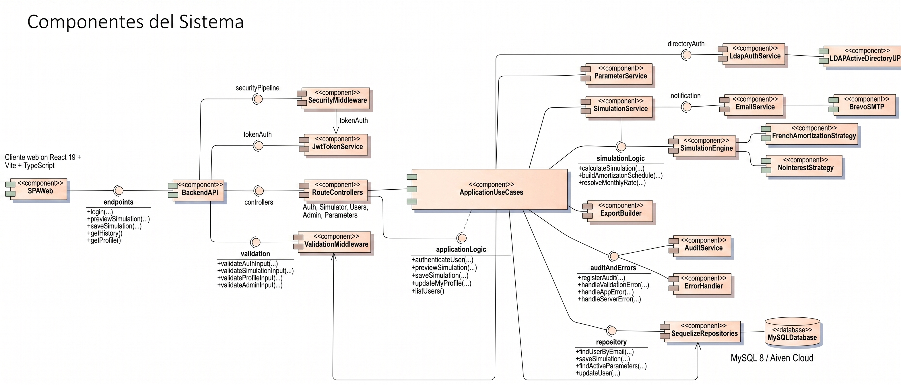
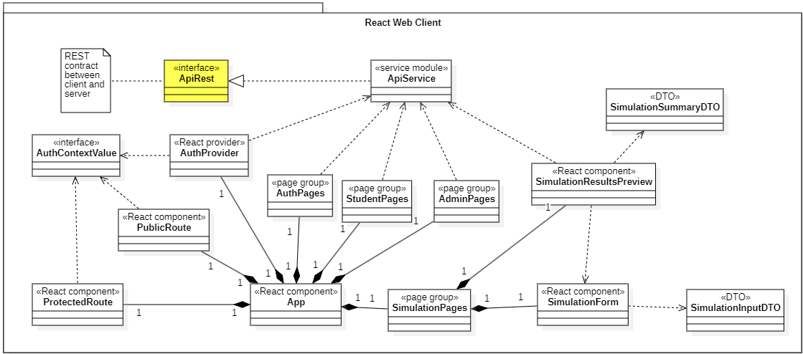
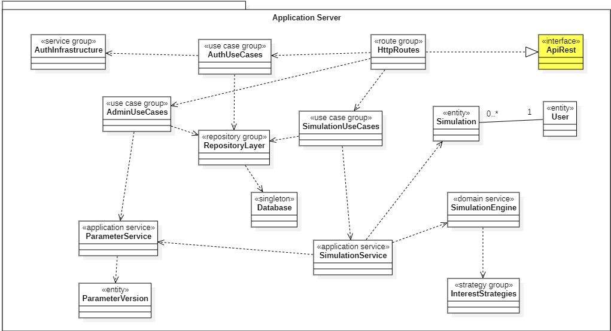
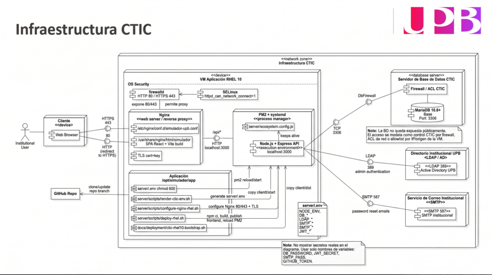

# ⚙️ Diseño del Sistema / System Design

**Simulador de Crédito UPB**

Documentación técnica de arquitectura, componentes, flujos, seguridad, datos y despliegue.

---

## 📌 Índice

1. [🌐 Vista de contexto](#1--vista-de-contexto)
2. [🧩 Componentes de aplicación](#2--componentes-de-aplicación)
3. [⚛️ Cliente React](#3-️-cliente-react)
4. [🟢 Servidor de aplicación](#4--servidor-de-aplicación)
5. [🔄 Flujos principales](#5--flujos-principales)
6. [🔐 Seguridad](#6--seguridad)
7. [🗄️ Modelo de datos](#7-️-modelo-de-datos)
8. [🚀 Despliegue](#8--despliegue)

---

## 1. 🌐 Vista de contexto

  
   
  <em>Usuarios, SPA React, API Node.js, base de datos, LDAP y SMTP.</em>

### 🧱 Responsabilidades por capa

| Capa | Componentes | Responsabilidad |
|---|---|---|
| 🎨 Presentación | React 19, Vite 8, TypeScript, Tailwind | Captura de datos, rutas por rol, formularios, resultados, historial y administración. |
| 🟢 Aplicación | Express 5, use cases, servicios, DTO | Exponer API REST, validar entradas, ejecutar reglas y responder en JSON/PDF/CSV. |
| 🧮 Dominio | `SimulationEngine`, estrategias financieras | Calcular cuotas, intereses, amortización y resumen financiero. |
| 🗄️ Datos | MySQL 8/Aiven, MariaDB/MySQL CTIC, Sequelize | Persistir usuarios, simulaciones, parámetros, auditoría y exportaciones. |
| 🔌 Integración | LDAP/AD, SMTP/Brevo o servicio institucional | Autenticar administradores y enviar correos transaccionales. |

---

## 2. 🧩 Componentes de aplicación

  
   
  <em>Componentes internos del backend, servicios de dominio, repositorios e integraciones externas.</em>

### 🧠 Componentes clave

| Componente | Propósito |
|---|---|
| `BackendAPI` | Punto de entrada HTTP; agrupa rutas, middlewares y controladores. |
| `SecurityMiddleware` | Helmet, CORS, rate limit, autenticación y autorización por rol. |
| `ValidationMiddleware` | Validación de payloads con esquemas y reglas de negocio. |
| `ApplicationUseCases` | Orquestación de autenticación, simulación, perfil, administración y exportaciones. |
| `SimulationEngine` | Motor financiero con estrategias intercambiables. |
| `SequelizeRepositories` | Acceso relacional a usuarios, simulaciones, parámetros y auditoría. |
| `EmailService` | Correos transaccionales y recuperación de contraseña. |
| `LdapAuthService` | Autenticación institucional de administradores. |

---

## 3. ⚛️ Cliente React

  
   
  <em>Rutas, proveedores, páginas y DTO usados por la SPA.</em>

### 🧭 Flujos de interfaz

| Flujo | Pantallas / componentes |
|---|---|
| 👤 Invitado | Landing, acceso invitado, formulario de simulación y resultados sin guardado. |
| 🎓 Estudiante | Login, panel principal, simulación, historial, detalle, exportación y perfil. |
| 🛡️ Administrador | Login administrativo, estudiantes, parámetros financieros y simulaciones. |
| ♻️ Compartido | `AuthProvider`, `ProtectedRoute`, `PublicRoute`, `ApiService`, validaciones y componentes UI. |

---

## 4. 🟢 Servidor de aplicación

  
   
  <em>Casos de uso, repositorios, servicios de aplicación y entidades principales.</em>

### 🏗️ Capas backend

| Capa | Ejemplos | Regla |
|---|---|---|
| `Core` | Entidades, interfaces de repositorio, errores | No depende de frameworks. |
| `Application` | Casos de uso, servicios, DTO, estrategias | Coordina reglas de negocio. |
| `Infrastructure` | Express, Sequelize, JWT, LDAP, SMTP, Swagger | Implementa detalles técnicos. |

---

## 5. 🔄 Flujos principales

### 🧮 Simulación de crédito

1. El usuario completa el formulario en la SPA.
2. El cliente valida estructura básica y envía `POST /api/simulator/preview`.
3. El backend aplica seguridad, sanitización y validación.
4. El caso de uso consulta la versión activa de parámetros.
5. `SimulationService` valida reglas de negocio.
6. `SimulationEngine` selecciona la estrategia financiera.
7. La API devuelve resumen, tabla de amortización y datos para gráficas.
8. Si el usuario autenticado decide guardar, se persiste la simulación y sus filas.

### 📄 Exportación

1. El usuario solicita PDF o CSV desde historial o detalle.
2. La API valida propiedad de la simulación o permiso administrador.
3. El backend consulta simulación, filas y parámetros.
4. El builder genera el archivo.
5. Se registra `export_logs` para auditoría.

### 🛠️ Administración de parámetros

1. El administrador consulta versiones financieras.
2. Modifica reglas de cuota inicial, tasas o configuración por nivel.
3. La API valida consistencia temporal y numérica.
4. La nueva configuración queda disponible para simulaciones posteriores.

---

## 6. 🔐 Seguridad

| Control | Aplicación |
|---|---|
| 🔑 Autenticación local | bcrypt + JWT para usuarios internos. |
| 🏛️ Autenticación institucional | LDAP/Active Directory para administradores cuando aplique. |
| 🛡️ Autorización | Guards por rol `STUDENT` y `ADMIN`. |
| 🌐 Seguridad HTTP | Helmet, CORS y rate limiting. |
| 🧹 Sanitización | Limpieza de entradas para reducir riesgo XSS. |
| 🔒 Secretos | `.env` y `ctic-rhel10.deploy.env` fuera de Git; solo plantillas versionadas. |
| 🧾 Auditoría | `audit_logs` y `export_logs` para operaciones relevantes. |

---

## 7. 🗄️ Modelo de datos

  
   
  <em>Modelo relacional final usado por la aplicación.</em>

### 📌 Tablas principales

| Tabla | Función |
|---|---|
| `users` | Usuarios y roles del sistema. |
| `simulations` | Simulaciones guardadas. |
| `amortization_rows` | Filas de amortización por simulación. |
| `parameter_versions` | Versiones de parámetros financieros. |
| `level_configs` | Configuración por nivel educativo. |
| `level_rate_rules` | Tasas por número de pagos. |
| `initial_payment_rules` | Reglas de cuota inicial. |
| `audit_logs` | Auditoría operativa. |
| `export_logs` | Trazabilidad de exportaciones. |
| `password_reset_tokens` | Recuperación de contraseña. |

---

## 8. 🚀 Despliegue

### 🟢 Producción CTIC

  

### 🟡 Preproducción

  

### 🔌 Puertos relevantes

| Servicio | Puerto |
|---|---:|
| HTTP | `80` |
| HTTPS | `443` |
| Backend Express local | `3000` |
| MariaDB/MySQL | `3306` |
| LDAP | `389` |
| SMTP | `587` |
