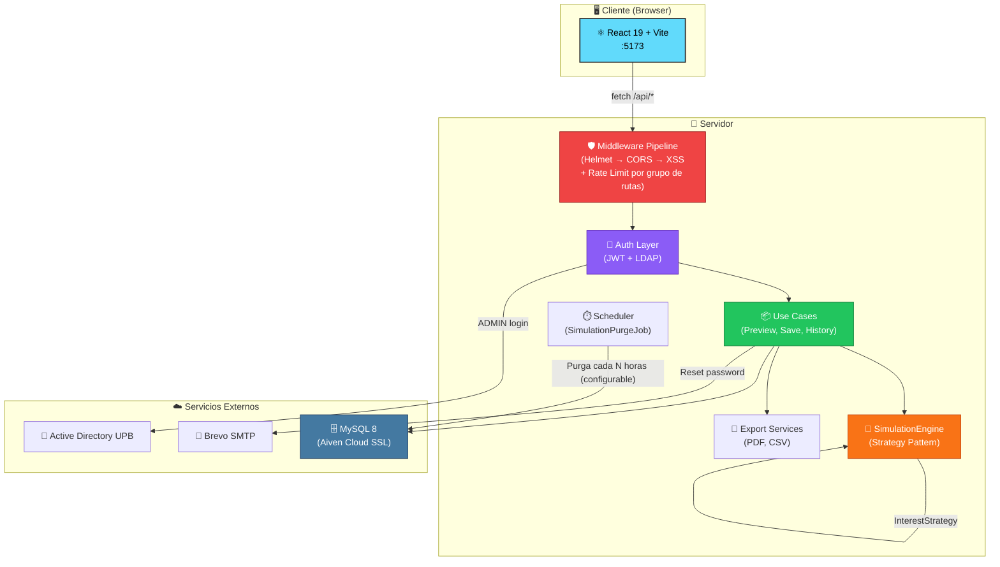
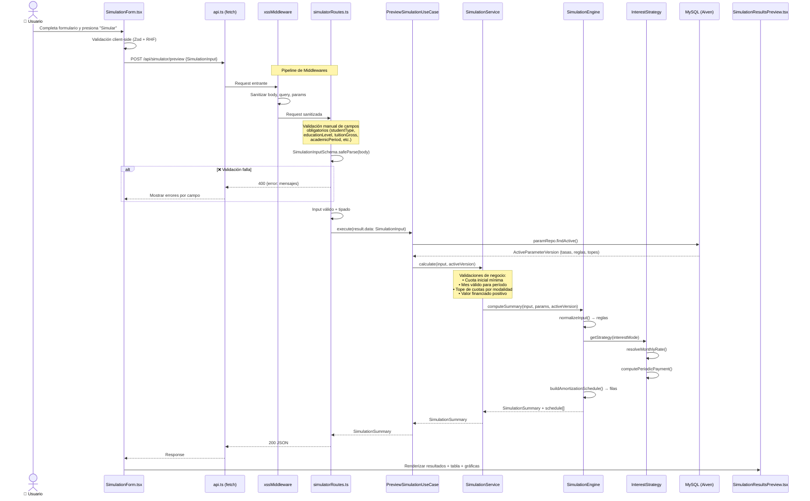
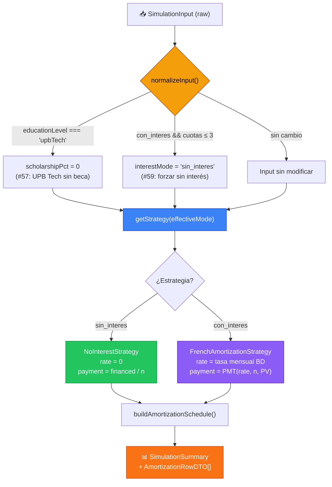
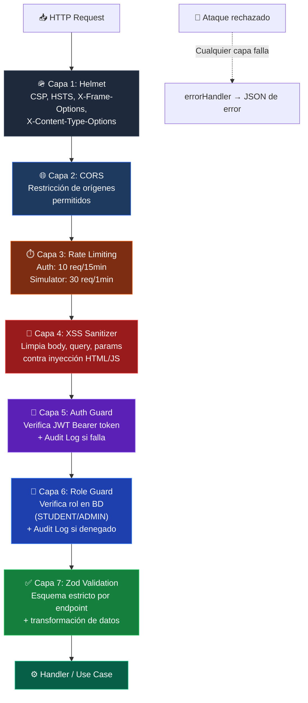
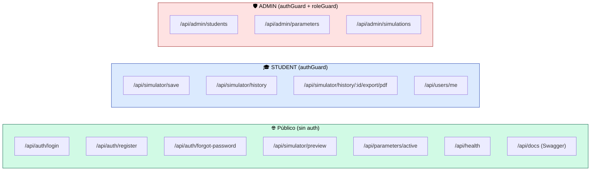
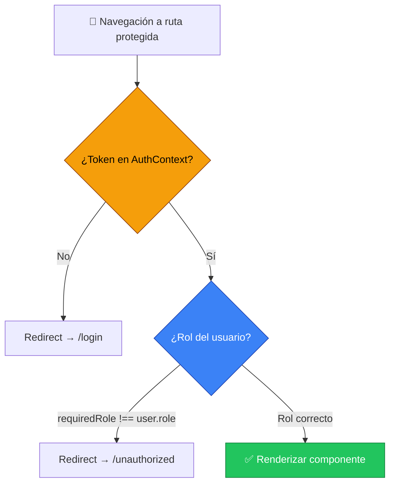
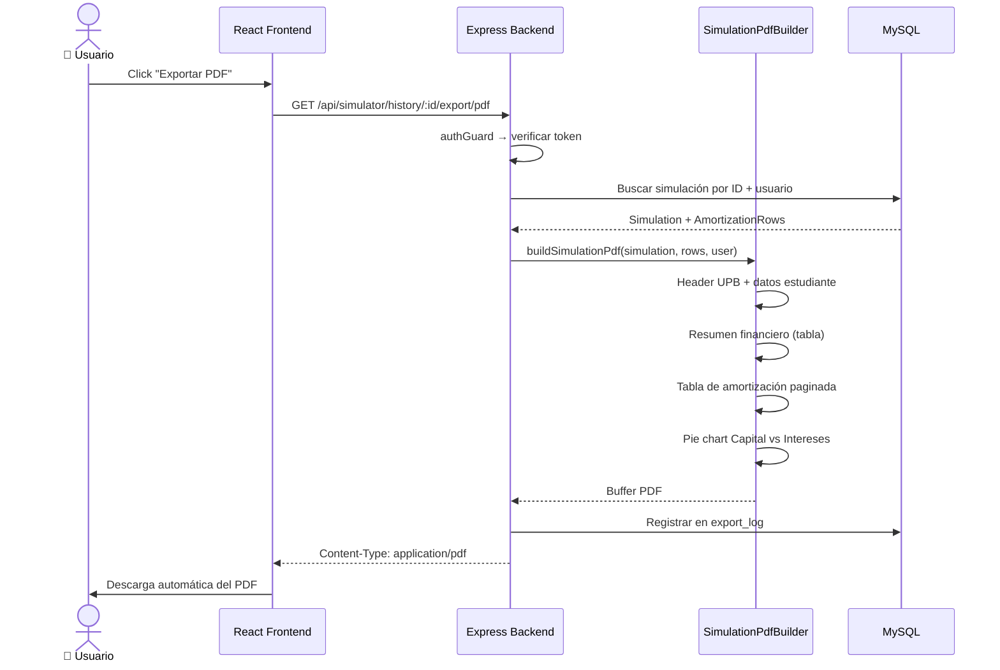
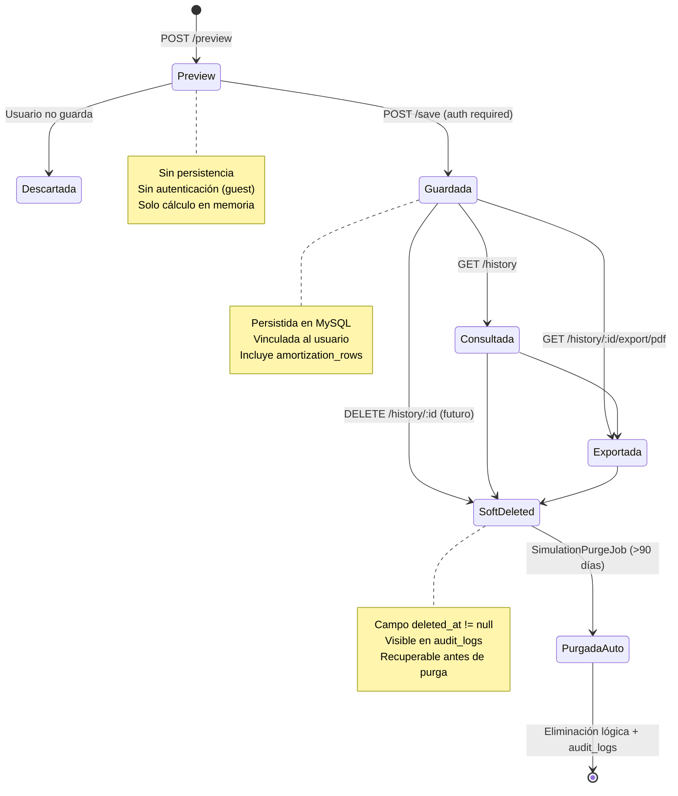
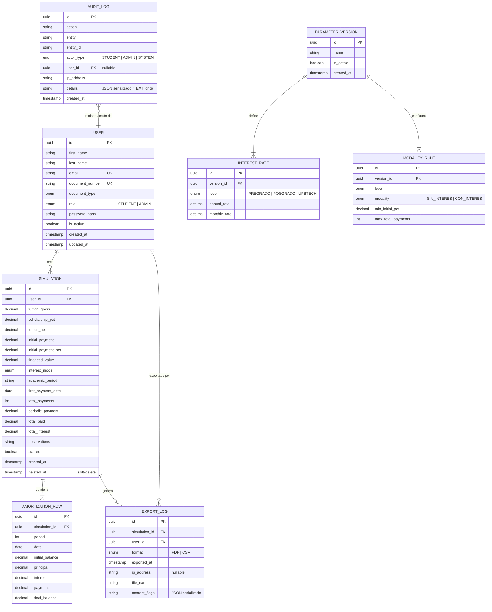

# ⚙️ Diseño del Sistema — Flujos Técnicos

**Simulador de Crédito UPB**

Documentación de los flujos de datos principales y el modelo de seguridad
implementado en la plataforma.

---

## Índice

1. [Arquitectura General del Sistema](#1-arquitectura-general-del-sistema)
2. [Flujo de Datos: Simulación de Crédito](#2-flujo-de-datos-simulación-de-crédito)
3. [Modelo de Seguridad — Defense in Depth](#3-modelo-de-seguridad--defense-in-depth)
4. [Flujo de Autenticación y Autorización](#4-flujo-de-autenticación-y-autorización)
5. [Flujo de Exportación PDF](#5-flujo-de-exportación-pdf)
6. [Ciclo de Vida de una Simulación](#6-ciclo-de-vida-de-una-simulación)
7. [Modelo de Datos](#7-modelo-de-datos)

---

## 1. Arquitectura General del Sistema

### Componentes y Responsabilidades

| Componente | Tecnología | Responsabilidad |
|---|---|---|
| **Frontend SPA** | React 19, Vite 7, TypeScript 5.9 | UI, formularios, gráficas, navegación por roles |
| **Middleware Pipeline** | Helmet, CORS, XSS, Rate Limit | Seguridad perimetral antes de cualquier lógica |
| **Auth Layer** | JWT (jsonwebtoken), bcrypt, LDAP | Autenticación dual + verificación de tokens |
| **Use Cases** | Clases TypeScript puras | Orquestación de lógica de negocio |
| **SimulationEngine** | Strategy Pattern + Money VO | Cálculo financiero (amortización, intereses) |
| **Export Services** | PDFKit, CSV builder | Generación de documentos exportables |
| **Scheduler** | `setInterval` + batch processing | Purga automática de simulaciones vencidas |
| **Base de Datos** | MySQL 8 (Aiven), Sequelize 6 | Persistencia relacional con SSL |
| **Email** | Nodemailer + Brevo SMTP | Correos de recuperación de contraseña |
| **Active Directory** | LDAP/AD UPB | Autenticación institucional de administradores |

---

## 2. Flujo de Datos: Simulación de Crédito

Este es el flujo completo desde que el usuario presiona "Simular" hasta que ve los resultados con la tabla de amortización.

### 2.1. Diagrama de Secuencia

### 2.2. Detalle del Motor Financiero

El `SimulationEngine` aplica las siguientes transformaciones antes de calcular:

### 2.3. Fórmula del Sistema Francés

La `FrenchAmortizationStrategy` calcula la cuota periódica usando la fórmula estándar de amortización francesa:

$$
\text{Cuota} = \frac{PV \times r}{1 - (1 + r)^{-n}}
$$

Donde:
- **PV** = Valor financiado (matrícula neta − cuota inicial)
- **r** = Tasa mensual efectiva (obtenida de `ActiveParameterVersion` en BD)
- **n** = Número de cuotas del plan (= `numberOfPayments - 1`, ya que la cuota 1 es la inicial)

---

## 3. Modelo de Seguridad — Defense in Depth

La seguridad se implementa como un pipeline de **7 capas** que toda request debe atravesar antes de llegar a la lógica de negocio.

### 3.1. Pipeline de Seguridad

### 3.2. Detalle por Capa

| Capa | Middleware | Archivo | Protección |
|---|---|---|---|
| 1 | `helmet()` | `app.ts:32` | Headers HTTP de seguridad (CSP, HSTS, X-Frame-Options, etc.) |
| 2 | `cors()` | `app.ts:33` | Previene requests de orígenes no autorizados |
| 3 | `authLimiter` / `simulatorLimiter` | `rateLimitGuard.ts` | Previene fuerza bruta (auth: 10/15min, sim: 30/1min) |
| 4 | `xssMiddleware()` | `xssMiddleware.ts` | Sanitiza `<script>`, HTML malicioso en toda entrada |
| 5 | `authGuard` | `authGuard.ts` | Verifica firma JWT, expiration, y registra intentos fallidos en audit log |
| 6 | `roleGuard(UserRole)` | `roleGuard.ts` | Verifica que el usuario exista en BD, esté activo, y tenga el rol requerido |
| 7 | `validateRequest(ZodSchema)` | `validateRequest.ts` | Valida y transforma body/query/params contra esquema estricto |

### 3.3. Medidas Adicionales

| Medida | Implementación | Propósito |
|---|---|---|
| **bcrypt** (factor 10) | `Infrastructure/auth/` | Hashing irreversible de contraseñas |
| **JWT con expiración** | `JwtTokenService` | Tokens de vida corta, sin estado en servidor |
| **Cache-Control: no-store** | `app.ts:41-46` | Impide que el browser cachee respuestas autenticadas (HU-05) |
| **Audit Log** | `AuditService.ts` | Registro de LOGIN_SUCCESS, LOGIN_FAILED, ACCESS_DENIED, TOKEN_EXPIRED, SESSION_EXPIRED |
| **Zod superRefine** | `SimulationInputSchema` | Validaciones cross-field (e.g., cuota mínima según nivel educativo) |
| **Error sanitization** | `errorHandler.ts` | Nunca expone stack traces ni detalles internos al cliente |

---

## 4. Flujo de Autenticación y Autorización

### 4.1. Mapa de Rutas por Nivel de Acceso

### 4.2. Protección Frontend

El frontend implementa un **doble control** de acceso:

Implementado en `App.tsx` con componentes `<ProtectedRoute requiredRole="STUDENT">` y `<PublicRoute>`.

---

## 5. Flujo de Exportación PDF

---

## 6. Ciclo de Vida de una Simulación

---

## 7. Modelo de Datos

### 7.1. Diagrama Entidad-Relación

### 7.2. Relaciones Clave

| Relación | Cardinalidad | Descripción |
|---|---|---|
| `USER → SIMULATION` | 1:N | Un usuario puede crear múltiples simulaciones |
| `SIMULATION → AMORTIZATION_ROW` | 1:N | Cada simulación genera N filas de amortización |
| `SIMULATION → EXPORT_LOG` | 1:N | Una simulación puede exportarse múltiples veces |
| `PARAMETER_VERSION → INTEREST_RATE` | 1:N | Una versión define tasas por nivel educativo |
| `PARAMETER_VERSION → MODALITY_RULE` | 1:N | Una versión define reglas por modalidad/nivel |
| `AUDIT_LOG → USER` | N:1 | Cada acción se vincula al usuario que la realizó |

---

> _"El diseño no es cómo se ve. El diseño es cómo funciona." — Steve Jobs_

🔙 <a href="../../README.md">Volver al README principal</a> · <a href="./technical-decisions.md">Decisiones Técnicas</a> · <a href="../README.md">Índice de Documentación</a>

