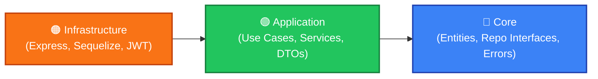
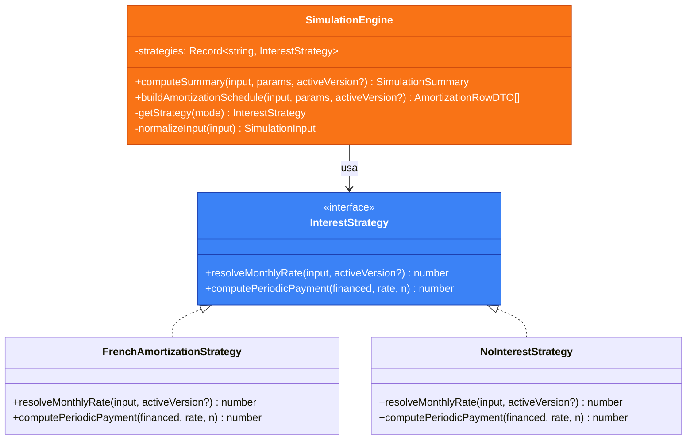
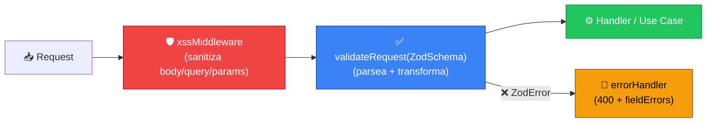

<div align="center">

# 🏗️ Decisiones Técnicas — ADR Log

**Simulador de Crédito UPB**

Registro de decisiones arquitectónicas (Architecture Decision Records) que fundamentan
las elecciones técnicas del proyecto.

</div>

---

## Índice

| # | Decisión | Estado |
|---|---|---|
| ADR-001 | [Clean Architecture como patrón estructural](#adr-001--clean-architecture-como-patrón-estructural) | ✅ Adoptada |
| ADR-002 | [Strategy Pattern para el Motor Financiero](#adr-002--strategy-pattern-para-el-motor-financiero) | ✅ Adoptada |
| ADR-003 | [Validación Server-Side con Zod + Sanitización XSS](#adr-003--validación-server-side-con-zod--sanitización-xss) | ✅ Adoptada |
| ADR-004 | [Autenticación Dual: JWT local + LDAP institucional](#adr-004--autenticación-dual-jwt-local--ldap-institucional) | ✅ Adoptada |
| ADR-005 | [Monorepo con npm Workspaces](#adr-005--monorepo-con-npm-workspaces) | ✅ Adoptada |
| ADR-006 | [React 19 + Vite como stack frontend](#adr-006--react-19--vite-como-stack-frontend) | ✅ Adoptada |
| ADR-007 | [MySQL en Aiven Cloud con Sequelize ORM](#adr-007--mysql-en-aiven-cloud-con-sequelize-orm) | ✅ Adoptada |
| ADR-008 | [Soft-Delete + Purga Automática de Simulaciones](#adr-008--soft-delete--purga-automática-de-simulaciones) | ✅ Adoptada |

---

## ADR-001 — Clean Architecture como patrón estructural

| Campo | Detalle |
|---|---|
| **Fecha** | Marzo 2026 |
| **Estado** | ✅ Adoptada |
| **Contexto** | El proyecto requiere un backend que sea testeable de forma aislada, mantenible a largo plazo y donde los cambios de framework (Express, Sequelize) no contaminen la lógica de negocio financiera. |

### Decisión

Se adopta **Clean Architecture** con tres capas estrictas:

```
server/src/
├── Core/               → Dominio puro (entidades, interfaces de repositorio, errores)
├── Application/        → Casos de uso, servicios, estrategias, DTOs
└── Infrastructure/     → Frameworks y drivers (Express, Sequelize, JWT, LDAP, Email)
```

### Flujo de Dependencias



> **Regla de oro:** Las dependencias siempre apuntan hacia adentro. `Core` no importa nada de `Application` ni `Infrastructure`.

### Alternativas Evaluadas

| Alternativa | Motivo de descarte |
|---|---|
| MVC clásico (Controller → Service → Model) | Acoplamiento alto entre lógica de negocio y framework. Dificulta testing y migración. |
| Hexagonal Architecture | Viable, pero más compleja de implementar para el tamaño del equipo. Clean Architecture ofrece la misma separación con convenciones más simples. |
| Sin arquitectura formal (scripts planos) | Inmantenible a medida que crecen los módulos (simulador, admin, auth, exportación). |

### Consecuencias

- ✅ **Testeabilidad**: `SimulationEngine` y `SimulationService` se testean sin levantar Express ni MySQL.
- ✅ **Independencia de framework**: Cambiar Express por Fastify solo requiere reescribir `Infrastructure/http/`.
- ✅ **Onboarding claro**: Nuevos desarrolladores ubican inmediatamente dónde colocar código según su naturaleza.
- ⚠️ **Más archivos**: La separación en capas genera más directorios y archivos que un MVC simple.
- ⚠️ **Curva de aprendizaje**: Requiere disciplina para no violar la regla de dependencias.

### Evidencia en el Código

| Capa | Ejemplo | Responsabilidad |
|---|---|---|
| `Core/entities/User.ts` | Entidad `User` con factory method y value objects | Reglas de dominio puro |
| `Core/entities/Money.ts` | Value Object para aritmética monetaria segura | Elimina errores de redondeo |
| `Application/use-cases/PreviewSimulationUseCase.ts` | Orquesta validación + cálculo | Caso de uso sin dependencia de HTTP |
| `Application/services/SimulationEngine.ts` | Motor financiero con Strategy Pattern | Lógica de negocio central |
| `Infrastructure/http/app.ts` | Configuración Express + middlewares | Cableado de framework |
| `Infrastructure/persistence/repositories/` | Implementaciones Sequelize de interfaces `Core` | Acceso a datos |

---

## ADR-002 — Strategy Pattern para el Motor Financiero

| Campo | Detalle |
|---|---|
| **Fecha** | Marzo 2026 |
| **Estado** | ✅ Adoptada |
| **Contexto** | El simulador debe calcular planes de pago con dos modalidades: **con interés** (Sistema Francés de amortización) y **sin interés** (cuotas iguales). Ambas comparten la misma estructura de tabla pero difieren en la resolución de tasa mensual y cuota periódica. |

### Decisión

Se implementa el **Strategy Pattern** mediante una interfaz `InterestStrategy` con dos implementaciones concretas registradas en un mapa estático dentro de `SimulationEngine`.

### Diagrama de Clases



### Registro de Estrategias

```typescript
// SimulationEngine.ts — línea 48
private static readonly strategies: Record<string, InterestStrategy> = {
  sin_interes: new NoInterestStrategy(),
  con_interes: new FrenchAmortizationStrategy(),
};
```

### Alternativas Evaluadas

| Alternativa | Motivo de descarte |
|---|---|
| `if/else` dentro del engine | Viola Open/Closed Principle. Agregar una tercera modalidad requiere modificar el engine. |
| Herencia (`SimulationEngine` → subclases) | Acoplamiento innecesario; el engine orquesta, no calcula. |
| Función pura con switch | Funcional, pero no permite inyección ni testing aislado de cada estrategia. |

### Consecuencias

- ✅ **Extensibilidad**: Agregar una nueva modalidad (e.g., "cuota fija con periodo de gracia") es crear una clase que implemente `InterestStrategy` y registrarla en el mapa.
- ✅ **Testing aislado**: Cada estrategia se testea con sus propios casos de borde sin involucrar el engine completo.
- ✅ **Claridad**: La fórmula financiera de cada modalidad vive en un solo lugar.
- ⚠️ **Indirección**: Un nivel más de abstracción que un cálculo directo.

### Regla de Negocio Crítica

```
Si interestMode === 'con_interes' && numberOfPayments <= 3
  → Se fuerza automáticamente a 'sin_interes'
```

Esta normalización ocurre en `SimulationEngine.normalizeInput()` y garantiza que planes cortos nunca cobren intereses, independientemente de lo que envíe el frontend.

---

## ADR-003 — Validación Server-Side con Zod + Sanitización XSS

| Campo | Detalle |
|---|---|
| **Fecha** | Marzo 2026 |
| **Estado** | ✅ Adoptada |
| **Contexto** | La aplicación recibe datos financieros sensibles del usuario. Toda entrada debe validarse estrictamente en el servidor (no confiar en el frontend) y sanitizarse contra inyecciones XSS antes de tocar la lógica de negocio. |

### Decisión

1. **Zod** como esquema de validación y transformación en servidor y cliente.
2. **Middleware `validateRequest`** genérico que valida `body`, `query` y `params` contra un esquema Zod y muta la request con datos transformados (trim, toLowerCase, etc.).
3. **Middleware `xssMiddleware`** global que sanitiza toda entrada antes de que llegue a cualquier handler.

### Pipeline de Validación



### Ejemplo Real: SimulationInputSchema

```typescript
// Application/dtos/SimulationInput.ts
export const SimulationInputSchema = z.object({
  studentType:    z.enum(['nuevo', 'continuo']),
  educationLevel: z.enum(['pregrado', 'posgrado', 'upbTech']),
  tuitionGross:   z.number().int().positive(),
  scholarshipPct: z.number().min(0).max(100),
  // ... 6 campos más con validaciones estrictas
}).superRefine((input, ctx) => {
  // Regla cross-field: pregrado/posgrado requieren mínimo 20% de cuota inicial
  if (input.educationLevel !== 'upbTech' && input.initialPaymentPct < 20) {
    ctx.addIssue({ ... });
  }
});
```

### Alternativas Evaluadas

| Herramienta | Motivo de descarte |
|---|---|
| Joi | API más verbosa, no comparte tipos con el frontend, sin inferencia TypeScript nativa. |
| express-validator | Basado en cadenas, no genera tipos. Difícil compartir esquemas cliente-servidor. |
| class-validator (decorators) | Requiere clases + reflect-metadata. Más pesado y menos funcional que Zod. |
| Validación manual (`if/else`) | No escalable, propenso a errores, sin tipado estático. |

### Consecuencias

- ✅ **Tipo seguro**: `z.infer<typeof Schema>` genera el tipo TypeScript automáticamente.
- ✅ **Compartido**: El mismo esquema se usa en frontend (React Hook Form + Zod resolver) y backend.
- ✅ **Transformación**: Zod aplica `.trim()`, `.toLowerCase()`, `.default()` durante el parseo.
- ✅ **Errores detallados**: El `errorHandler` devuelve `fieldErrors` con path exacto del campo inválido.
- ⚠️ **Dependencia fuerte**: Todo el proyecto depende de Zod para validación.

---

## ADR-004 — Autenticación Dual: JWT local + LDAP institucional

| Campo | Detalle |
|---|---|
| **Fecha** | Marzo 2026 |
| **Estado** | ✅ Adoptada |
| **Contexto** | La UPB requiere que los administradores se autentiquen con sus credenciales institucionales del Active Directory. Los estudiantes, en cambio, se registran con email y contraseña local. El sistema debe soportar ambos flujos de forma transparente. |

### Decisión

Implementar **autenticación dual** con:

| Rol | Mecanismo | Almacenamiento |
|---|---|---|
| **STUDENT** | Registro local → bcrypt hash → JWT | Base de datos MySQL |
| **ADMIN** | LDAP bind contra AD UPB → JWT | Active Directory (externo) |

Ambos flujos convergen en un **JWT stateless** que se envía al frontend y se valida en cada request protegida mediante `authGuard`.

### Flujo de Autenticación

```mermaid
sequenceDiagram
    actor U as Usuario
    participant FE as React Frontend
    participant BE as Express Backend
    participant DB as MySQL
    participant AD as Active Directory

    U->>FE: Ingresa credenciales
    FE->>BE: POST /api/auth/login {email, password, role}

    alt role === STUDENT
        BE->>DB: Buscar usuario por email
        DB-->>BE: User record
        BE->>BE: bcrypt.compare(password, hash)
    else role === ADMIN
        BE->>AD: LDAP bind (username, password)
        AD-->>BE: Bind result + user data
    end

    BE->>BE: Generar JWT (userId, role, exp)
    BE-->>FE: {user, token}
    FE->>FE: Guardar token en memoria
    FE->>BE: Requests subsiguientes con Authorization: Bearer <token>
    BE->>BE: authGuard → verifyToken()
    BE->>BE: roleGuard → verificar rol en BD
```



### Alternativas Evaluadas

| Alternativa | Motivo de descarte |
|---|---|
| Solo sesiones (cookies) | No stateless, complica escalabilidad horizontal y CORS con SPA. |
| OAuth2 / OpenID Connect | Sobredimensionado para el alcance actual. LDAP es el estándar de la UPB. |
| Solo LDAP para todos | Los estudiantes no tienen cuenta en el AD de la universidad. |
| Solo JWT local para todos | No cumple el requisito institucional de que los admins usen sus credenciales del AD. |

### Consecuencias

- ✅ **Cumplimiento institucional**: Admins usan sus credenciales AD existentes.
- ✅ **Autonomía estudiantil**: Estudiantes se registran sin depender de TI de la UPB.
- ✅ **Stateless**: JWT permite escalar sin sesiones compartidas.
- ✅ **Audit trail**: Cada login (exitoso o fallido) se registra en `audit_logs` con IP y tipo de actor.
- ⚠️ **Complejidad dual**: Dos flujos de autenticación que mantener y testear.
- ⚠️ **LDAP stub**: En desarrollo, el servicio LDAP es un stub; requiere integración real para producción.

---

## ADR-005 — Monorepo con npm Workspaces

| Campo | Detalle |
|---|---|
| **Fecha** | Marzo 2026 |
| **Estado** | ✅ Adoptada |
| **Contexto** | El proyecto tiene dos aplicaciones (frontend React + backend Express) que comparten tipos TypeScript y convenciones. Se necesita una estructura que permita desarrollo coordinado sin la complejidad de repositorios separados. |

### Decisión

Usar **npm workspaces** nativos con la siguiente estructura:

```json
// package.json (raíz)
{
  "workspaces": ["server", "client"],
  "scripts": {
    "dev": "concurrently \"npm run dev -w server\" \"npm run dev -w client\""
  }
}
```

### Alternativas Evaluadas

| Herramienta | Motivo de descarte |
|---|---|
| Turborepo / Nx | Potentes pero sobredimensionados para 2 workspaces. Agregan complejidad de configuración. |
| Lerna | En modo mantenimiento. npm workspaces cubre las necesidades del proyecto. |
| Repos separados | Dificulta compartir tipos, versionado coordinado y onboarding. |

### Consecuencias

- ✅ **Un solo `npm install`** instala dependencias de ambos proyectos.
- ✅ **`npm run dev`** levanta frontend y backend simultáneamente con `concurrently`.
- ✅ **Commits atómicos** que abarcan cambios frontend + backend.
- ⚠️ **Sin cache de builds** (Turborepo lo resolvería, pero no es necesario aún).

---

## ADR-006 — React 19 + Vite como stack frontend

| Campo | Detalle |
|---|---|
| **Fecha** | Marzo 2026 |
| **Estado** | ✅ Adoptada |
| **Contexto** | Se necesita un framework frontend moderno, rápido en desarrollo y con excelente ecosistema para formularios complejos, gráficas financieras y exportación. |

### Decisión

| Herramienta | Versión | Rol |
|---|---|---|
| **React** | 19 | UI library |
| **Vite** | 7 | Build tool + dev server (HMR ~50ms) |
| **TypeScript** | 5.9 | Tipado estático |
| **Tailwind CSS** | 4 | Utility-first styling |
| **React Hook Form** | 7 | Gestión de formularios sin re-renders |
| **Zod** | 4 | Validación + inferencia de tipos |
| **React Router** | 7 | Routing con rutas protegidas por rol |
| **Recharts** (planificado) | 2 | Gráficas financieras (donut, bar) — aún no integrado en el código ni en package.json |
| **Lucide React** | — | Iconografía consistente |
| **Vitest** | — | Testing unitario |

### Alternativas Evaluadas

| Alternativa | Motivo de descarte |
|---|---|
| Next.js | SSR innecesario para una SPA interna. Agrega complejidad de servidor. |
| Angular | Curva de aprendizaje más alta para el equipo. Más verboso para formularios dinámicos. |
| Vue 3 + Nuxt | Ecosistema más pequeño para el tipo de validaciones financieras requeridas. |
| Create React App | Deprecated. Vite es el reemplazo oficial recomendado por el equipo de React. |

---

## ADR-007 — MySQL en Aiven Cloud con Sequelize ORM

| Campo | Detalle |
|---|---|
| **Fecha** | Marzo 2026 |
| **Estado** | ✅ Adoptada |
| **Contexto** | Se requiere persistencia relacional para usuarios, simulaciones, tablas de amortización, parámetros financieros y logs de auditoría. La base de datos debe ser accesible desde cualquier entorno de desarrollo del equipo. |

### Decisión

| Componente | Elección | Justificación |
|---|---|---|
| **Motor de BD** | MySQL 8 | Requisito del área de TI de la UPB. Estándar institucional. |
| **Hosting** | Aiven Cloud | BD compartida accesible por todo el equipo sin configuración local. SSL obligatorio. |
| **ORM** | Sequelize 6 | Maduro, soporte nativo MySQL, migraciones, modelos declarativos TypeScript. |
| **Conexión** | SSL/TLS (certificado CA) | Requerido por Aiven. Certificado almacenado en `server/certs/` (gitignored). |

### Alternativas Evaluadas

| Alternativa | Motivo de descarte |
|---|---|
| PostgreSQL | Excelente técnicamente, pero no es el estándar de la UPB. |
| MongoDB | NoSQL no es ideal para datos financieros con relaciones fuertes (user → simulations → amortization_rows). |
| Prisma | Moderno, pero el equipo ya tenía experiencia con Sequelize. |
| BD local por desarrollador | Inconsistencias de esquema y datos entre miembros del equipo. |

---

## ADR-008 — Soft-Delete + Purga Automática de Simulaciones

| Campo | Detalle |
|---|---|
| **Fecha** | Marzo 2026 |
| **Estado** | ✅ Adoptada |
| **Contexto** | Las simulaciones deben eliminarse después de 90 días por política de retención de datos. Sin embargo, eliminar registros directamente impide auditoría y recuperación ante errores. |

### Decisión

1. **Soft-delete**: Las simulaciones se marcan con `deleted_at` en lugar de eliminarse físicamente.
2. **Purga automática (soft-delete)**: Un `SimulationPurgeJob` ejecuta periódicamente (cada N horas, configurable vía `PURGE_INTERVAL_HOURS`) un batch que selecciona simulaciones con `saved_at` ≤ NOW() − retentionDays y `deleted_at IS NULL`, y les aplica soft-delete seteando `deleted_at` y `delete_reason` (sin borrado físico).
3. **Audit log**: Cada ejecución del job genera un registro en `audit_logs` con el número de registros eliminados lógicamente.

### Consecuencias

- ✅ **Recuperación**: Un admin puede restaurar simulaciones "eliminadas" antes de la purga.
- ✅ **Trazabilidad**: Toda eliminación queda registrada en `audit_logs`.
- ✅ **Cumplimiento**: La política de retención de 90 días se aplica automáticamente.
- ⚠️ **Crecimiento de BD**: Las simulaciones "eliminadas" ocupan espacio hasta la purga.

---

<div align="center">

> _"La arquitectura es la forma de las decisiones que tomamos." — Grady Booch_

<sub>🔙 <a href="../../README.md">Volver al README principal</a> · <a href="../README.md">Índice de Documentación</a></sub>

</div>
