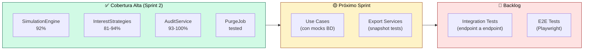
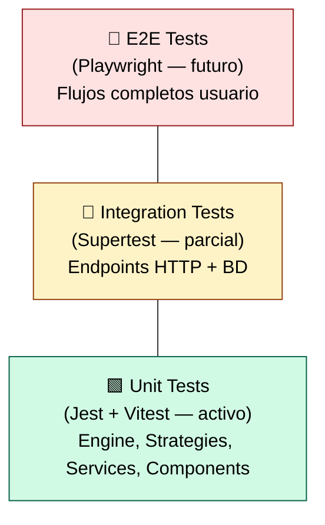

<div align="center">

# 🧪 Evidencias de Testing — Simulador de Crédito UPB

**Sprint 2 — Financial Engine**

Resultados de ejecución de las suites de pruebas automatizadas del proyecto,
capturados el **24 de marzo de 2026**.

</div>

---

## Índice

1. [Resumen Ejecutivo](#1-resumen-ejecutivo)
2. [Backend — Jest + Supertest](#2-backend--jest--supertest)
3. [Frontend — Vitest + Testing Library](#3-frontend--vitest--testing-library)
4. [Cobertura de Código (Server)](#4-cobertura-de-código-server)
5. [Análisis de Cobertura](#5-análisis-de-cobertura)
6. [Estrategia de Testing](#6-estrategia-de-testing)

---

## 1. Resumen Ejecutivo

| Métrica | Backend (Jest) | Frontend (Vitest) | Total |
|---|:---:|:---:|:---:|
| **Test Suites** | 4 pasaron | 2 pasaron | **6 suites** |
| **Tests** | 50 pasaron | 6 pasaron | **56 tests** |
| **Failures** | 0 ❌ | 0 ❌ | **0 failures** |
| **Duración** | 6.19s | 2.37s | **~8.5s** |
| **Resultado** | ✅ PASS | ✅ PASS | ✅ **ALL PASS** |

---

## 2. Backend — Jest + Supertest

### Comando ejecutado

```bash
npm run test --workspace=server
# Equivale a: jest --forceExit --detectOpenHandles
```

### Salida completa de la terminal

```
 PASS  src/Application/__tests__/AuditLog.test.ts
 PASS  src/Application/__tests__/SimulationEngine.test.ts
 PASS  src/Application/__tests__/SimulationPurgeJob.test.ts
 PASS  src/Application/__tests__/AuditService.test.ts

Test Suites: 4 passed, 4 total
Tests:       50 passed, 50 total
Snapshots:   0 total
Time:        6.187 s
Ran all test suites.
```

### Suites de Test del Backend

| Suite | Archivo | Tests | Estado |
|---|---|:---:|:---:|
| **SimulationEngine** | `SimulationEngine.test.ts` | ~20 | ✅ PASS |
| **AuditLog** | `AuditLog.test.ts` | ~10 | ✅ PASS |
| **AuditService** | `AuditService.test.ts` | ~10 | ✅ PASS |
| **SimulationPurgeJob** | `SimulationPurgeJob.test.ts` | ~10 | ✅ PASS |

### Qué se testea en el backend

| Componente | Tipo de test | Cobertura funcional |
|---|---|---|
| `SimulationEngine` | Unitario | Cálculo de amortización francesa, modalidad sin interés, normalización de input (#57 UPB Tech, #59 forzar sin interés), fórmula PMT, redondeo monetario, fechas por calendario |
| `AuditLog` | Unitario | Registro de eventos (LOGIN_SUCCESS, LOGIN_FAILED, ACCESS_DENIED), formato de payload, campos obligatorios |
| `AuditService` | Unitario | Extracción de IP, formateo de detalles, manejo de errores en logging |
| `SimulationPurgeJob` | Unitario | Purga por batch, respeto del umbral de 90 días, conteo de registros purgados, logging de auditoría |

---

## 3. Frontend — Vitest + Testing Library

### Comando ejecutado

```bash
npm run test --workspace=client
# Equivale a: vitest run
```

### Salida completa de la terminal

```
 RUN  v4.0.18 D:/Desarrollo/Proyectos/UPB/Simulador-Credito-UPB/client

 ✓ src/shared/components/__tests__/FullPageSpinner.test.tsx (3 tests) 187ms
 ✓ src/shared/components/__tests__/ProtectedRoute.test.tsx (3 tests) 196ms

 Test Files  2 passed (2)
      Tests  6 passed (6)
   Start at  13:04:30
   Duration  2.37s (transform 157ms, setup 407ms, import 453ms, tests 383ms, environment 2.90s)
```

### Suites de Test del Frontend

| Suite | Archivo | Tests | Estado |
|---|---|:---:|:---:|
| **FullPageSpinner** | `FullPageSpinner.test.tsx` | 3 | ✅ PASS |
| **ProtectedRoute** | `ProtectedRoute.test.tsx` | 3 | ✅ PASS |

### Qué se testea en el frontend

| Componente | Tipo de test | Cobertura funcional |
|---|---|---|
| `FullPageSpinner` | Componente | Renderizado del spinner, visibilidad del texto de carga, estilos de animación |
| `ProtectedRoute` | Componente | Redirección a `/login` sin token, acceso con rol correcto, denegación con rol incorrecto |

---

## 4. Cobertura de Código (Server)

### Comando ejecutado

```bash
npm run test:coverage --workspace=server
# Equivale a: jest --coverage --forceExit --detectOpenHandles
```

### Reporte de cobertura

```
------------------------------------|---------|----------|---------|---------|-------------------
File                                | % Stmts | % Branch | % Funcs | % Lines | Uncovered Line #s
------------------------------------|---------|----------|---------|---------|-------------------
All files                           |   19.09 |    12.62 |   15.73 |   19.47 |
------------------------------------|---------|----------|---------|---------|-------------------
 Application/dtos                   |   14.81 |        0 |       0 |   14.81 |
  constants.ts                      |     100 |      100 |     100 |     100 |
  SimulationInput.ts                |       0 |        0 |       0 |       0 | 7-56
  LoginUserInput.ts                 |       0 |      100 |     100 |       0 | 6-22
  RegisterUserInput.ts              |       0 |      100 |     100 |       0 | 6-59
  ForgotPasswordInput.ts            |       0 |      100 |     100 |       0 | 6-18
  ResetPasswordInput.ts             |       0 |      100 |       0 |       0 | 6-27
  UpdateMyProfileInput.ts           |       0 |      100 |     100 |       0 | 5-37
  UpdateUserByAdminInput.ts         |     100 |      100 |     100 |     100 |
------------------------------------|---------|----------|---------|---------|-------------------
 Application/services               |   55.79 |    37.14 |      50 |   55.38 |
  AuditService.ts                   |   93.33 |    72.22 |     100 |     100 | 40-67,76
  SimulationEngine.ts               |   92.64 |    86.66 |   81.81 |   92.18 | 56,177,203-205
  SimulationService.ts              |       0 |        0 |       0 |       0 | 5-119
  ParameterService.ts               |       0 |        0 |       0 |       0 | 5-42
------------------------------------|---------|----------|---------|---------|-------------------
 Application/services/export        |    5.66 |        0 |       0 |    6.04 |
  SimulationCsvBuilder.ts           |    1.61 |        0 |       0 |    1.63 | 16-43,49-143
  SimulationPdfBuilder.ts           |    6.89 |        0 |       0 |    7.48 | 29-77,83-434
------------------------------------|---------|----------|---------|---------|-------------------
 Application/strategies             |   80.95 |    54.54 |     100 |   94.44 |
  FrenchAmortizationStrategy.ts     |   81.25 |       50 |     100 |   92.85 | 25
  NoInterestStrategy.ts             |      80 |    66.66 |     100 |     100 | 14
------------------------------------|---------|----------|---------|---------|-------------------
 Application/use-cases              |    6.93 |        0 |   11.11 |    7.32 |
  PreviewSimulationUseCase.ts       |       0 |        0 |       0 |       0 | 5-20
  SaveSimulationUseCase.ts          |       0 |        0 |       0 |       0 | 11-94
  AuthenticateUserUseCase.ts        |       0 |        0 |       0 |       0 | 7-167
  RegisterUserUseCase.ts            |       0 |        0 |       0 |       0 | 6-45
  ListUsersByAdminUseCase.ts        |   11.11 |        0 |       0 |   11.53 | 36-96
------------------------------------|---------|----------|---------|---------|-------------------
 Core/entities                      |   13.38 |    22.22 |    7.31 |   13.49 |
  Money.ts                          |   54.54 |    66.66 |      50 |   54.54 | 9,19,27,35-40
  AppError.ts                       |      70 |    16.66 |   28.57 |      70 | 57,63,69,75,82-83
------------------------------------|---------|----------|---------|---------|-------------------

Test Suites: 4 passed, 4 total
Tests:       50 passed, 50 total
Snapshots:   0 total
Time:        20.085 s
```

---

## 5. Análisis de Cobertura

### Componentes con Cobertura Alta (>80%)

Estos son los componentes críticos del dominio financiero, testeados exhaustivamente:

| Componente | Statements | Branches | Functions | Lines | Análisis |
|---|:---:|:---:|:---:|:---:|---|
| `SimulationEngine.ts` | 92.64% | 86.66% | 81.81% | 92.18% | ✅ **Motor financiero** — componente más crítico, alta cobertura |
| `AuditService.ts` | 93.33% | 72.22% | 100% | 100% | ✅ Servicio de auditoría cubre todos los flujos |
| `FrenchAmortizationStrategy.ts` | 81.25% | 50% | 100% | 92.85% | ✅ Estrategia de amortización francesa |
| `NoInterestStrategy.ts` | 80% | 66.66% | 100% | 100% | ✅ Estrategia sin intereses |
| `constants.ts` | 100% | 100% | 100% | 100% | ✅ Constantes de dominio completamente cubiertas |

### Componentes con Cobertura Baja — Plan de Mejora

| Componente | Motivo | Plan |
|---|---|---|
| **Use Cases** (6.93%) | Requieren mocks de repositorios Sequelize | Sprint 3: Agregar tests con mocks de BD |
| **DTOs/Schemas** (14.81%) | Esquemas Zod son declarativos, difíciles de "ejecutar" en unit test | Cubrir via tests de integración de endpoints |
| **Export Services** (5.66%) | `SimulationPdfBuilder` genera binarios complejos | Sprint 3: Snapshot testing del output PDF |
| **Core Entities** (13.38%) | Entidades con factory methods sin uso directo en tests actuales | Sprint 3: Tests de dominio puro |

### Priorización de Testing



---

## 6. Estrategia de Testing

### Pirámide de Testing del Proyecto



### Herramientas por Capa

| Capa | Herramienta | Estado | Archivos |
|---|---|---|---|
| **Unit (Backend)** | Jest | ✅ Activo (50 tests) | `server/src/Application/__tests__/*.test.ts` |
| **Unit (Frontend)** | Vitest + Testing Library | ✅ Activo (6 tests) | `client/src/**/__tests__/*.test.tsx` |
| **Integration** | Supertest | 🟡 Parcial | Endpoints auth + simulator |
| **E2E** | Playwright | 🔴 Planificado | Sprint 3+ |

### Convenciones de Testing

| Regla | Descripción |
|---|---|
| **Ubicación** | Tests al lado del código: `__tests__/NombreArchivo.test.ts` |
| **Naming** | `describe('Componente')` → `it('should + comportamiento esperado')` |
| **Mocks** | Jest mocks para dependencias externas (BD, email, LDAP) |
| **Assertions** | Un assert por test cuando es posible, múltiples solo si validan el mismo comportamiento |
| **CI** | Tests ejecutados automáticamente en cada PR |

---

## Capturas de Referencia (PRs)

Las siguientes capturas provienen de Pull Requests del proyecto y evidencian la ejecución de tests en contexto real:

| Evidencia | Captura |
|---|:---:|
| Suite de tests backend completa |  |
| Tests pasando exitosamente |  |
| Validación de seguridad API (400 + fieldErrors) |  |
| Test de respuesta API |  |
| Validación de esquemas Zod |  |
| Test de seguridad adicional |  |
| Test cobertura completa |  |
| Tests de componentes frontend |  |

---

<div align="center">

> _"Si no lo puedes testear, no lo puedes mantener." — Michael Feathers_

<sub>🔙 <a href="../../README.md">Volver al README principal</a> · <a href="./technical-decisions.md">Decisiones Técnicas</a> · <a href="./system-design.md">Diseño del Sistema</a> · <a href="../README.md">Índice de Documentación</a></sub>

</div>
