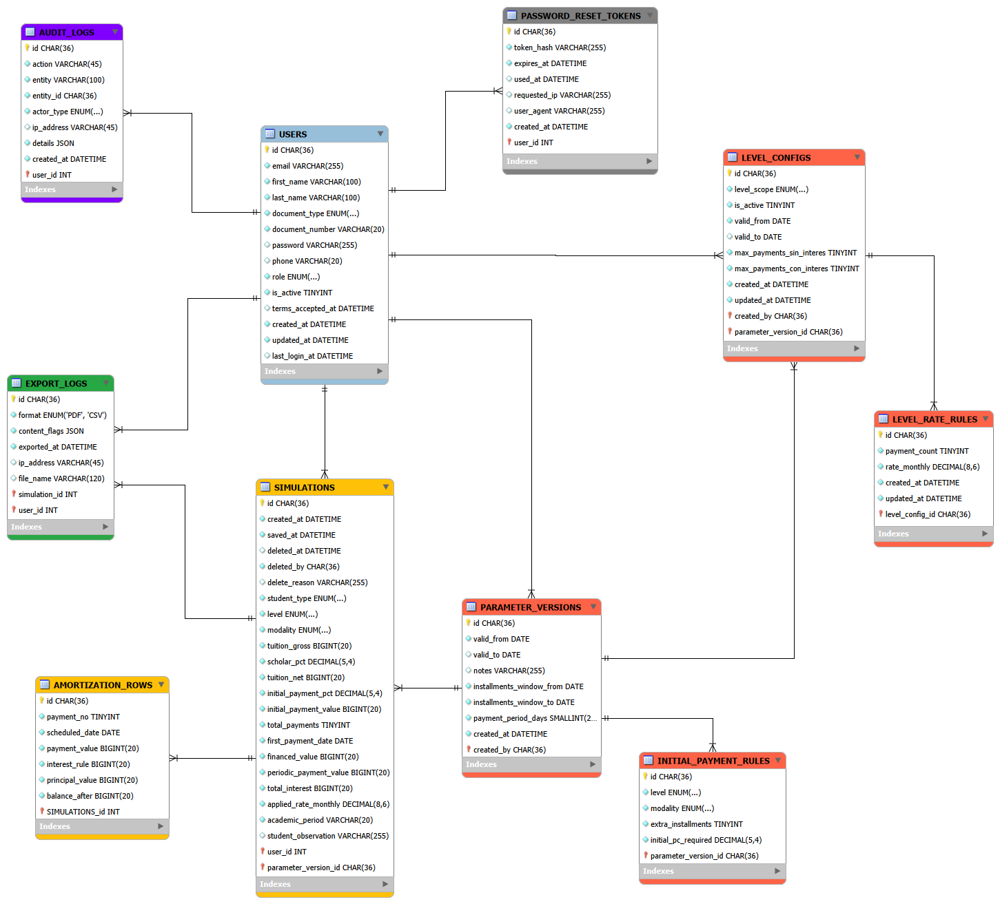
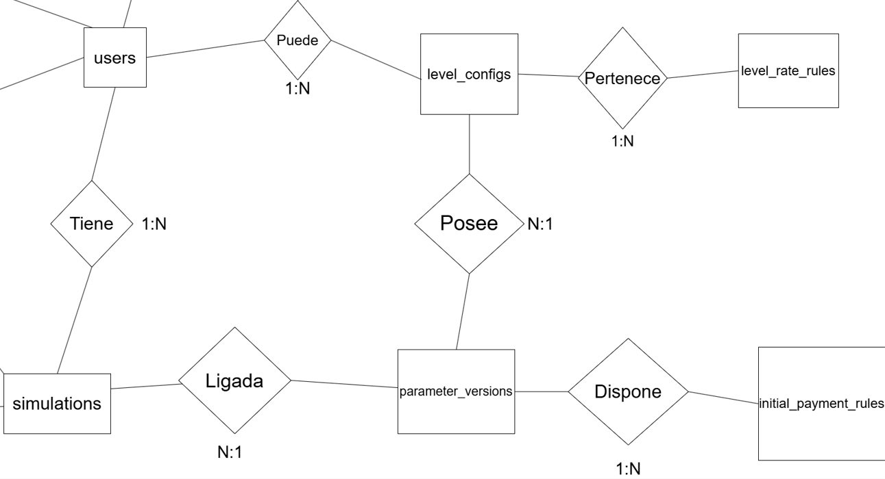
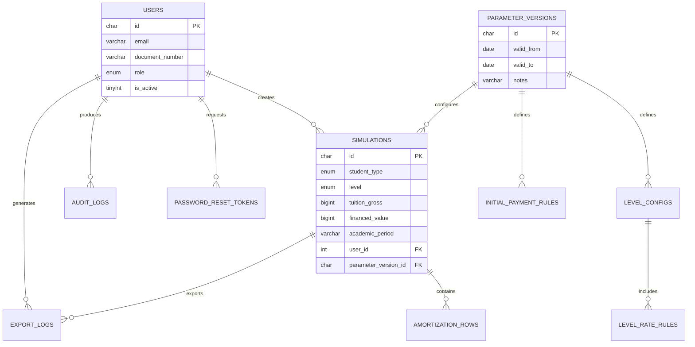

# Base de Datos

La persistencia del Simulador de Credito UPB se modela sobre MySQL 8 en Aiven para preproduccion y MariaDB/MySQL administrado por CTIC para el entorno objetivo. El backend usa Sequelize y debe operar con permisos funcionales; la estructura se entrega mediante scripts SQL versionados.

## Modelo relacional

El archivo legacy [`er-diagram.png`](./er-diagram.png) y la imagen historica [`diagrama simulador.png`](./diagrama%20simulador.png) fueron actualizados con el mismo modelo relacional para mantener compatibilidad con enlaces existentes.

## Modelo conceptual

## Entidades principales

## Archivos

| Archivo | Proposito |
|---|---|
| [`data-dictionary.html`](./data-dictionary.html) | Diccionario de tablas, columnas, tipos y restricciones. |
| [`hu-66/backup-migration.md`](./hu-66/backup-migration.md) | Procedimiento de preparacion, backup y migracion CTIC. |
| [`hu-66/scripts/00_ctic_full_deploy_mariadb_10_11.sql`](./hu-66/scripts/00_ctic_full_deploy_mariadb_10_11.sql) | Script consolidado para crear estructura, datos tecnicos y permisos. |
| [`hu-66/scripts/01_pre_migration_validation.sql`](./hu-66/scripts/01_pre_migration_validation.sql) | Consultas de inventario e integridad antes de migrar. |
| [`hu-66/scripts/02_post_restore_validation.sql`](./hu-66/scripts/02_post_restore_validation.sql) | Consultas de validacion posterior a restauracion. |

## Consideraciones para CTIC

- Puerto por defecto de MariaDB/MySQL: `3306`.
- La base de datos no debe exponerse publicamente; el acceso debe limitarse por firewall, ACL o allowlist de la VM.
- El usuario tecnico del backend no debe requerir permisos estructurales como `ALTER` o `DROP` en operacion normal.
- Los dumps reales y resultados con datos sensibles deben mantenerse fuera de Git.
