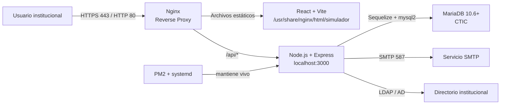

<div align="center">

# 🟢 Despliegue en Producción CTIC — HU-59

**Simulador de Crédito UPB**

Guía técnica oficial para el despliegue productivo on-premise en infraestructura
administrada por CTIC.

</div>

---

## Índice

1. [Objetivo](#1-objetivo)
2. [Arquitectura Productiva](#2-arquitectura-productiva)
3. [Stack Requerido](#3-stack-requerido)
4. [Recursos Estimados](#4-recursos-estimados)
5. [Base de Datos MariaDB](#5-base-de-datos-mariadb)
6. [Variables de Entorno](#6-variables-de-entorno)
7. [Puertos, Proxy y Exposición](#7-puertos-proxy-y-exposición)
8. [PM2, Systemd y Persistencia](#8-pm2-systemd-y-persistencia)
9. [Artefactos Entregados](#9-artefactos-entregados)
10. [Procedimiento de Despliegue](#10-procedimiento-de-despliegue)
11. [Validación Operativa](#11-validación-operativa)
12. [Responsabilidades CTIC / Equipo UPB](#12-responsabilidades-ctic--equipo-upb)

---

## 1. Objetivo

Este documento describe el despliegue productivo solicitado por CTIC para el
**Simulador de Crédito UPB**, sin dependencia de GitHub Actions en producción.

El modelo propuesto usa una VM Red Hat Enterprise Linux para la aplicación:
Nginx publica el frontend y actúa como reverse proxy, mientras PM2 mantiene el
backend Node.js/Express ejecutándose como servicio persistente mediante systemd.

---

## 2. Arquitectura Productiva



### Componentes

| Componente | Tecnología | Responsabilidad |
|---|---|---|
| **Servidor web** | Nginx | Publicar SPA y enrutar `/api/*` al backend |
| **Frontend** | React + Vite | Aplicación estática compilada en `client/dist` |
| **Backend** | Node.js + Express | API REST, autenticación, simulaciones, exportaciones |
| **Gestor de proceso** | PM2 | Reinicio automático, cluster y persistencia |
| **Persistencia** | MariaDB 10.6+ | Datos de usuarios, simulaciones, parámetros y auditoría |
| **Servicio del SO** | systemd | Arranque de PM2 después de reinicios de VM |

---

## 3. Stack Requerido

| Capa | Versión / Requisito |
|---|---|
| Sistema operativo | Red Hat Enterprise Linux |
| Node.js | 20+ LTS |
| npm | Compatible con la versión instalada de Node.js |
| Nginx | Versión estable provista por repositorios CTIC |
| PM2 | Instalado globalmente con `npm install -g pm2` |
| Base de datos | MariaDB 10.6+ |

> Nota: el entorno de pre-producción opera actualmente con Node.js `v24.14.0`;
> para producción CTIC se recomienda Node.js **20+ LTS** por estabilidad de soporte.

---

## 4. Recursos Estimados

| Recurso | Estimación inicial | Comentario |
|---|---:|---|
| CPU | 4 vCPU | Permite PM2 cluster y operación concurrente moderada |
| RAM | 8 GB | Suficiente para Nginx, Node.js y jobs internos |
| Disco | 50 GB | Código, logs, dependencias, builds y crecimiento operativo |
| Base de datos inicial | < 2 GB | Estimación para arranque productivo |
| Crecimiento anual BD | < 500 MB | Depende del volumen real de simulaciones y auditoría |

---

## 5. Base de Datos MariaDB

CTIC debe entregar una base de datos MariaDB 10.6+ vacía y un usuario de
aplicación con privilegios sobre esa base.

### Requerimientos

| Requisito | Detalle |
|---|---|
| Motor | MariaDB 10.6+ |
| Ubicación | Misma VM o servidor dedicado de BD administrado por CTIC |
| Estado inicial | Base de datos vacía creada previamente |
| Usuario | Usuario exclusivo de aplicación |
| Privilegios DDL | Crear y ajustar tablas, índices y estructuras requeridas |
| Privilegios DML | Insertar, consultar, actualizar y eliminar datos operativos |
| Conectividad | Acceso desde la VM de aplicación al puerto MariaDB definido por CTIC |

La aplicación ejecuta rutinas de inicialización/migración al iniciar el backend.
Por ello, CTIC no necesita cargar manualmente tablas, pero sí debe entregar la BD
y el usuario antes del primer arranque.

---

## 6. Variables de Entorno

CTIC debe crear manualmente el archivo:

```text
server/.env
```

El archivo no se versiona en Git y debe permanecer protegido en el servidor.

### Matriz de Variables

| Variable | Tipo | Requerida | Descripción |
|---|---|:---:|---|
| `NODE_ENV` | Backend | Sí | Usar `production` |
| `PORT` | Backend | Sí | Puerto interno del backend. Valor esperado: `3000` |
| `FRONTEND_URL` | Backend | Sí | URL pública del frontend |
| `DB_HOST` | Backend | Sí | Host o IP de MariaDB |
| `DB_PORT` | Backend | Sí | Puerto de MariaDB |
| `DB_NAME` | Backend | Sí | Nombre de la base |
| `DB_USER` | Backend | Sí | Usuario de aplicación |
| `DB_PASSWORD` | Secreto | Sí | Contraseña del usuario de BD |
| `DB_SSL` | Backend | Sí | En la versión actual debe ser `true` en `NODE_ENV=production` |
| `JWT_SECRET` | Secreto | Sí | Secreto robusto para firma JWT |
| `JWT_EXPIRES_IN` | Backend | Sí | Vigencia de token, por ejemplo `8h` |
| `LDAP_URL` | Backend | Sí | URL LDAP/Active Directory |
| `LDAP_DOMAIN` | Backend | Sí | Dominio institucional |
| `LDAP_BASE_DN` | Backend | Sí | Base DN de búsqueda LDAP |
| `LDAP_TIMEOUT_MS` | Backend | No | Timeout LDAP. Valor sugerido: `5000` |
| `SMTP_HOST` | Backend | Sí | Host SMTP |
| `SMTP_PORT` | Backend | Sí | Puerto SMTP, normalmente `587` |
| `SMTP_USER` | Backend | Sí | Usuario SMTP |
| `SMTP_PASS` | Secreto | Sí | Contraseña/token SMTP |
| `SMTP_FROM_EMAIL` | Backend | Sí | Remitente institucional |
| `VITE_API_URL` | Frontend | Sí | URL de API usada durante build. Recomendado: `/api` |
| `RETENTION_DAYS` | Operación | No | Retención de simulaciones. Valor usado: `90` |
| `PURGE_INTERVAL_HOURS` | Operación | No | Frecuencia de purga. Valor usado: `24` |
| `PURGE_BATCH_SIZE` | Operación | No | Tamaño de lote. Valor usado: `500` |
| `TOKEN_PURGE_RETENTION_DAYS` | Operación | No | Retención de tokens. Valor usado: `30` |
| `TOKEN_PURGE_INTERVAL_HOURS` | Operación | No | Frecuencia de purga de tokens. Valor usado: `24` |
| `TOKEN_PURGE_BATCH_SIZE` | Operación | No | Tamaño de lote de tokens. Valor usado: `1000` |

### Consideraciones de Formato

El archivo `.env` debe ser compatible con shell porque el script de despliegue lo
carga antes de reiniciar PM2:

```bash
set -a
source server/.env
set +a
```

Los valores con espacios deben ir entre comillas:

```bash
LDAP_BASE_DN="OU=Usuarios,DC=upb,DC=edu"
```

---

## 7. Puertos, Proxy y Exposición

| Servicio | Puerto | Exposición | Observación |
|---|---:|---|---|
| Nginx HTTP | `80` | Externo | Puede redirigir a HTTPS cuando CTIC configure SSL |
| Nginx HTTPS | `443` | Externo | Certificado y hardening TLS a cargo de CTIC |
| Node.js / Express | `3000` | Interno | No debe exponerse directamente a Internet |
| MariaDB | Definido por CTIC | Red interna | Solo accesible desde la VM de aplicación |

La configuración base de Nginx se entrega en:

```text
infrastructure/nginx/simulador-upb.conf
```

Instalación sugerida:

```bash
sudo cp infrastructure/nginx/simulador-upb.conf /etc/nginx/conf.d/simulador-upb.conf
sudo nginx -t
sudo systemctl reload nginx
```

---

## 8. PM2, Systemd y Persistencia

El backend se administra con PM2 usando:

```text
server/ecosystem.config.js
```

PM2 se registra como servicio persistente mediante systemd:

```bash
pm2 startup systemd
pm2 save
```

Este wrapper garantiza que el proceso `simulador-backend` vuelva a levantarse
después de un reinicio de la VM.

---

## 9. Artefactos Entregados

| Archivo | Uso |
|---|---|
| [`Manual de Despliegue Simulador - CTIC.pdf`](./Manual%20de%20Despliegue%20Simulador%20-%20CTIC.pdf) | Manual formal final para CTIC |
| [`HU-91-DEPLOYMENT-CLOSURE.md`](./HU-91-DEPLOYMENT-CLOSURE.md) | Cierre documental de HU-91 con evidencias, validaciones y control de seguridad |
| [`server/scripts/deploy-rhel.sh`](../../server/scripts/deploy-rhel.sh) | Script Bash de despliegue en RHEL |
| [`infrastructure/nginx/simulador-upb.conf`](../../infrastructure/nginx/simulador-upb.conf) | Virtual host Nginx para frontend + reverse proxy |
| [`server/ecosystem.config.js`](../../server/ecosystem.config.js) | Definición PM2 del backend |
| [`.env.example`](../../.env.example) | Plantilla de variables sin secretos reales |
| [`ctic-rhel10.deploy.env.example`](./ctic-rhel10.deploy.env.example) | Plantilla de bootstrap sin secretos reales; el archivo `ctic-rhel10.deploy.env` no se versiona |

---

## 10. Procedimiento de Despliegue

### 10.1. Preparación

| Paso | Acción |
|---:|---|
| 1 | Instalar Node.js 20+ LTS, npm, Nginx y PM2 |
| 2 | Clonar o copiar el repositorio en la VM |
| 3 | Crear `server/.env` con variables reales de producción |
| 4 | Copiar la configuración Nginx a `/etc/nginx/conf.d/` |
| 5 | Validar Nginx con `sudo nginx -t` |

### 10.2. Ejecución

Desde la raíz del repositorio:

```bash
chmod +x server/scripts/deploy-rhel.sh
./server/scripts/deploy-rhel.sh
```

El script ejecuta:

1. Validación de Node.js, npm y PM2.
2. Instalación de dependencias del monorepo con `npm ci`.
3. Carga segura de `server/.env`.
4. Build del frontend y backend.
5. Copia de `client/dist` a `/usr/share/nginx/html/simulador`.
6. Reinicio de PM2 con `pm2 reload` o `pm2 start`.
7. Registro de PM2 en systemd.
8. Health check local en `/api/health`.

---

## 11. Validación Operativa

### Comandos

```bash
pm2 status
pm2 logs simulador-backend
curl --fail http://localhost:3000/api/health
sudo nginx -t
sudo systemctl status nginx --no-pager
```

### Criterios de Aceptación

| Validación | Resultado esperado |
|---|---|
| Frontend | El dominio productivo carga la SPA correctamente |
| API local | `http://localhost:3000/api/health` responde `status: ok` |
| API vía Nginx | `/api/health` responde a través del dominio público |
| Base de datos | El backend registra conexión exitosa a MariaDB |
| PM2 | `simulador-backend` aparece `online` |
| Systemd | PM2 restaura el backend después de reiniciar la VM |
| Nginx | `nginx -t` no reporta errores |

---

## 12. Responsabilidades CTIC / Equipo UPB

| Frente | CTIC | Equipo UPB |
|---|---|---|
| VM RHEL | Provisión, hardening, usuarios y red | Requisitos técnicos |
| Nginx / SSL | Instalación, certificados, puertos 80/443 | Archivo base de configuración |
| MariaDB | Crear BD vacía, usuario y privilegios | Modelo Sequelize y migraciones de app |
| Variables `.env` | Ubicar archivo real en servidor | Entregar plantilla y descripción |
| PM2 / systemd | Autorizar persistencia del servicio | Script y `ecosystem.config.js` |
| Soporte funcional | Observabilidad de infraestructura | Validación funcional de la aplicación |
