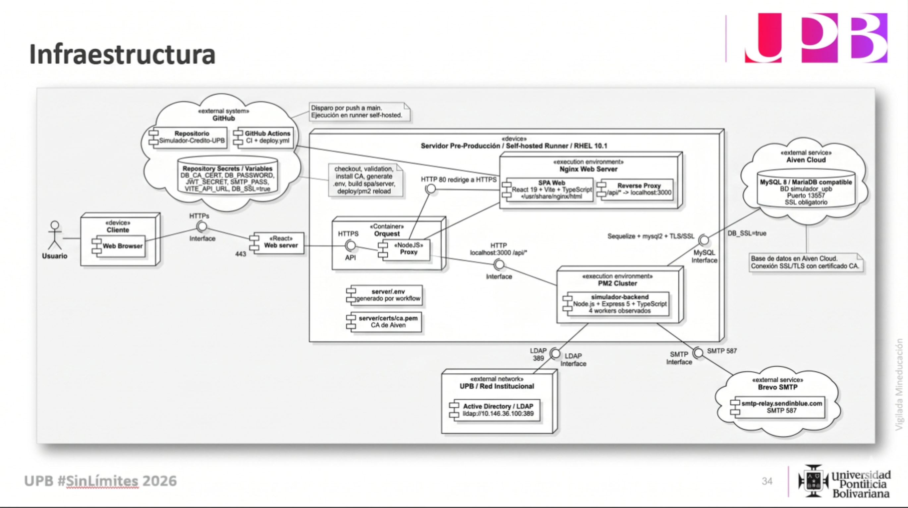

<div align="center">

# 🟡 Entorno de Pre-Producción — HU-59

**Simulador de Crédito UPB**

Documentación técnica del ambiente Staging actualmente operativo, desplegado de
forma automatizada con GitHub Actions sobre Red Hat Enterprise Linux.

</div>

---

## Índice

1. [Resumen Ejecutivo](#1-resumen-ejecutivo)
2. [Arquitectura Actual](#2-arquitectura-actual)
3. [Flujo CI/CD](#3-flujo-cicd)
4. [Generación de Entorno](#4-generación-de-entorno)
5. [Stack y Versiones Observadas](#5-stack-y-versiones-observadas)
6. [Backend PM2 Cluster](#6-backend-pm2-cluster)
7. [Frontend y Nginx](#7-frontend-y-nginx)
8. [Base de Datos Aiven Cloud](#8-base-de-datos-aiven-cloud)
9. [Servicios Externos](#9-servicios-externos)
10. [Variables y Secretos GitHub Actions](#10-variables-y-secretos-github-actions)
11. [Evidencia Operativa](#11-evidencia-operativa)
12. [Observaciones](#12-observaciones)

---

## 1. Resumen Ejecutivo

| Atributo | Estado actual |
|---|---|
| Ambiente | 🟡 Pre-Producción / Staging |
| Despliegue | Automatizado vía GitHub Actions |
| Trigger | `push` a la rama `main` |
| Runner | Self-hosted runner en Red Hat Enterprise Linux |
| Frontend | React/Vite compilado y servido por Nginx |
| Backend | Node.js/Express administrado por PM2 en modo cluster |
| Base de datos | Aiven Cloud MySQL (MariaDB-compatible), SSL obligatorio |
| SMTP | Brevo / Sendinblue por puerto `587` |
| Dominio | `https://simuladorupbbga.app` |

---

## 2. Arquitectura Actual

<div align="center">
  
  <br />
  <em>Preproduccion: GitHub Actions, runner self-hosted, Nginx, PM2, Aiven, LDAP y SMTP.</em>
</div>

### Componentes

| Componente | Implementación | Detalle |
|---|---|---|
| CI/CD | `.github/workflows/deploy.yml` | Pipeline automatizado por push a `main` |
| Runner | Self-hosted | Ejecuta el despliegue en servidor RHEL |
| Frontend | React + Vite | Build en `client/dist` y publicación con Nginx |
| Backend | Node.js + Express | API en puerto `3000` |
| Proceso | PM2 cluster | 4 workers observados online |
| Base de datos | Aiven Cloud MySQL (MariaDB-compatible) | Puerto `13557`, SSL forzado |
| Correo | Brevo SMTP | `smtp-relay.sendinblue.com:587` |

---

## 3. Flujo CI/CD

El flujo de despliegue está completamente automatizado por GitHub Actions.

| Etapa | Acción del workflow |
|---|---|
| 1. Trigger | Se ejecuta al hacer `push` sobre `main` |
| 2. Checkout | Descarga el último código con `actions/checkout@v6` |
| 3. Validación | Verifica variables y secretos obligatorios |
| 4. Certificado | Escribe `server/certs/ca.pem` desde `DB_CA_CERT` |
| 5. `.env` físico | Genera `server/.env` dentro del backend |
| 6. Dependencias | Ejecuta `npm ci` en el monorepo |
| 7. Build | Compila `client` y `server` por workspace |
| 8. Frontend | Copia `client/dist/*` hacia `/usr/share/nginx/html/` |
| 9. Backend | Reinicia PM2 con `pm2 reload ... --update-env` |
| 10. Persistencia | Ejecuta `pm2 save` |
| 11. Smoke test | Valida `http://localhost:3000/api/health` |

Fragmento operativo del reinicio:

```bash
set -a; source .env; set +a;

pm2 reload ecosystem.config.js --env production --update-env \
  || pm2 start ecosystem.config.js --env production --update-env

pm2 save
```

Este patrón permite reinicio sin caída perceptible mediante `pm2 reload` y fuerza
la inyección del entorno actualizado en cada worker.

---

## 4. Generación de Entorno

El workflow no depende de un `.env` versionado. En cada despliegue:

1. Lee **GitHub Repository Variables** para valores no secretos.
2. Lee **GitHub Repository Secrets** para credenciales y certificados.
3. Crea físicamente `server/.env`.
4. Protege valores con espacios usando comillas, especialmente LDAP.

Ejemplo del manejo de LDAP:

```bash
echo "LDAP_DOMAIN=\"${{ vars.LDAP_DOMAIN }}\"" >> .env
echo "LDAP_BASE_DN=\"${{ vars.LDAP_BASE_DN }}\"" >> .env
```

Esto evita fallos al cargar variables como:

```text
LDAP_BASE_DN="OU=OU Empleados,DC=bga,DC=upb"
```

---

## 5. Stack y Versiones Observadas

Evidencia tomada del servidor de Pre-Producción.

| Componente | Versión observada |
|---|---|
| Sistema operativo | Red Hat Enterprise Linux 10.1 (Coughlan) |
| Node.js | `v24.14.0` |
| npm | `11.9.0` |
| PM2 | `6.0.14` |
| Nginx | `1.26.3` |

Comandos de referencia:

```bash
cat /etc/os-release | grep -E "PRETTY_NAME|VERSION="
node -v
npm -v
pm2 -v
nginx -v
```

---

## 6. Backend PM2 Cluster

El backend opera en PM2 con `NODE_ENV=production` y modo cluster. La evidencia de
`pm2 status` muestra 4 instancias online del proceso `simulador-backend`.

| ID PM2 | Proceso | Modo | Estado | Memoria observada |
|---:|---|---|---|---:|
| 18 | `simulador-backend` | cluster | online | 108.2 MB |
| 19 | `simulador-backend` | cluster | online | 116.6 MB |
| 20 | `simulador-backend` | cluster | online | 109.6 MB |
| 21 | `simulador-backend` | cluster | online | 115.3 MB |

El archivo [`server/ecosystem.config.js`](../../server/ecosystem.config.js)
define `exec_mode: "cluster"` e `instances: "max"`. En el servidor actual esto
se materializa como 4 workers.

---

## 7. Frontend y Nginx

El frontend React/Vite se compila durante el workflow y se publica como archivos
estáticos:

```text
/usr/share/nginx/html/*
```

El servicio Nginx está activo y escuchando en HTTP/HTTPS:

| Puerto | Servicio | Estado observado |
|---:|---|---|
| `80` | Nginx HTTP | Listening en IPv4/IPv6 |
| `443` | Nginx HTTPS | Listening en IPv4/IPv6 |
| `3000` | Backend Node.js | Listening por PM2 |

Evidencia:

```bash
systemctl status nginx --no-pager
# Active: active (running) since Sun 2026-04-26 22:26:34 -05
```

---

## 8. Base de Datos Aiven Cloud

| Variable | Valor operativo |
|---|---|
| `DB_HOST` | `simuladordecredito20261-simuladordecredito20261.e.aivencloud.com` |
| `DB_PORT` | `13557` |
| `DB_NAME` | `simulador_upb` |
| `DB_USER` | `avnadmin` |
| `DB_SSL` | `true` |
| Certificado CA | Inyectado desde `DB_CA_CERT` hacia `server/certs/ca.pem` |

La conexión SSL es obligatoria. El workflow valida que `DB_SSL=true` antes de
construir y desplegar.

---

## 9. Servicios Externos

| Servicio | Configuración | Uso |
|---|---|---|
| Brevo / Sendinblue | `smtp-relay.sendinblue.com:587` | Correos transaccionales |
| LDAP UPB | `ldap://<LDAP_HOST_CTIC>:389` | Autenticación institucional |
| Aiven Cloud | MySQL SSL `:13557` | Persistencia relacional |

Los logs del backend registran uso de SMTP configurado:

```text
EmailService: usando SMTP configurado {"host":"smtp-relay.sendinblue.com"}
```

---

## 10. Variables y Secretos GitHub Actions

### Repository Secrets

| Secret | Uso |
|---|---|
| `DB_CA_CERT` | Certificado CA para conexión SSL a Aiven |
| `DB_PASSWORD` | Password de base de datos |
| `JWT_SECRET` | Firma de tokens JWT |
| `LDAP_BIND_PASSWORD` | Password de cuenta LDAP si aplica |
| `SMTP_PASS` | Password/token SMTP |

### Repository Variables

| Variable | Valor |
|---|---|
| `PORT` | `3000` |
| `FRONTEND_URL` | `https://simuladorupbbga.app` |
| `VITE_API_URL` | `https://simuladorupbbga.app/api` |
| `DB_HOST` | `simuladordecredito20261-simuladordecredito20261.e.aivencloud.com` |
| `DB_PORT` | `13557` |
| `DB_NAME` | `simulador_upb` |
| `DB_USER` | `avnadmin` |
| `DB_SSL` | `true` |
| `LDAP_URL` | `ldap://<LDAP_HOST_CTIC>:389` |
| `LDAP_DOMAIN` | `bga.upb` |
| `LDAP_BASE_DN` | `OU=OU Empleados,DC=bga,DC=upb` |
| `LDAP_TIMEOUT_MS` | `5000` |
| `JWT_EXPIRES_IN` | `8h` |
| `SMTP_HOST` | `smtp-relay.sendinblue.com` |
| `SMTP_PORT` | `587` |
| `SMTP_USER` | `<SMTP_USER_STAGING>` |
| `SMTP_FROM_EMAIL` | `<SMTP_FROM_EMAIL_STAGING>` |
| `RETENTION_DAYS` | `90` |
| `PURGE_INTERVAL_HOURS` | `24` |
| `PURGE_BATCH_SIZE` | `500` |
| `TOKEN_PURGE_RETENTION_DAYS` | `30` |
| `TOKEN_PURGE_INTERVAL_HOURS` | `24` |
| `TOKEN_PURGE_BATCH_SIZE` | `1000` |

---

## 11. Evidencia Operativa

### 11.1. Arranque y salud del backend

Los logs del 26 de abril de 2026 registran:

| Evidencia | Resultado |
|---|---|
| Migraciones | `Migraciones ejecutadas correctamente` |
| Documentos soportados | `CC, CE, DE, PA, PE, PT, RC, TI, VI` |
| Scheduler de simulaciones | Retención `90` días, ciclo `24h`, batch `500` |
| Scheduler de tokens | Retención `30` días, ciclo `24h`, batch `1000` |
| API | `Servidor corriendo en http://localhost:3000` |
| Health check | `http://localhost:3000/api/health` |
| Swagger | `http://localhost:3000/api/docs` |

### 11.2. Conectividad a MySQL

Los logs muestran conexiones exitosas recurrentes:

```text
Conexión a MySQL establecida correctamente
```

También existen eventos históricos de timeout/host no encontrado durante pruebas
de conectividad, por lo que la disponibilidad de red hacia Aiven debe seguirse
monitoreando.

### 11.3. Actividad funcional

La evidencia del backend incluye autenticación exitosa, cierre de sesión,
inserciones de auditoría, creación de simulaciones, exportaciones y purga de
tokens expirados.

---

## 12. Observaciones

| Observación | Impacto | Recomendación |
|---|---|---|
| LDAP registró `ConnectionError: connection timeout` | Autenticación institucional puede fallar si AD no responde | Validar alcance de red hacia `<LDAP_HOST_CTIC>:389` |
| Se observaron slow queries entre ~150 ms y ~787 ms | Útil para monitoreo, no necesariamente incidente | Revisar índices si el volumen crece |
| Hubo timeouts históricos hacia Aiven | Riesgo intermitente de conectividad externa | Monitorear red/DNS y disponibilidad de Aiven |
| Se observó un error histórico `Unknown column 'saved_at'` en historial | Indica desalineación temporal entre código y esquema durante pruebas | Verificar después de cada deploy que migraciones y smoke test queden en verde |
| Backend escucha en puerto `3000` | Debe consumirse por Nginx | Restringir exposición directa con firewall si aplica |

---

## Referencias

| Archivo | Descripción |
|---|---|
| [`.github/workflows/deploy.yml`](../../.github/workflows/deploy.yml) | Pipeline automatizado de Pre-Producción |
| [`server/ecosystem.config.js`](../../server/ecosystem.config.js) | Configuración PM2 cluster |
| [`docs/deployment/CTIC-PROD-DEPLOYMENT.md`](./CTIC-PROD-DEPLOYMENT.md) | Guía de Producción CTIC |
