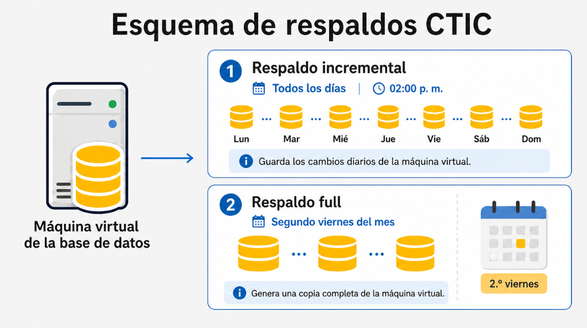
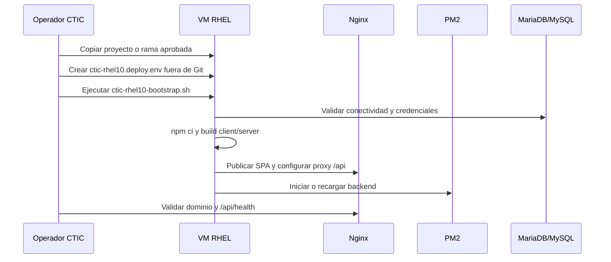

# Despliegue CTIC

Esta carpeta contiene la documentacion operativa para instalar, validar, auditar y volver a desplegar el Simulador de Credito UPB en la VM administrada por CTIC.

## Documentos principales

| Documento | Proposito |
|---|---|
| [`Manual de Despliegue Simulador - CTIC.pdf`](./Manual%20de%20Despliegue%20Simulador%20-%20CTIC.pdf) | Manual formal de despliegue y nuevo despliegue. |
| [`CTIC-RHEL-RUNBOOK.md`](./CTIC-RHEL-RUNBOOK.md) | Runbook accionable para ejecucion en RHEL. |
| [`CTIC-PROD-DEPLOYMENT.md`](./CTIC-PROD-DEPLOYMENT.md) | Arquitectura productiva, variables, puertos y operacion. |
| [`PRE-PROD-ENVIRONMENT.md`](./PRE-PROD-ENVIRONMENT.md) | Ambiente de preproduccion con runner self-hosted y Aiven. |
| [`HU-91-DEPLOYMENT-CLOSURE.md`](./HU-91-DEPLOYMENT-CLOSURE.md) | Cierre tecnico de despliegue y evidencias. |

## Topologia CTIC

## Preproduccion

## Respaldo de base de datos

## Puertos por defecto

| Servicio | Puerto | Exposicion esperada |
|---|---:|---|
| HTTP | `80` | Publico, normalmente redirige a HTTPS. |
| HTTPS | `443` | Publico si TLS termina en la VM. |
| Backend Express | `3000` | Solo local; Nginx enruta `/api` hacia este puerto. |
| MariaDB/MySQL | `3306` | Privado entre VM y servidor de base de datos. |
| LDAP/AD | `389` | Privado hacia directorio institucional. |
| SMTP | `587` | Salida hacia servicio de correo transaccional. |

## Flujo resumido de despliegue

## Reglas de seguridad

- El archivo real `ctic-rhel10.deploy.env` no debe versionarse.
- Los certificados, llaves privadas y dumps de produccion se administran fuera de Git.
- `APP_DOMAIN` debe usar solo letras, numeros, puntos y guiones.
- Si cambia el dominio final, actualizar variables y Nginx en la VM, no hardcodear dominios institucionales en el repositorio.
