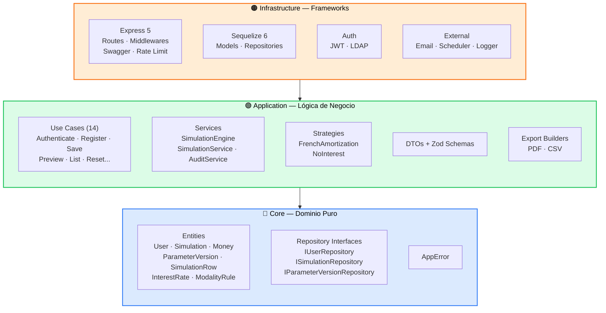
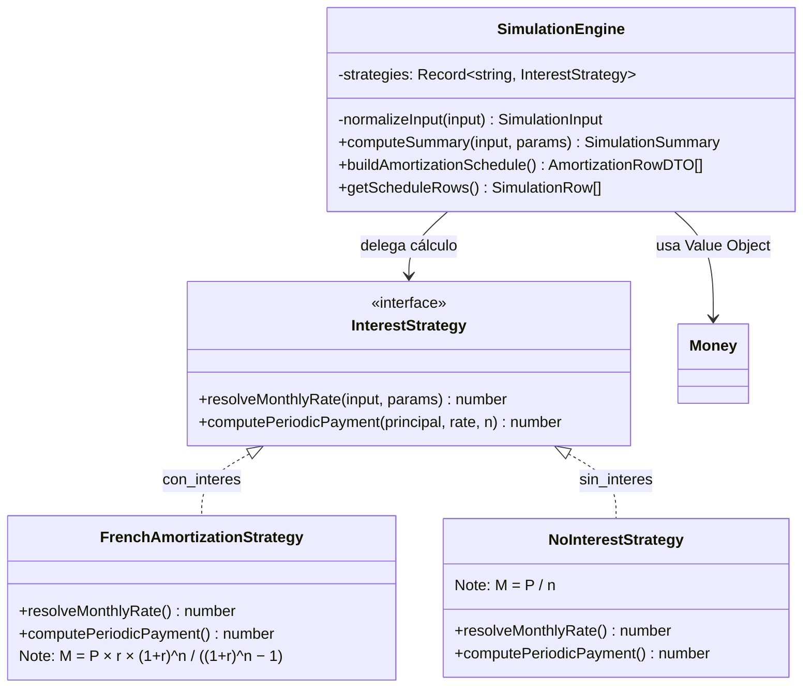
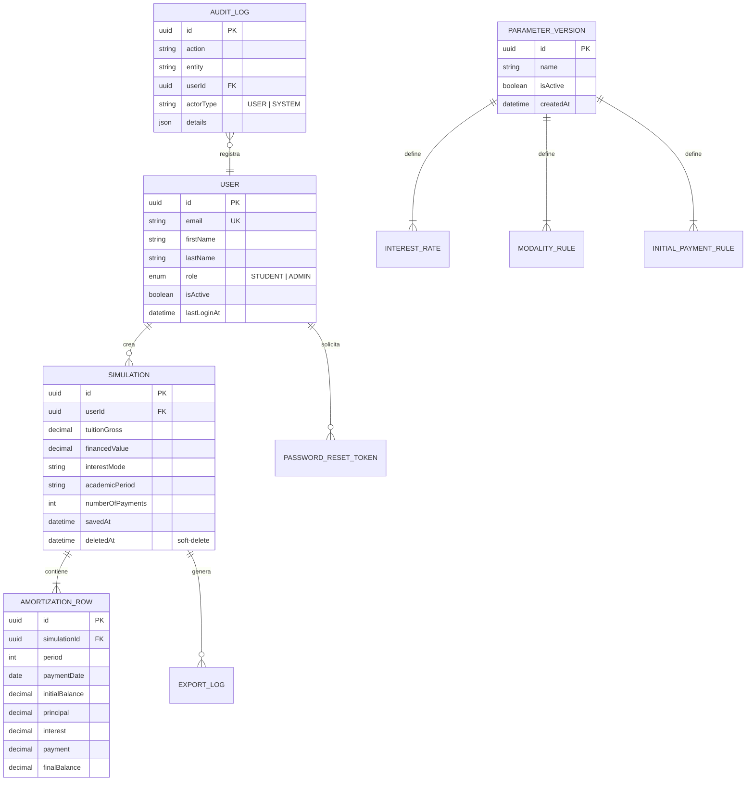

<div align="center">

# 🟢 Server — Simulador de Crédito UPB

Backend API REST construido con **Express 5.2**, **TypeScript 6** y **Clean Architecture**

[](https://nodejs.org/)
[](https://www.typescriptlang.org/)
[](https://www.mysql.com/)
[](https://swagger.io/)

</div>

---

## 📁 Estructura — Clean Architecture

```
server/src/
├── Core/                           # 🔵 DOMINIO — Cero dependencias externas
│   ├── entities/                   # Entidades de negocio (inmutables)
│   │   ├── User.ts                 # Usuario (STUDENT | ADMIN) + Factory Method
│   │   ├── Simulation.ts           # Simulación de crédito
│   │   ├── SimulationRow.ts        # Fila de tabla de amortización
│   │   ├── Money.ts                # Value Object — manejo preciso de moneda
│   │   ├── ParameterVersion.ts     # Versión de parámetros financieros
│   │   ├── InterestRate.ts         # Tasa de interés
│   │   ├── ModalityRule.ts         # Regla por modalidad de crédito
│   │   └── InitialPaymentRule.ts   # Regla de cuota inicial
│   ├── repositories/               # Interfaces (contratos)
│   │   ├── IUserRepository.ts
│   │   ├── ISimulationRepository.ts
│   │   └── IParameterVersionRepository.ts
│   └── errors/
│       └── AppError.ts             # Error de dominio tipado (status + code)
│
├── Application/                    # 🟢 CASOS DE USO — Lógica de aplicación
│   ├── use-cases/                  # Orquestadores de flujo
│   │   ├── AuthenticateUserUseCase.ts
│   │   ├── RegisterUserUseCase.ts
│   │   ├── SaveSimulationUseCase.ts
│   │   ├── PreviewSimulationUseCase.ts
│   │   ├── ListMySimulationsUseCase.ts
│   │   ├── RequestPasswordResetUseCase.ts
│   │   ├── ResetPasswordUseCase.ts
│   │   ├── UpdateMyProfileUseCase.ts
│   │   ├── ListUsersByAdminUseCase.ts
│   │   ├── ListUserSimulationsByAdminUseCase.ts
│   │   └── ...
│   ├── services/                   # Servicios de dominio
│   │   ├── SimulationEngine.ts     # Motor financiero (Strategy Pattern)
│   │   ├── SimulationService.ts    # Orquestador de simulación
│   │   ├── AuditService.ts         # Auditoría de acciones
│   │   └── export/
│   │       ├── SimulationPdfBuilder.ts  # Generador PDF (PDFKit)
│   │       └── SimulationCsvBuilder.ts  # Generador CSV
│   ├── strategies/                 # Strategy Pattern
│   │   ├── InterestStrategy.ts     # Interface
│   │   ├── FrenchAmortizationStrategy.ts
│   │   └── NoInterestStrategy.ts
│   ├── dtos/                       # Data Transfer Objects (Zod-validated)
│   │   ├── SimulationInput.ts
│   │   ├── SimulationSummary.ts
│   │   ├── LoginUserInput.ts
│   │   ├── RegisterUserInput.ts
│   │   └── ...
│   └── __tests__/                  # Tests unitarios
│       ├── SimulationEngine.test.ts
│       ├── AuditService.test.ts
│       ├── AuditLog.test.ts
│       └── SimulationPurgeJob.test.ts
│
├── Infrastructure/                 # 🟠 FRAMEWORKS — Implementaciones concretas
│   ├── http/
│   │   ├── app.ts                  # Configuración Express
│   │   ├── swagger.ts              # OpenAPI spec completa
│   │   ├── routes/
│   │   │   ├── authRoutes.ts       # /api/auth (login, register, reset)
│   │   │   ├── simulatorRoutes.ts  # /api/simulator (CRUD simulaciones)
│   │   │   ├── adminRoutes.ts      # /api/admin (gestión, parámetros)
│   │   │   ├── userRoutes.ts       # /api/users (perfil)
│   │   │   ├── simulatorPublicRoutes.ts  # /api/simulator/preview (público)
│   │   │   └── parameterPublicRoutes.ts  # /api/parameters (público)
│   │   └── middlewares/
│   │       ├── authGuard.ts        # Verificación JWT
│   │       ├── roleGuard.ts        # Autorización por rol
│   │       ├── validateRequest.ts  # Validación Zod
│   │       ├── rateLimitGuard.ts   # Rate limiting
│   │       ├── xssMiddleware.ts    # Sanitización XSS
│   │       └── errorHandler.ts     # Manejador global de errores
│   ├── persistence/
│   │   ├── models/                 # Modelos Sequelize (10 tablas)
│   │   │   ├── UserModel.ts
│   │   │   ├── SimulationModel.ts
│   │   │   ├── AmortizationRowModel.ts
│   │   │   ├── ParameterVersionModel.ts
│   │   │   ├── AuditLogModel.ts
│   │   │   ├── ExportLogModel.ts
│   │   │   └── ...
│   │   └── repositories/           # Implementaciones Sequelize
│   │       ├── SequelizeUserRepository.ts
│   │       ├── SequelizeSimulationRepository.ts
│   │       └── SequelizeParameterVersionRepository.ts
│   ├── auth/
│   │   ├── JwtTokenService.ts      # Emisión y verificación JWT
│   │   └── LdapAuthService.ts      # Autenticación LDAP/AD
│   ├── email/
│   │   └── EmailService.ts         # Nodemailer + Brevo (HTML responsive)
│   ├── scheduler/
│   │   └── SimulationPurgeJob.ts   # Purga automática (soft-delete + audit)
│   ├── config/
│   │   ├── env.ts                  # Variables de entorno (Zod-validated)
│   │   └── database.ts             # Singleton Sequelize (SSL Aiven)
│   └── logger/
│       └── index.ts                # Winston structured logging
│
└── index.ts                        # Bootstrap: DB → Scheduler → Express
```

---

## 🏛️ Flujo de Dependencias



---

## 🧮 Motor Financiero — SimulationEngine

El motor implementa el **Strategy Pattern** para separar las modalidades de cálculo:



### Reglas de Negocio Clave

| Regla | Descripción |
|---|---|
| **#57** | UPB Tech: se ignora beca/descuento aunque llegue en el payload |
| **#58** | La cuota inicial NO es cuota del plan → `planN = numberOfPayments - 1` |
| **#59** | Si `numberOfPayments ≤ 3` y se envía `con_interes`, se fuerza a `sin_interes` |
| **#60** | Fechas avanzan por mes calendario (clamp al último día si no existe) |
| **Redondeo** | `interest = round(balance × r)`, `principal = round(M − interest)`, última fila forzada a `finalBalance = 0` |

---

## 🔌 API Endpoints

### Públicos (sin autenticación)

| Método | Ruta | Descripción |
|---|---|---|
| `POST` | `/api/auth/login` | Login (bcrypt + JWT) |
| `POST` | `/api/auth/register` | Registro de estudiante |
| `POST` | `/api/auth/forgot-password` | Solicitar reset de contraseña |
| `POST` | `/api/auth/reset-password` | Restablecer contraseña (token) |
| `POST` | `/api/simulator/preview` | Preview de simulación (invitados) |
| `GET` | `/api/parameters/active` | Parámetros financieros activos |
| `GET` | `/api/health` | Health check |
| `GET` | `/api/docs` | Swagger UI |

### Protegidos — STUDENT

| Método | Ruta | Descripción |
|---|---|---|
| `POST` | `/api/simulator` | Guardar simulación |
| `GET` | `/api/simulator` | Listar mis simulaciones |
| `GET` | `/api/simulator/:id` | Detalle de simulación |
| `GET` | `/api/simulator/:id/export/pdf` | Exportar PDF |
| `GET` | `/api/simulator/:id/export/csv` | Exportar CSV |
| `GET` | `/api/users/me` | Mi perfil |
| `PATCH` | `/api/users/me` | Actualizar mi perfil |

### Protegidos — ADMIN

| Método | Ruta | Descripción |
|---|---|---|
| `GET` | `/api/admin/users` | Listar usuarios |
| `GET` | `/api/admin/users/:id` | Detalle de usuario |
| `PATCH` | `/api/admin/users/:id` | Editar usuario |
| `GET` | `/api/admin/simulations` | Listar simulaciones (todos) |
| `GET` | `/api/admin/simulations/:id` | Detalle de simulación |
| `DELETE` | `/api/admin/simulations/:id` | Soft-delete simulación |
| `GET/POST/PATCH` | `/api/admin/parameters/*` | CRUD de parámetros financieros |
| `GET` | `/api/admin/audit` | Log de auditoría |

---

## 🛡️ Middlewares

```mermaid
graph LR
    REQ["Request"] --> HELMET["Helmet<br/>(Security Headers)"]
    HELMET --> CORS["CORS"]
    CORS --> JSON["express.json()"]
    JSON --> XSS["XSS Sanitizer"]
    XSS --> CACHE["Cache-Control<br/>(no-store)"]
    CACHE --> RATE["Rate Limiter<br/>(auth + simulator)"]
    RATE --> AUTH["authGuard<br/>(JWT verify)"]
    AUTH --> ROLE["roleGuard<br/>(ADMIN check)"]
    ROLE --> VALIDATE["validateRequest<br/>(Zod schema)"]
    VALIDATE --> HANDLER["Route Handler"]
    HANDLER --> ERR["errorHandler<br/>(global catch)"]

    style REQ fill:#f0f9ff,stroke:#3b82f6,color:#000
    style HANDLER fill:#dcfce7,stroke:#22c55e,color:#000
    style ERR fill:#fee2e2,stroke:#ef4444,color:#000
```



---

## 🗄️ Modelo de Datos



---

## 🚀 Desarrollo

```bash
# Desde la raíz del monorepo
npm run dev:server

# O directamente
cd server && npm run dev
```

| Comando | Descripción |
|---|---|
| `npm run dev` | ts-node-dev con hot reload → `:3000` |
| `npm run build` | Compilar TypeScript a `dist/` |
| `npm run start` | Ejecutar build compilado |
| `npm run test` | Jest (forceExit + detectOpenHandles) |
| `npm run test:coverage` | Jest con reporte de cobertura |
| `npm run lint` | ESLint sobre `src/` |

### Variables de Entorno

Copia `.env.example` en la raíz del monorepo y configura:

| Variable | Descripción |
|---|---|
| `PORT` | Puerto del servidor (default: 3000) |
| `NODE_ENV` | `development` / `production` |
| `DB_HOST`, `DB_PORT`, `DB_NAME`, `DB_USER`, `DB_PASSWORD` | Credenciales MySQL (Aiven) |
| `DB_SSL` | Habilitar SSL para la conexión |
| `LDAP_URL`, `LDAP_BIND_DN`, `LDAP_BIND_PASSWORD` | Config LDAP/AD |
| `JWT_SECRET`, `JWT_EXPIRES_IN` | Secreto y expiración JWT |
| `SMTP_HOST`, `SMTP_PORT`, `SMTP_USER`, `SMTP_PASS`, `SMTP_FROM_EMAIL` | Config Brevo SMTP |
| `FRONTEND_URL` | URL del frontend (para links en emails) |

---

<div align="center">
  <sub>🔙 <a href="../README.md">Volver al README principal</a></sub>
</div>
